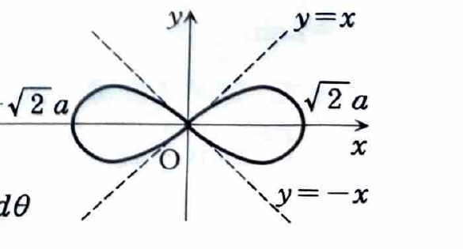

**類題 4-2（資料末尾に収録された解答断片）**

> 資料にはこの類題の問題文が収録されておらず、解答だけが掲載されている。以下の問題文は、解答中の極座標面積公式、被積分関数および図から復元したものである。

極方程式

$$
r^2=2a^2\cos2\theta
\qquad(a>0)
$$

で表される曲線によって囲まれる部分の面積を求めよ。

---

## 解答

> **解法の選択**
>
> 極方程式 $r=r(\theta)$ で表された曲線と2本の半直線で囲まれる面積は、
>
> $$
> \frac12\int_\alpha^\beta r^2\,d\theta
> $$
>
> で求められる。本曲線は原点に関して左右対称で、さらに $x$ 軸についても対称である。第1象限側の4分の1の面積を求めて4倍する。
>
> 直交座標へ変換して二重積分する方法もあるが、極方程式が与えられているため極座標の面積公式が最短である。

曲線が存在するためには、

$$
r^2=2a^2\cos2\theta\ge0
$$

でなければならない。第1象限では、

$$
0\le\theta\le\frac\pi4
$$

で $\cos2\theta\ge0$ となる。

曲線の対称性より、全体の面積 $S$ は第1象限部分の4倍である。したがって、

$$
S
=
4\int_0^{\pi/4}\frac12r^2\,d\theta
$$

となる。ここに、代入前の極方程式

$$
r^2=2a^2\cos2\theta
$$

を代入すると、

$$
\begin{aligned}
S
&=
2\int_0^{\pi/4}r^2\,d\theta\\
&=
2\int_0^{\pi/4}2a^2\cos2\theta\,d\theta\\
&=
4a^2
\left[
\frac12\sin2\theta
\right]_0^{\pi/4}\\
&=
2a^2
\left[
\sin2\theta
\right]_0^{\pi/4}\\
&=
2a^2(\sin\frac\pi2-\sin0)\\
&=
2a^2.
\end{aligned}
$$

したがって、

$$
\boxed{S=2a^2}
$$
