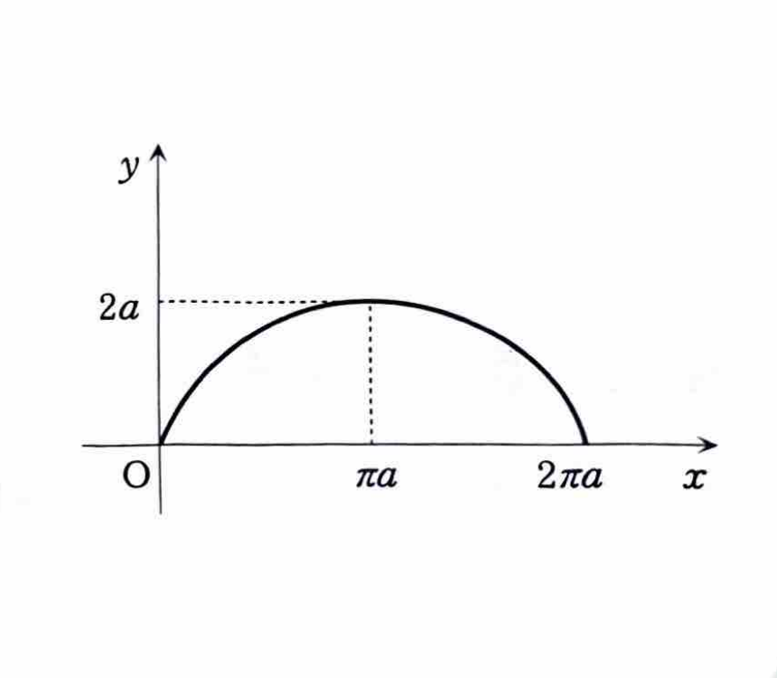

例題 4-1（面積①）

曲線 $y=f(x)$, $y=g(x)$ および直線 $x=a$, $x=b$ で囲まれる図形の面積は、

$$
S=\int_a^b |f(x)-g(x)|\,dx
$$

で求められる。特に、区間全体で $f(x)\ge g(x)$ なら、

$$
S=\int_a^b \{f(x)-g(x)\}\,dx
$$

である。

---

曲線 $C$ が

$$
\begin{cases}
x=a(t-\sin t),\\
y=a(1-\cos t)
\end{cases}
\qquad (0\le t\le 2\pi,\ a>0)
$$

で与えられているとき、曲線 $C$ と $x$ 軸で囲まれる領域の面積 $S$ を求めよ。

---

## 解答

> 曲線が $x$ の陽関数 $y=f(x)$ ではなく、媒介変数 $t$ で表されているため、面積公式
>
> $$
> S=\int y\,dx
> $$
>
> を媒介変数に置き換えて計算する。すなわち $dx=(dx/dt)dt$ を用いる。
>
> 別の方法として、媒介変数を消去して $y$ を $x$ の式に直す方法も考えられるが、サイクロイドでは式が複雑になるため、置換積分を用いる方法が最も直接的である。
>
> まず、積分区間と曲線の向きを確認する。 $0\le t\le2\pi$ では
>
> $$
> \frac{dx}{dt}=a(1-\cos t)\ge0
> $$
>
> であるから、 $x$ は $0$ から $2\pi a$ まで単調に増加する。また、
>
> $$
> y=a(1-\cos t)\ge0
> $$
>
> であるため、曲線は $x$ 軸の上側にある。

微分する前の式は

$$
x=a(t-\sin t),\qquad y=a(1-\cos t)
$$

である。これを $t$ で微分すると、

$$
\frac{dx}{dt}=a(1-\cos t),\qquad
\frac{dy}{dt}=a\sin t
$$

となる。

曲線の概形は次のとおりである。

面積公式は

$$
S=\int_0^{2\pi a}y\,dx
$$

である。ここで、媒介変数による置換公式

$$
\int y\,dx
=
\int y\frac{dx}{dt}\,dt
$$

を用いる。 $y=a(1-\cos t)$, $dx/dt=a(1-\cos t)$ を代入すると、

$$
S=\int_0^{2\pi}
a(1-\cos t)\cdot a(1-\cos t)\,dt
$$

したがって、

$$
S=a^2\int_0^{2\pi}(1-\cos t)^2\,dt
$$

となる。平方を展開すると、

$$
(1-\cos t)^2=1-2\cos t+\cos^2t
$$

であるから、

$$
S=a^2\int_0^{2\pi}
(1-2\cos t+\cos^2t)\,dt
$$

となる。

> $\cos^2t$ をそのまま積分するのではなく、半角公式
>
> $$
> \cos^2t=\frac{1+\cos2t}{2}
> $$
>
> を用いる。

半角公式を代入すると、

$$
S=a^2\int_0^{2\pi}
\left(
1-2\cos t+\frac{1+\cos2t}{2}
\right)dt
$$

よって、

$$
S=a^2\int_0^{2\pi}
\left(
\frac32-2\cos t+\frac12\cos2t
\right)dt
$$

である。各項を積分すると、

$$
\int
\left(
\frac32-2\cos t+\frac12\cos2t
\right)dt
=
\frac32t-2\sin t+\frac14\sin2t
$$

なので、

$$
S
=
a^2
\left[
\frac32t-2\sin t+\frac14\sin2t
\right]_0^{2\pi}
$$

となる。上端 $t=2\pi$ と下端 $t=0$ を代入すると、

$$
S
=
a^2
\left\{
\left(
3\pi-2\sin2\pi+\frac14\sin4\pi
\right)
-
\left(
0-2\sin0+\frac14\sin0
\right)
\right\}
$$

ここで、

$$
\sin0=\sin2\pi=\sin4\pi=0
$$

であるから、

$$
S=3\pi a^2
$$

したがって、

$$
\boxed{S=3\pi a^2}
$$
