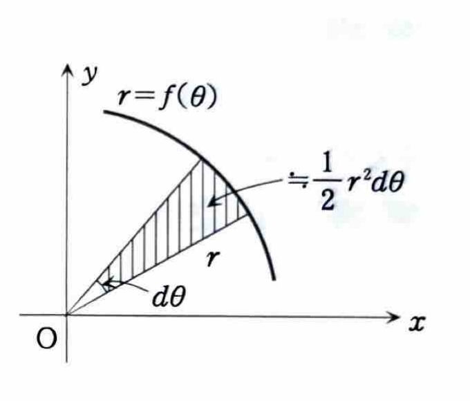
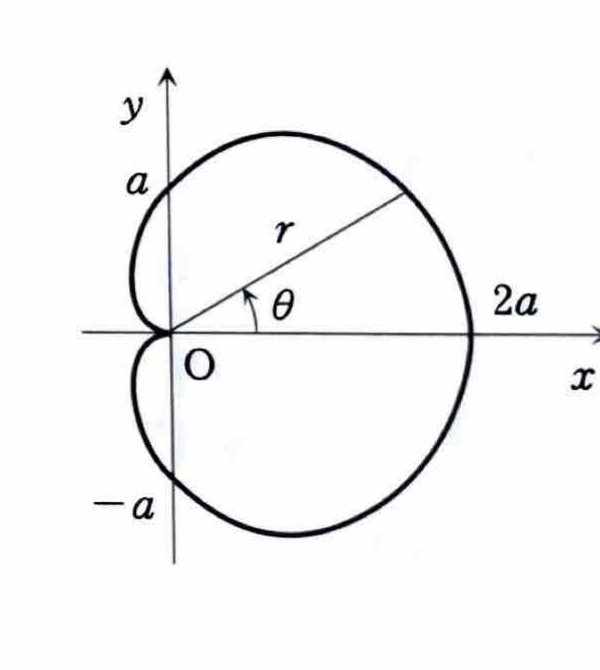

例題 4-2（面積②）

極座標 $(r,\theta)$ と直交座標 $(x,y)$ の関係は、

$$
x=r\cos\theta,\qquad y=r\sin\theta,\qquad x^2+y^2=r^2
$$

である。

極方程式 $r=f(\theta)$ と2本の半直線 $\theta=\theta_1$, $\theta=\theta_2$ で囲まれる図形の面積は、

$$
S=\int_{\theta_1}^{\theta_2}\frac12 r^2\,d\theta
=\frac12\int_{\theta_1}^{\theta_2}\{f(\theta)\}^2\,d\theta
$$

で求められる。微小角 $d\theta$ に対応する微小扇形の面積が

$$
dS=\frac12r^2\,d\theta
$$

となるためである。

---

曲線 $C$ が極方程式

$$
r=a(1+\cos\theta)\qquad (a>0)
$$

で与えられているとき、曲線 $C$ で囲まれる領域の面積 $S$ を求めよ。

---

## 解答

> 極方程式で表された曲線が囲む面積なので、極座標の面積公式
>
> $$
> S=\frac12\int r^2\,d\theta
> $$
>
> を用いる。
>
> $0\le\theta\le2\pi$ をそのまま積分してもよいが、この曲線は $x$ 軸に関して対称である。そこで上半分 $0\le\theta\le\pi$ の面積を求めて2倍すると、曲線の対応が分かりやすい。
>
> 別解として、全周を
>
> $$
> S=\frac12\int_0^{2\pi}a^2(1+\cos\theta)^2\,d\theta
> $$
>
> と計算しても同じ結果になる。

極座標の微小面積は、

$$
dS=\frac12r^2\,d\theta
$$

である。

曲線 $r=a(1+\cos\theta)$ はカージオイドであり、その概形は次のとおりである。

上半分の面積を2倍するので、面積の文字式は

$$
S
=
2\int_0^\pi\frac12r^2\,d\theta
$$

である。ここに

$$
r=a(1+\cos\theta)
$$

を代入すると、

$$
S
=
2\int_0^\pi
\frac12\{a(1+\cos\theta)\}^2\,d\theta
$$

したがって、

$$
S
=
a^2\int_0^\pi(1+\cos\theta)^2\,d\theta
$$

となる。平方を展開すると、

$$
(1+\cos\theta)^2
=
1+2\cos\theta+\cos^2\theta
$$

であるから、

$$
S
=
a^2\int_0^\pi
(1+2\cos\theta+\cos^2\theta)\,d\theta
$$

となる。

> $\cos^2\theta$ には半角公式
>
> $$
> \cos^2\theta=\frac{1+\cos2\theta}{2}
> $$
>
> を用いる。この公式は $\cos2\theta=2\cos^2\theta-1$ を変形したものである。

半角公式を代入すると、

$$
S
=
a^2\int_0^\pi
\left(
1+2\cos\theta+\frac{1+\cos2\theta}{2}
\right)d\theta
$$

よって、

$$
S
=
a^2\int_0^\pi
\left(
\frac32+2\cos\theta+\frac12\cos2\theta
\right)d\theta
$$

である。各項を積分すると、

$$
\int
\left(
\frac32+2\cos\theta+\frac12\cos2\theta
\right)d\theta
=
\frac32\theta+2\sin\theta+\frac14\sin2\theta
$$

なので、

$$
S
=
a^2
\left[
\frac32\theta+2\sin\theta+\frac14\sin2\theta
\right]_0^\pi
$$

となる。上端と下端を代入すると、

$$
S
=
a^2
\left\{
\left(
\frac32\pi+2\sin\pi+\frac14\sin2\pi
\right)
-
\left(
0+2\sin0+\frac14\sin0
\right)
\right\}
$$

ここで、

$$
\sin0=\sin\pi=\sin2\pi=0
$$

であるから、

$$
S=\frac32\pi a^2
$$

したがって、

$$
\boxed{S=\frac32\pi a^2}
$$
