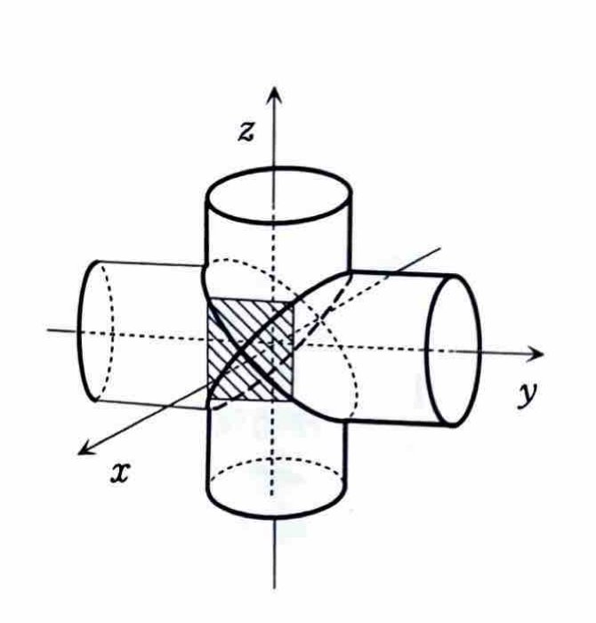
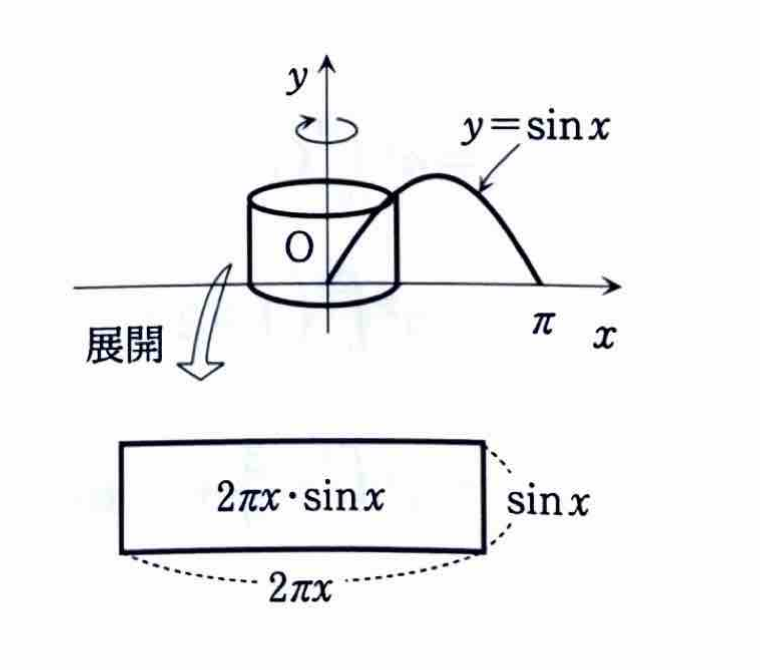

例題 4-3（体積）

立体を $x$ 軸に垂直な平面で切ったときの切り口の面積を $S(x)$ とすると、体積は

$$
V=\int_a^b S(x)\,dx
$$

で求められる。

---

## (1)

2つの円柱

$$
x^2+y^2=1,\qquad x^2+z^2=1
$$

で囲まれる部分の体積を求めよ。

---

## (1) 解答

> 立体を平面 $x=t$ で切ると、2つの円柱の条件から $y$ と $z$ の範囲が同じになり、切り口は正方形になる。したがって、切り口の面積を積分する方法が最も簡単である。
>
> 別解として三重積分を直接設定することもできるが、積分範囲の記述が複雑になる。切り口が単純な正方形になることを利用する方が見通しがよい。

平面 $x=t$ で立体を切る。

第1の円柱の式は

$$
x^2+y^2=1
$$

である。ここに $x=t$ を代入すると、

$$
t^2+y^2=1
$$

したがって、

$$
y^2=1-t^2
$$

より、

$$
-\sqrt{1-t^2}\le y\le\sqrt{1-t^2}
$$

である。

同様に、第2の円柱の式は

$$
x^2+z^2=1
$$

である。ここに $x=t$ を代入すると、

$$
t^2+z^2=1
$$

したがって、

$$
-\sqrt{1-t^2}\le z\le\sqrt{1-t^2}
$$

である。

この切り口では、 $y$ 方向の長さも $z$ 方向の長さも

$$
\sqrt{1-t^2}-\left(-\sqrt{1-t^2}\right)
=
2\sqrt{1-t^2}
$$

である。よって、切り口は一辺

$$
2\sqrt{1-t^2}
$$

の正方形である。

切り口の面積を $S(t)$ とすると、正方形の面積の公式

$$
S(t)=(\text{一辺})^2
$$

に一辺 $2\sqrt{1-t^2}$ を代入して、

$$
S(t)
=
\left(2\sqrt{1-t^2}\right)^2
$$

したがって、

$$
S(t)=4(1-t^2)
$$

となる。

立体が存在する範囲は

$$
-1\le t\le1
$$

であるから、体積の公式

$$
V=\int_{-1}^{1}S(t)\,dt
$$

に $S(t)=4(1-t^2)$ を代入すると、

$$
V
=
\int_{-1}^{1}4(1-t^2)\,dt
$$

となる。被積分関数 $1-t^2$ は偶関数なので、

$$
\int_{-1}^{1}4(1-t^2)\,dt
=
8\int_0^1(1-t^2)\,dt
$$

よって、

$$
V
=
8\left[
t-\frac{t^3}{3}
\right]_0^1
$$

である。上端と下端を代入すると、

$$
V
=
8\left\{
\left(1-\frac13\right)
-
\left(0-\frac03\right)
\right\}
$$

したがって、

$$
V
=
8\cdot\frac23
=
\frac{16}{3}
$$

ゆえに、

$$
\boxed{V=\frac{16}{3}}
$$

---

## (2)

$y=\sin x$ $(0\le x\le\pi)$ と $x$ 軸で囲まれた部分を $y$ 軸のまわりに1回転してできる立体の体積を求めよ。

---

## (2) 解答

> 回転軸が $y$ 軸で、領域が $x$ の関数 $y=\sin x$ として与えられているため、円筒殻法を用いる。
>
> $x$ の位置にある幅 $dx$ の縦長の短冊を $y$ 軸のまわりに回転すると、半径 $x$、高さ $\sin x$、厚さ $dx$ の薄い円筒殻になる。その体積は
>
> $$
> dV=(円周)\times(高さ)\times(厚さ)
> $$
>
> である。
>
> ワッシャー法を用いる別解もあるが、 $x=\arcsin y$ と $x=\pi-\arcsin y$ の2本を扱う必要があるため、円筒殻法の方が簡単である。

円筒殻の半径は

$$
x
$$

であり、その円周は

$$
2\pi x
$$

である。円筒殻の高さは

$$
\sin x
$$

であるから、切り口を展開すると、横 $2\pi x$、縦 $\sin x$ の長方形になる。

微小体積の文字式は

$$
dV
=
2\pi(\text{半径})(\text{高さ})\,dx
$$

である。半径 $x$、高さ $\sin x$ を代入すると、

$$
dV
=
2\pi x\sin x\,dx
$$

したがって、求める体積は

$$
V
=
\int_0^\pi2\pi x\sin x\,dx
$$

すなわち、

$$
V
=
2\pi\int_0^\pi x\sin x\,dx
$$

である。

> $\int x\sin x\,dx$ は積の積分なので、部分積分
>
> $$
> \int u\,dv=uv-\int v\,du
> $$
>
> を用いる。
>
> ここで
>
> $$
> u=x,\qquad dv=\sin x\,dx
> $$
>
> とおくと、
>
> $$
> du=dx,\qquad v=-\cos x
> $$
>
> となる。

部分積分の文字式に代入すると、

$$
\int x\sin x\,dx
=
-x\cos x+\int\cos x\,dx
$$

したがって、

$$
\int x\sin x\,dx
=
-x\cos x+\sin x
$$

である。よって、

$$
V
=
2\pi
\left[
-x\cos x+\sin x
\right]_0^\pi
$$

となる。上端と下端を代入すると、

$$
V
=
2\pi
\left\{
\left(
-\pi\cos\pi+\sin\pi
\right)
-
\left(
-0\cos0+\sin0
\right)
\right\}
$$

ここで、

$$
\cos\pi=-1,\qquad \sin\pi=0,\qquad \sin0=0
$$

であるから、

$$
V
=
2\pi\{\pi-0\}
=
2\pi^2
$$

したがって、

$$
\boxed{V=2\pi^2}
$$
