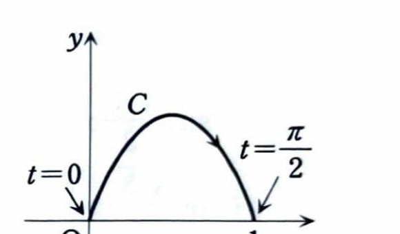

第4章 章末問題 1

媒介変数表示

$$
x=x(t),\qquad y=y(t)
$$

に対し、 $dx/dt\ne0$ なら、

$$
\frac{dy}{dx}
=
\frac{dy/dt}{dx/dt}
$$

である。また、2階導関数は、

$$
\frac{d^2y}{dx^2}
=
\frac{
\dfrac{d}{dt}\left(\dfrac{dy}{dx}\right)
}{
\dfrac{dx}{dt}
}
$$

で求められる。

曲線 $y=f(x)$, $y=g(x)$ および直線 $x=a$, $x=b$ で囲まれる図形の面積は、

$$
S=\int_a^b |f(x)-g(x)|\,dx
$$

で求められる。特に、区間全体で $f(x)\ge g(x)$ なら、

$$
S=\int_a^b \{f(x)-g(x)\}\,dx
$$

である。

---

関数 $y=f(x)$ のグラフ $C$ が

$$
(x,y)=(\sin t,\ t\cos t)
\qquad
\left(0\le t\le\frac{\pi}{2}\right)
$$

と表されるとする。 $t=\pi/4$ のときの $C$ 上の点を $P(x_0,y_0)$ とおく。

---

## (1)

$f'(x_0)$ を計算し、点 $P$ における $C$ の接線の方程式を求めよ。

---

## (1) 解答

> 媒介変数表示なので、傾きは
>
> $$
> \frac{dy}{dx}
> =
> \frac{dy/dt}{dx/dt}
> $$
>
> で求める。まず一般の $t$ における傾きを求め、その後で $t=\pi/4$ を代入する。
>
> $y$ を $x$ の陽関数として表す別解もある。 $t=\sin^{-1}x$ を代入すればよいが、微分が複雑になるため、媒介変数の公式が簡単である。

微分する前の式は

$$
x=\sin t,\qquad y=t\cos t
$$

である。 $x$ を $t$ で微分すると、

$$
\frac{dx}{dt}=\cos t
$$

となる。

$y=t\cos t$ は積なので、積の微分公式

$$
(uv)'=u'v+uv'
$$

を用いる。したがって、

$$
\frac{dy}{dt}
=
1\cdot\cos t+t(-\sin t)
$$

よって、

$$
\frac{dy}{dt}
=
\cos t-t\sin t
$$

である。

傾きの文字式は

$$
\frac{dy}{dx}
=
\frac{dy/dt}{dx/dt}
$$

である。ここに導関数を代入すると、

$$
\frac{dy}{dx}
=
\frac{\cos t-t\sin t}{\cos t}
$$

したがって、

$$
\frac{dy}{dx}
=
1-t\tan t
$$

となる。

ここで $t=\pi/4$ を代入する前の式は

$$
\frac{dy}{dx}=1-t\tan t
$$

である。 $t=\pi/4$ を代入すると、

$$
f'(x_0)
=
1-\frac{\pi}{4}\tan\frac{\pi}{4}
$$

$\tan(\pi/4)=1$ なので、

$$
\boxed{
f'(x_0)=1-\frac{\pi}{4}
}
$$

である。

次に、点 $P$ の座標を求める。座標の文字式は

$$
x_0=\sin t,\qquad y_0=t\cos t
$$

である。 $t=\pi/4$ を代入すると、

$$
x_0
=
\sin\frac{\pi}{4}
=
\frac{1}{\sqrt2}
$$

$$
y_0
=
\frac{\pi}{4}\cos\frac{\pi}{4}
=
\frac{\pi}{4\sqrt2}
$$

したがって、

$$
P\left(
\frac{1}{\sqrt2},
\frac{\pi}{4\sqrt2}
\right)
$$

である。

傾き $m$、通る点 $(x_0,y_0)$ の接線の文字式は、

$$
y-y_0=m(x-x_0)
$$

である。ここに

$$
m=1-\frac{\pi}{4},
\qquad
x_0=\frac1{\sqrt2},
\qquad
y_0=\frac{\pi}{4\sqrt2}
$$

を代入すると、

$$
y-\frac{\pi}{4\sqrt2}
=
\left(
1-\frac{\pi}{4}
\right)
\left(
x-\frac1{\sqrt2}
\right)
$$

となる。これを展開すると、

$$
y
=
\left(
1-\frac{\pi}{4}
\right)x
-
\frac1{\sqrt2}
+
\frac{\pi}{4\sqrt2}
+
\frac{\pi}{4\sqrt2}
$$

したがって、接線の方程式は、

$$
\boxed{
y
=
\left(
1-\frac{\pi}{4}
\right)x
+
\frac{\pi}{2\sqrt2}
-
\frac1{\sqrt2}
}
$$

である。

---

## (2)

$f''(x_0)$ を計算せよ。

---

## (2) 解答

> 1階導関数 $dy/dx$ は $t$ の関数として求められている。これを $x$ で微分するには、まず $t$ で微分し、 $dx/dt$ で割る。
>
> $$
> \frac{d^2y}{dx^2}
> =
> \frac{
> d(dy/dx)/dt
> }{
> dx/dt
> }
> $$
>
> を使う。 $t=\pi/4$ は最後に代入する。

(1) で求めた1階導関数は、

$$
\frac{dy}{dx}=1-t\tan t
$$

である。これを $t$ で微分する前の文字式は

$$
\frac{d}{dt}
\left(
\frac{dy}{dx}
\right)
=
\frac{d}{dt}(1-t\tan t)
$$

である。積の微分公式を使うと、

$$
\frac{d}{dt}(t\tan t)
=
\tan t+t\frac{1}{\cos^2t}
$$

なので、

$$
\frac{d}{dt}
\left(
\frac{dy}{dx}
\right)
=
-\tan t-\frac{t}{\cos^2t}
$$

となる。

2階導関数の文字式は

$$
\frac{d^2y}{dx^2}
=
\frac{
\dfrac{d}{dt}\left(\dfrac{dy}{dx}\right)
}{
\dfrac{dx}{dt}
}
$$

である。ここに

$$
\frac{d}{dt}
\left(
\frac{dy}{dx}
\right)
=
-\tan t-\frac{t}{\cos^2t},
\qquad
\frac{dx}{dt}=\cos t
$$

を代入すると、

$$
\frac{d^2y}{dx^2}
=
\frac{
-\tan t-\dfrac{t}{\cos^2t}
}{
\cos t
}
$$

となる。

ここで $t=\pi/4$ を代入する前の式は

$$
\frac{d^2y}{dx^2}
=
\frac{
-\tan t-\dfrac{t}{\cos^2t}
}{
\cos t
}
$$

である。 $t=\pi/4$ を代入すると、

$$
f''(x_0)
=
\frac{
-\tan\dfrac{\pi}{4}
-
\dfrac{\pi/4}{\cos^2(\pi/4)}
}{
\cos(\pi/4)
}
$$

ここで、

$$
\tan\frac{\pi}{4}=1,\qquad
\cos\frac{\pi}{4}=\frac1{\sqrt2},\qquad
\cos^2\frac{\pi}{4}=\frac12
$$

であるから、

$$
f''(x_0)
=
\frac{
-1-\dfrac{\pi/4}{1/2}
}{
1/\sqrt2
}
$$

$$
=
\frac{
-1-\dfrac{\pi}{2}
}{
1/\sqrt2
}
$$

したがって、

$$
f''(x_0)
=
-\sqrt2\left(
1+\frac{\pi}{2}
\right)
$$

よって、

$$
\boxed{
f''(x_0)
=
-\sqrt2-\frac{\pi}{\sqrt2}
}
$$

である。

---

## (3)

曲線 $C$ と $x$ 軸とが囲む部分の面積を求めよ。

---

## (3) 解答

> 曲線は媒介変数表示されているので、
>
> $$
> S=\int y\,dx
> =
> \int y\frac{dx}{dt}\,dt
> $$
>
> を用いる。
>
> $0\le t\le\pi/2$ では $x=\sin t$ は $0$ から $1$ まで増加し、 $y=t\cos t\ge0$ であるため、積分値がそのまま面積になる。

曲線の概形は次のとおりである。

面積公式の文字式は

$$
S=\int_0^1y\,dx
$$

である。媒介変数に置き換えると、

$$
S
=
\int_0^{\pi/2}
y\frac{dx}{dt}\,dt
$$

となる。ここに

$$
y=t\cos t,\qquad
\frac{dx}{dt}=\cos t
$$

を代入すると、

$$
S
=
\int_0^{\pi/2}
t\cos t\cdot\cos t\,dt
$$

したがって、

$$
S
=
\int_0^{\pi/2}
t\cos^2t\,dt
$$

となる。半角公式

$$
\cos^2t
=
\frac{1+\cos2t}{2}
$$

を代入すると、

$$
S
=
\frac12
\int_0^{\pi/2}
t(1+\cos2t)\,dt
$$

よって、

$$
S
=
\frac12
\left\{
\int_0^{\pi/2}t\,dt
+
\int_0^{\pi/2}t\cos2t\,dt
\right\}
$$

である。

第1の積分は、

$$
\int_0^{\pi/2}t\,dt
=
\left[
\frac{t^2}{2}
\right]_0^{\pi/2}
=
\frac{\pi^2}{8}
$$

である。

第2の積分には部分積分を用いる。部分積分の文字式は、

$$
\int u\,dv=uv-\int v\,du
$$

である。ここで、

$$
u=t,\qquad dv=\cos2t\,dt
$$

とおくと、

$$
du=dt,\qquad v=\frac12\sin2t
$$

である。したがって、

$$
\int_0^{\pi/2}t\cos2t\,dt
=
\left[
\frac12t\sin2t
\right]_0^{\pi/2}
-
\frac12
\int_0^{\pi/2}\sin2t\,dt
$$

となる。境界項は、

$$
\left[
\frac12t\sin2t
\right]_0^{\pi/2}
=
0
$$

である。また、

$$
\int\sin2t\,dt
=
-\frac12\cos2t
$$

なので、

$$
\int_0^{\pi/2}t\cos2t\,dt
=
-\frac12
\left[
-\frac12\cos2t
\right]_0^{\pi/2}
$$

$$
=
\frac14
\left(
\cos\pi-\cos0
\right)
$$

ここで、

$$
\cos\pi=-1,\qquad \cos0=1
$$

であるから、

$$
\int_0^{\pi/2}t\cos2t\,dt
=
\frac14(-1-1)
=
-\frac12
$$

となる。

したがって、

$$
S
=
\frac12
\left(
\frac{\pi^2}{8}-\frac12
\right)
$$

よって、

$$
\boxed{
S=\frac{\pi^2}{16}-\frac14
}
$$
