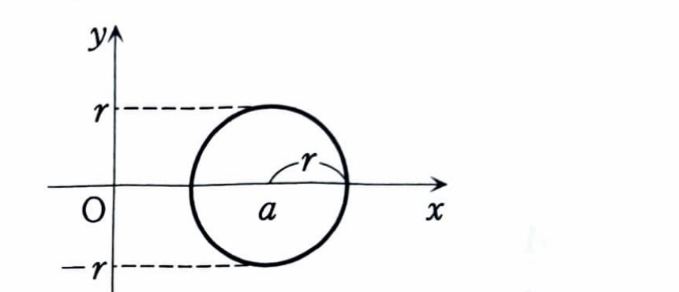

第4章 章末問題 3

立体を $x$ 軸に垂直な平面で切ったときの切り口の面積を $S(x)$ とすると、体積は

$$
V=\int_a^b S(x)\,dx
$$

で求められる。

---

## (1)

$$
(x-a)^2+y^2=r^2
\qquad (a>r>0)
$$

で与えられる図形の概形を描け。

---

## (1) 解答

> 円の標準形
>
> $$
> (x-p)^2+(y-q)^2=R^2
> $$
>
> は、中心 $(p,q)$、半径 $R$ の円を表す。
>
> 与えられた式と比較すれば、中心と半径を直ちに読み取れる。

与えられた式は、

$$
(x-a)^2+y^2=r^2
$$

である。これを

$$
(x-a)^2+(y-0)^2=r^2
$$

と見れば、中心は

$$
(a,0)
$$

であり、半径は

$$
r
$$

である。

また、条件 $a>r>0$ より、

$$
a-r>0
$$

である。したがって、円の左端の $x$ 座標 $a-r$ は正であり、円全体は $y$ 軸の右側にある。

概形は次のとおりである。

---

## (2)

この図形を $y$ 軸のまわりに回転して得られるドーナツ型の回転体（トーラス）の体積 $V$ を求めよ。

---

## (2) 解答

> $y$ を固定して水平に切ると、円の右側と左側の $x$ 座標が得られる。これを $y$ 軸のまわりに回転すると、外半径と内半径をもつワッシャー状の切り口になる。
>
> したがって、
>
> $$
> dV
> =
> \pi\{(\text{外半径})^2-(\text{内半径})^2\}\,dy
> $$
>
> を積分する。
>
> 別解としてパップスの定理を用いれば、「円の面積 $\pi r^2$」と「重心が移動する距離 $2\pi a$」の積から $2\pi^2ar^2$ を得られる。ここでは積分で導く。

円の方程式は、

$$
(x-a)^2+y^2=r^2
$$

である。 $x$ について解く前の文字式は、

$$
(x-a)^2=r^2-y^2
$$

である。平方根を取ると、

$$
x-a=\pm\sqrt{r^2-y^2}
$$

したがって、右端と左端の $x$ 座標は、

$$
x_{\mathrm{out}}
=
a+\sqrt{r^2-y^2}
$$

$$
x_{\mathrm{in}}
=
a-\sqrt{r^2-y^2}
$$

である。

> $a>r$ なので、 $a-\sqrt{r^2-y^2}>0$ である。したがって、左端も $y$ 軸の右側にあり、回転後の切り口には穴ができる。

ワッシャーの外半径を $R(y)$、内半径を $\rho(y)$ とすると、

$$
R(y)
=
a+\sqrt{r^2-y^2}
$$

$$
\rho(y)
=
a-\sqrt{r^2-y^2}
$$

である。

ワッシャーの面積の文字式は、

$$
S(y)
=
\pi\{R(y)^2-\rho(y)^2\}
$$

である。ここに外半径と内半径を代入すると、

$$
S(y)
=
\pi
\left[
\left(
a+\sqrt{r^2-y^2}
\right)^2
-
\left(
a-\sqrt{r^2-y^2}
\right)^2
\right]
$$

となる。

差の平方を整理するため、

$$
(A+B)^2-(A-B)^2=4AB
$$

を用いる。ここで、

$$
A=a,\qquad
B=\sqrt{r^2-y^2}
$$

とすると、

$$
S(y)
=
4\pi a\sqrt{r^2-y^2}
$$

である。

$y$ の範囲は円の下端から上端までなので、

$$
-r\le y\le r
$$

である。したがって、体積公式

$$
V
=
\int_{-r}^{r}S(y)\,dy
$$

に $S(y)=4\pi a\sqrt{r^2-y^2}$ を代入すると、

$$
V
=
4\pi a
\int_{-r}^{r}
\sqrt{r^2-y^2}\,dy
$$

となる。

> 積分
>
> $$
> \int_{-r}^{r}\sqrt{r^2-y^2}\,dy
> $$
>
> は、円
>
> $$
> y^2+z^2=r^2
> $$
>
> の上半分の面積を表す。したがって、半径 $r$ の円の面積 $\pi r^2$ の半分である。

よって、

$$
\int_{-r}^{r}
\sqrt{r^2-y^2}\,dy
=
\frac{\pi r^2}{2}
$$

である。これを代入すると、

$$
V
=
4\pi a\cdot\frac{\pi r^2}{2}
$$

したがって、

$$
V
=
2\pi^2ar^2
$$

ゆえに、

$$
\boxed{
V=2\pi^2ar^2
}
$$
