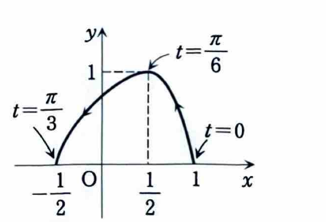

練習 4-1

曲線 $y=f(x)$, $y=g(x)$ および直線 $x=a$, $x=b$ で囲まれる図形の面積は、

$$
S=\int_a^b |f(x)-g(x)|\,dx
$$

で求められる。特に、区間全体で $f(x)\ge g(x)$ なら、

$$
S=\int_a^b \{f(x)-g(x)\}\,dx
$$

である。

---

曲線 $C$ が

$$
\begin{cases}
x=\cos2t,\\
y=\sin3t
\end{cases}
\qquad
\left(0\le t\le\frac{\pi}{3}\right)
$$

で与えられているとき、曲線 $C$ と $x$ 軸で囲まれる領域の面積 $S$ を求めよ。

---

## 解答

> 媒介変数表示された曲線なので、面積
>
> $$
> S=\int y\,dx
> $$
>
> に $dx=(dx/dt)dt$ を代入して計算する。
>
> この問題では $t$ が増えると $x$ が減少する。したがって、積分区間の向きを誤ると面積が負になる。先に端点と増減を調べ、 $x$ の小さい側から大きい側へ積分する。
>
> 別解として、積分の絶対値を取る方法
>
> $$
> S=\left|\int_0^{\pi/3}y\frac{dx}{dt}\,dt\right|
> $$
>
> もあるが、ここでは向きを明示するため、 $t=\pi/3$ から $t=0$ へ積分する。

微分する前の式は

$$
x=\cos2t,\qquad y=\sin3t
$$

である。これらを $t$ で微分すると、

$$
\frac{dx}{dt}=-2\sin2t,\qquad
\frac{dy}{dt}=3\cos3t
$$

となる。

端点での座標を調べる。 $t=0$ を代入すると、

$$
x=\cos0=1,\qquad y=\sin0=0
$$

である。 $t=\pi/3$ を代入すると、

$$
x=\cos\frac{2\pi}{3}=-\frac12,\qquad
y=\sin\pi=0
$$

である。

また、区間 $0<t<\pi/3$ では $0<2t<2\pi/3$ なので、

$$
\sin2t>0
$$

したがって、

$$
\frac{dx}{dt}=-2\sin2t<0
$$

であり、 $x$ は $1$ から $-1/2$ へ減少する。一方、 $0<3t<\pi$ なので、

$$
y=\sin3t>0
$$

であり、曲線は $x$ 軸の上側にある。

曲線の概形は次のとおりである。

求める面積の公式は

$$
S=\int_{-1/2}^{1}y\,dx
$$

である。 $x$ が $-1/2$ から $1$ へ動くとき、 $t$ は $\pi/3$ から $0$ へ動くため、

$$
S=
\int_{\pi/3}^{0}
y\frac{dx}{dt}\,dt
$$

となる。ここに $y=\sin3t$, $dx/dt=-2\sin2t$ を代入すると、

$$
S=
\int_{\pi/3}^{0}
\sin3t\cdot(-2\sin2t)\,dt
$$

積分区間を逆にすると符号が変わるので、

$$
S=
2\int_0^{\pi/3}\sin3t\sin2t\,dt
$$

となる。

> 積 $\sin3t\sin2t$ を積分するため、積和公式
>
> $$
> \sin A\sin B
> =
> \frac12\{\cos(A-B)-\cos(A+B)\}
> $$
>
> を用いる。

積和公式に $A=3t$, $B=2t$ を代入すると、

$$
\sin3t\sin2t
=
\frac12(\cos t-\cos5t)
$$

である。したがって、

$$
S
=
2\int_0^{\pi/3}
\frac12(\cos t-\cos5t)\,dt
$$

よって、

$$
S
=
\int_0^{\pi/3}
(\cos t-\cos5t)\,dt
$$

となる。各項を積分すると、

$$
\int(\cos t-\cos5t)\,dt
=
\sin t-\frac15\sin5t
$$

なので、

$$
S
=
\left[
\sin t-\frac15\sin5t
\right]_0^{\pi/3}
$$

である。上端と下端を代入すると、

$$
S
=
\left(
\sin\frac{\pi}{3}
-\frac15\sin\frac{5\pi}{3}
\right)
-
\left(
\sin0-\frac15\sin0
\right)
$$

ここで、

$$
\sin\frac{\pi}{3}=\frac{\sqrt3}{2},\qquad
\sin\frac{5\pi}{3}=-\frac{\sqrt3}{2},\qquad
\sin0=0
$$

であるから、

$$
S
=
\frac{\sqrt3}{2}
-\frac15\left(-\frac{\sqrt3}{2}\right)
$$

$$
S
=
\frac{\sqrt3}{2}
+\frac{\sqrt3}{10}
=
\frac{5\sqrt3+\sqrt3}{10}
=
\frac{3\sqrt3}{5}
$$

したがって、

$$
\boxed{S=\frac{3\sqrt3}{5}}
$$
