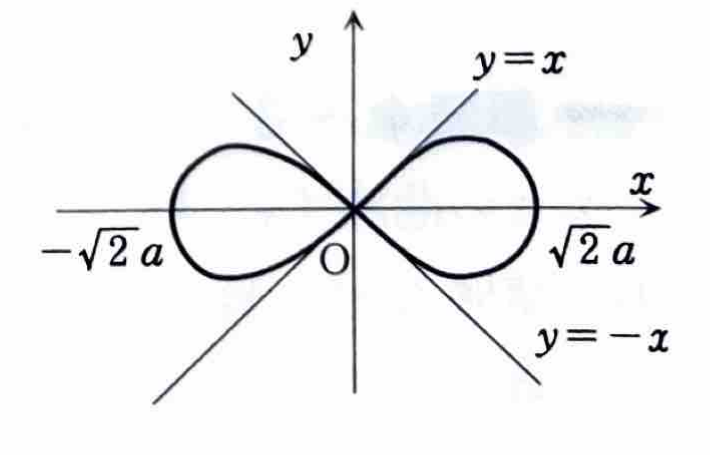

練習 4-2

極座標 $(r,\theta)$ と直交座標 $(x,y)$ の関係は、

$$
x=r\cos\theta,\qquad y=r\sin\theta,\qquad x^2+y^2=r^2
$$

である。

極方程式 $r=f(\theta)$ と2本の半直線 $\theta=\theta_1$, $\theta=\theta_2$ で囲まれる図形の面積は、

$$
S=\int_{\theta_1}^{\theta_2}\frac12 r^2\,d\theta
=\frac12\int_{\theta_1}^{\theta_2}\{f(\theta)\}^2\,d\theta
$$

で求められる。微小角 $d\theta$ に対応する微小扇形の面積が

$$
dS=\frac12r^2\,d\theta
$$

となるためである。

関連する本章要項として、極方程式 $r=f(\theta)$ $(\theta_1\le\theta\le\theta_2)$ の曲線の長さは、

$$
L
=
\int_{\theta_1}^{\theta_2}
\sqrt{
r^2+\left(\frac{dr}{d\theta}\right)^2
}\,d\theta
$$

で求められる。この練習では長さではなく面積を求めるため、実際の計算には面積公式を用いる。

---

曲線

$$
r^2=2a^2\cos2\theta\qquad (a>0)
$$

（レムニスケート）によって囲まれる領域の面積 $S$ を求めよ。

---

## 解答

> 極方程式で囲まれた面積なので、
>
> $$
> S=\frac12\int r^2\,d\theta
> $$
>
> を用いる。
>
> この曲線は $x$ 軸、 $y$ 軸および原点に関して対称である。第1象限にある右側の半ループの上半分、すなわち $0\le\theta\le\pi/4$ の面積を求めて4倍するのが最も簡単である。
>
> 別解として、右側の1ループを $-\pi/4\le\theta\le\pi/4$ で求めて2倍してもよい。

実数の $r$ が存在するには、

$$
r^2\ge0
$$

でなければならない。与えられた式

$$
r^2=2a^2\cos2\theta
$$

より、右側のループでは

$$
-\frac{\pi}{4}\le\theta\le\frac{\pi}{4}
$$

となる。第1象限側の部分は

$$
0\le\theta\le\frac{\pi}{4}
$$

である。

曲線の概形は次のとおりである。

対称性を使う前の面積公式は

$$
S
=
4\int_0^{\pi/4}\frac12r^2\,d\theta
$$

である。ここに

$$
r^2=2a^2\cos2\theta
$$

を代入すると、

$$
S
=
4\int_0^{\pi/4}
\frac12\cdot2a^2\cos2\theta\,d\theta
$$

したがって、

$$
S
=
4a^2\int_0^{\pi/4}\cos2\theta\,d\theta
$$

となる。

$\cos2\theta$ の原始関数は、合成関数の微分を逆に考えて、

$$
\int\cos2\theta\,d\theta
=
\frac12\sin2\theta
$$

である。よって、

$$
S
=
4a^2
\left[
\frac12\sin2\theta
\right]_0^{\pi/4}
$$

となる。上端と下端を代入すると、

$$
S
=
4a^2\cdot\frac12
\left(
\sin\frac{\pi}{2}-\sin0
\right)
$$

ここで、

$$
\sin\frac{\pi}{2}=1,\qquad \sin0=0
$$

であるから、

$$
S
=
4a^2\cdot\frac12
=
2a^2
$$

したがって、

$$
\boxed{S=2a^2}
$$
