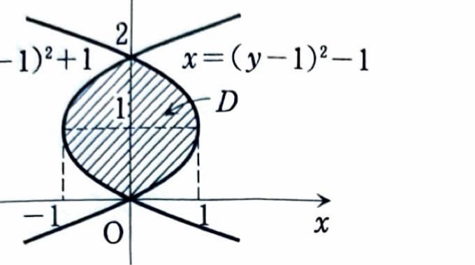

練習 4-3

立体を $x$ 軸に垂直な平面で切ったときの切り口の面積を $S(x)$ とすると、体積は

$$
V=\int_a^b S(x)\,dx
$$

で求められる。

---

2つの曲線

$$
(y-1)^2=1+x,\qquad (y-1)^2=1-x
$$

で囲まれる領域を $D$ とする。

---

## (1)

領域 $D$ を $y$ 軸のまわりに1回転してできる立体の体積 $V_y$ を求めよ。

---

## (1) 解答

> 2つの曲線を $x$ について解くと、領域は $y$ 軸に関して対称であることが分かる。 $y$ を固定した水平な切り口を $y$ 軸のまわりに回転すると円板になるので、円板法を用いる。
>
> 円筒殻法で $x$ について積分する方法もあるが、曲線を $y$ の関数として上下に分ける必要がある。 $y$ について積分する方が一つの式で済む。

第1の曲線

$$
(y-1)^2=1+x
$$

を $x$ について解くと、

$$
x=(y-1)^2-1
$$

である。

第2の曲線

$$
(y-1)^2=1-x
$$

を $x$ について解くと、

$$
x=1-(y-1)^2
$$

である。

交点では2つの $x$ が等しいので、

$$
(y-1)^2-1=1-(y-1)^2
$$

となる。整理すると、

$$
2(y-1)^2=2
$$

$$
(y-1)^2=1
$$

したがって、

$$
y-1=\pm1
$$

より、

$$
y=0,\qquad y=2
$$

である。

領域 $D$ の概形は次のとおりである。

$0\le y\le2$ において、右端の $x$ 座標は

$$
x=1-(y-1)^2
$$

である。これが $y$ 軸から円板の外周までの半径になる。したがって、半径を $R(y)$ とすると、

$$
R(y)=1-(y-1)^2
$$

である。

円板の面積の文字式は

$$
S(y)=\pi\{R(y)\}^2
$$

である。 $R(y)=1-(y-1)^2$ を代入すると、

$$
S(y)
=
\pi\{1-(y-1)^2\}^2
$$

したがって、体積は

$$
V_y
=
\int_0^2S(y)\,dy
$$

より、

$$
V_y
=
\pi\int_0^2\{1-(y-1)^2\}^2\,dy
$$

となる。まず、

$$
1-(y-1)^2
=
1-(y^2-2y+1)
=
-y^2+2y
$$

であるから、

$$
V_y
=
\pi\int_0^2(-y^2+2y)^2\,dy
$$

となる。平方を展開すると、

$$
(-y^2+2y)^2
=
y^4-4y^3+4y^2
$$

なので、

$$
V_y
=
\pi\int_0^2
(y^4-4y^3+4y^2)\,dy
$$

である。各項を積分すると、

$$
V_y
=
\pi
\left[
\frac{y^5}{5}-y^4+\frac43y^3
\right]_0^2
$$

上端と下端を代入すると、

$$
V_y
=
\pi
\left\{
\left(
\frac{2^5}{5}-2^4+\frac43\cdot2^3
\right)
-0
\right\}
$$

$$
V_y
=
\pi
\left(
\frac{32}{5}-16+\frac{32}{3}
\right)
$$

通分すると、

$$
\frac{32}{5}-16+\frac{32}{3}
=
\frac{96-240+160}{15}
=
\frac{16}{15}
$$

したがって、

$$
\boxed{V_y=\frac{16}{15}\pi}
$$

---

## (2)

領域 $D$ を $x$ 軸のまわりに1回転してできる立体の体積 $V_x$ を求めよ。

---

## (2) 解答

> $y$ を固定した水平な短冊を $x$ 軸のまわりに回転すると、半径 $y$ の円筒殻になる。短冊の横の長さは「右端の $x$ 座標－左端の $x$ 座標」で求められる。
>
> ワッシャー法も可能だが、 $x$ の正負によって上下の境界の扱いが変わる。円筒殻法なら $0\le y\le2$ の一つの積分で計算できる。

水平な短冊の左端は

$$
x_L=(y-1)^2-1
$$

であり、右端は

$$
x_R=1-(y-1)^2
$$

である。したがって、短冊の長さは

$$
x_R-x_L
$$

である。これらを代入すると、

$$
x_R-x_L
=
\{1-(y-1)^2\}
-
\{(y-1)^2-1\}
$$

よって、

$$
x_R-x_L
=
2\{1-(y-1)^2\}
$$

となる。

円筒殻の微小体積の文字式は

$$
dV
=
2\pi(\text{半径})(\text{高さ})\,dy
$$

である。半径 $y$、高さ $2\{1-(y-1)^2\}$ を代入すると、

$$
dV
=
2\pi y\cdot2\{1-(y-1)^2\}\,dy
$$

したがって、

$$
V_x
=
4\pi\int_0^2
y\{1-(y-1)^2\}\,dy
$$

となる。先ほど求めた

$$
1-(y-1)^2=-y^2+2y
$$

を代入すると、

$$
V_x
=
4\pi\int_0^2
y(-y^2+2y)\,dy
$$

よって、

$$
V_x
=
4\pi\int_0^2
(-y^3+2y^2)\,dy
$$

である。各項を積分すると、

$$
V_x
=
4\pi
\left[
-\frac{y^4}{4}+\frac23y^3
\right]_0^2
$$

上端と下端を代入すると、

$$
V_x
=
4\pi
\left\{
\left(
-\frac{2^4}{4}+\frac23\cdot2^3
\right)
-0
\right\}
$$

$$
V_x
=
4\pi
\left(
-4+\frac{16}{3}
\right)
$$

$$
V_x
=
4\pi\cdot\frac43
=
\frac{16}{3}\pi
$$

したがって、

$$
\boxed{V_x=\frac{16}{3}\pi}
$$
