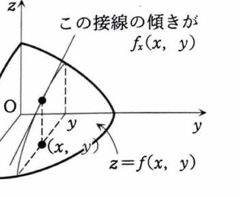

例題 6-1（偏微分）

次の関数の第1次、第2次の偏導関数を求めよ。

> **前提知識：偏導関数**
>
> 2変数関数 $z=f(x,y)$ を $x$ で偏微分するときは、$y$ を定数として扱う。逆に、$y$ で偏微分するときは、$x$ を定数として扱う。
>
> 定義は
>
> $$
> f_x(x,y)=\lim_{h\to0}\frac{f(x+h,y)-f(x,y)}{h}
> $$
>
> であり、$f_y(x,y)$ も同様に定義される。2階偏導関数は
>
> $$
> f_{xx},\quad f_{xy},\quad f_{yx},\quad f_{yy}
> $$
>
> で表す。$f_{xy}$ と $f_{yx}$ がともに連続なら、
>
> $$
> f_{xy}=f_{yx}
> $$
>
> が成り立つ。
>
> 幾何学的には、$f_x$ は $x$ 軸方向に曲面を切ったときの接線の傾き、$f_y$ は $y$ 軸方向に切ったときの接線の傾きである。

---

## (1)

$$
z=3x^2-xy+2y^2
$$

---

## (1) 解答

> この関数は多項式なので、$x$ で偏微分するときは $y$ を定数、$y$ で偏微分するときは $x$ を定数として項別に微分する方法が最も直接的である。定義から極限を計算する方法もあるが、通常の微分公式を用いる方が簡潔である。

まず、$x$ について偏微分する。

$$
z_x
=
\frac{\partial}{\partial x}\left(3x^2-xy+2y^2\right)
$$

各項を微分すると、

$$
\frac{\partial}{\partial x}(3x^2)=6x
$$

$$
\frac{\partial}{\partial x}(-xy)=-y
$$

$$
\frac{\partial}{\partial x}(2y^2)=0
$$

よって、

$$
z_x=6x-y
$$

次に、$y$ について偏微分する。

$$
z_y
=
\frac{\partial}{\partial y}\left(3x^2-xy+2y^2\right)
$$

各項を微分すると、

$$
\frac{\partial}{\partial y}(3x^2)=0
$$

$$
\frac{\partial}{\partial y}(-xy)=-x
$$

$$
\frac{\partial}{\partial y}(2y^2)=4y
$$

したがって、

$$
z_y=-x+4y
$$

第2次偏導関数を求める。

$$
z_{xx}
=
\frac{\partial}{\partial x}(z_x)
=
\frac{\partial}{\partial x}(6x-y)
=
6
$$

$$
z_{yy}
=
\frac{\partial}{\partial y}(z_y)
=
\frac{\partial}{\partial y}(-x+4y)
=
4
$$

混合偏導関数は、

$$
z_{xy}
=
\frac{\partial}{\partial y}(z_x)
=
\frac{\partial}{\partial y}(6x-y)
=
-1
$$

$$
z_{yx}
=
\frac{\partial}{\partial x}(z_y)
=
\frac{\partial}{\partial x}(-x+4y)
=
-1
$$

よって、

$$
\boxed{
z_x=6x-y,\quad
z_y=-x+4y,\quad
z_{xx}=6,\quad
z_{yy}=4,\quad
z_{xy}=z_{yx}=-1
}
$$

---

## (2)

$$
z=\sin(x^2y)
$$

---

## (2) 解答

> 外側が $\sin$、内側が $x^2y$ である合成関数なので、チェイン・ルールを使う。第2次偏導関数では積の微分も必要になる。内側を $u=x^2y$ とおいてから微分すると構造が分かりやすい。

内側の関数を

$$
u=x^2y
$$

とおくと、

$$
z=\sin u
$$

である。

まず $x$ について偏微分する。チェイン・ルールより、

$$
z_x=\cos u\cdot u_x
$$

ここで、

$$
u_x=\frac{\partial}{\partial x}(x^2y)=2xy
$$

であるから、

$$
z_x=2xy\cos(x^2y)
$$

同様に、$y$ について偏微分すると、

$$
z_y=\cos u\cdot u_y
$$

ここで、

$$
u_y=\frac{\partial}{\partial y}(x^2y)=x^2
$$

だから、

$$
z_y=x^2\cos(x^2y)
$$

次に $z_{xx}$ を求める。代入前の式は、

$$
z_{xx}
=
\frac{\partial}{\partial x}\left(2xy\cos(x^2y)\right)
$$

積の微分公式

$$
\frac{\partial}{\partial x}(AB)=A_xB+AB_x
$$

を用いると、

$$
z_{xx}
=
(2xy)_x\cos(x^2y)
+
2xy\left\{\cos(x^2y)\right\}_x
$$

各部分は、

$$
(2xy)_x=2y
$$

および、

$$
\left\{\cos(x^2y)\right\}_x
=
-\sin(x^2y)\cdot(2xy)
$$

である。したがって、

$$
z_{xx}
=
2y\cos(x^2y)
+
2xy\left\{-2xy\sin(x^2y)\right\}
$$

$$
z_{xx}
=
2y\cos(x^2y)-4x^2y^2\sin(x^2y)
$$

次に $z_{yy}$ を求める。

$$
z_{yy}
=
\frac{\partial}{\partial y}\left(x^2\cos(x^2y)\right)
$$

$x^2$ は $y$ に関して定数なので、

$$
z_{yy}
=
x^2\left\{\cos(x^2y)\right\}_y
$$

ここで、

$$
\left\{\cos(x^2y)\right\}_y
=
-\sin(x^2y)\cdot x^2
$$

だから、

$$
z_{yy}
=
-x^4\sin(x^2y)
$$

最後に混合偏導関数を求める。

$$
z_{xy}
=
\frac{\partial}{\partial y}\left(2xy\cos(x^2y)\right)
$$

積の微分より、

$$
z_{xy}
=
(2xy)_y\cos(x^2y)
+
2xy\left\{\cos(x^2y)\right\}_y
$$

ここで、

$$
(2xy)_y=2x
$$

$$
\left\{\cos(x^2y)\right\}_y=-x^2\sin(x^2y)
$$

であるから、

$$
z_{xy}
=
2x\cos(x^2y)-2x^3y\sin(x^2y)
$$

同様に計算すると、

$$
z_{yx}
=
2x\cos(x^2y)-2x^3y\sin(x^2y)
$$

よって、

$$
\boxed{
\begin{aligned}
z_x&=2xy\cos(x^2y),\\
z_y&=x^2\cos(x^2y),\\
z_{xx}&=2y\cos(x^2y)-4x^2y^2\sin(x^2y),\\
z_{yy}&=-x^4\sin(x^2y),\\
z_{xy}&=z_{yx}=2x\cos(x^2y)-2x^3y\sin(x^2y)
\end{aligned}
}
$$
