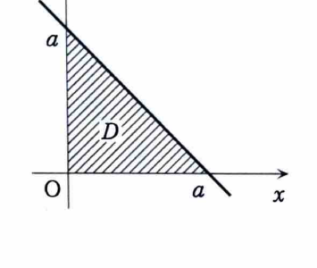

例題 6-10（最大・最小①）

$x,y,z$ がすべて正で、

$$
x+y+z=a
$$

ただし $a$ は定数とする。このとき、積

$$
x^2y^3z
$$

の最大値を求めよ。

---

## 解答

> 制約から $z=a-x-y$ と消去し、2変数関数の最大値問題に直す。ラグランジュの乗数法や重み付き相加相乗平均を使う方法もあるが、資料に沿って停留点と境界を調べる。

制約条件

$$
x+y+z=a
$$

から、

$$
z=a-x-y
$$

である。

$x,y,z>0$ より、

$$
x>0,\qquad y>0,\qquad a-x-y>0
$$

したがって、

$$
x>0,\qquad y>0,\qquad x+y<a
$$

である。この領域を $D$ とする。

目的の積を2変数関数に直す。

$$
x^2y^3z=x^2y^3(a-x-y)
$$

そこで、

$$
f(x,y)=x^2y^3(a-x-y)
$$

とおく。展開すると、

$$
f(x,y)=ax^2y^3-x^3y^3-x^2y^4
$$

である。

まず $x$ について偏微分する。

$$
f_x
=
2axy^3-3x^2y^3-2xy^4
$$

共通因子をくくると、

$$
f_x
=
xy^3(2a-3x-2y)
$$

同様に $y$ について偏微分する。

$$
f_y
=
3ax^2y^2-3x^3y^2-4x^2y^3
$$

$$
f_y
=
x^2y^2(3a-3x-4y)
$$

領域 $D$ の内部では $x>0$、$y>0$ なので、停留点では、

$$
2a-3x-2y=0
\tag{1}
$$

$$
3a-3x-4y=0
\tag{2}
$$

が成り立つ。

式 (2) から式 (1) を引くと、

$$
a-2y=0
$$

したがって、

$$
y=\frac{a}{2}
$$

である。

この値を式 (1) に代入する前の式は、

$$
2a-3x-2y=0
$$

である。$y=\frac{a}{2}$ を代入すると、

$$
2a-3x-a=0
$$

$$
3x=a
$$

$$
x=\frac{a}{3}
$$

である。

さらに、

$$
z=a-x-y
$$

に代入すると、

$$
z
=
a-\frac{a}{3}-\frac{a}{2}
$$

$$
z
=
\frac{a}{6}
$$

となる。

閉領域の境界では、$x=0$、$y=0$、または $z=a-x-y=0$ となるので、

$$
x^2y^3z=0
$$

である。一方、内部の候補点では正の値をとる。内部の停留点はこの1点だけなので、ここで最大となる。

最大値を求める。代入前の式は、

$$
x^2y^3z
$$

である。$x=\frac{a}{3}$、$y=\frac{a}{2}$、$z=\frac{a}{6}$ を代入する。

$$
\left(\frac{a}{3}\right)^2
\left(\frac{a}{2}\right)^3
\left(\frac{a}{6}\right)
$$

$$
=
\frac{a^2}{9}\cdot\frac{a^3}{8}\cdot\frac{a}{6}
$$

$$
=
\frac{a^6}{432}
$$

したがって、

$$
\boxed{
\text{最大値は }\frac{a^6}{432}
}
$$

この最大値は、

$$
\boxed{
(x,y,z)=\left(\frac{a}{3},\frac{a}{2},\frac{a}{6}\right)
}
$$

で得られる。
