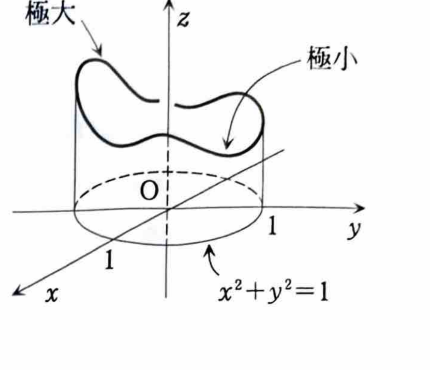

例題 6-11（最大・最小②：ラグランジュの乗数法）

条件

$$
x^2+y^2-1=0
$$

のもとで、関数

$$
f(x,y)=3x-y
$$

が極値をとり得る点をすべて求め、その点で極大か極小かを判定せよ。

> **前提知識：ラグランジュの乗数法**
>
> 制約
>
> $$
> g(x,y)=0
> $$
>
> のもとで $f(x,y)$ が極値をとる点では、通常、ある定数 $\lambda$ が存在して
>
> $$
> f_x=\lambda g_x,\qquad f_y=\lambda g_y
> $$
>
> が成り立つ。制約条件そのもの
>
> $$
> g(x,y)=0
> $$
>
> と合わせて解く。
>
> この方法は、制約曲線上での接線方向には $f$ が変化しないため、$\nabla f$ が制約曲線の法線方向 $\nabla g$ と平行になることを利用している。

---

## 解答

> 制約は単位円であり、閉じた有界な曲線上で連続関数 $f$ を考えるので最大値・最小値が存在する。制約を $y=\pm\sqrt{1-x^2}$ として1変数化する方法もあるが、場合分けが必要になるため、ラグランジュの乗数法が最も体系的である。

制約関数を、

$$
g(x,y)=x^2+y^2-1
$$

とおく。

偏導関数は、

$$
f_x=3,\qquad f_y=-1
$$

$$
g_x=2x,\qquad g_y=2y
$$

である。

ラグランジュの乗数法より、極値候補 $(a,b)$ では、ある $\lambda$ が存在して、

$$
f_x(a,b)=\lambda g_x(a,b)
$$

$$
f_y(a,b)=\lambda g_y(a,b)
$$

が成り立つ。したがって、

$$
3=2\lambda a
\tag{1}
$$

$$
-1=2\lambda b
\tag{2}
$$

さらに制約条件より、

$$
a^2+b^2=1
\tag{3}
$$

である。

式 (1) から、

$$
a=\frac{3}{2\lambda}
$$

式 (2) から、

$$
b=-\frac{1}{2\lambda}
$$

である。

これらを式 (3) に代入する。

$$
\left(\frac{3}{2\lambda}\right)^2
+
\left(-\frac{1}{2\lambda}\right)^2
=
1
$$

$$
\frac{9}{4\lambda^2}
+
\frac{1}{4\lambda^2}
=
1
$$

$$
\frac{10}{4\lambda^2}=1
$$

$$
\lambda^2=\frac{5}{2}
$$

したがって、

$$
\lambda=\pm\frac{\sqrt{10}}{2}
$$

である。

$\lambda=\frac{\sqrt{10}}{2}$ のとき、

$$
a=\frac{3}{\sqrt{10}},\qquad
b=-\frac{1}{\sqrt{10}}
$$

である。

$\lambda=-\frac{\sqrt{10}}{2}$ のとき、

$$
a=-\frac{3}{\sqrt{10}},\qquad
b=\frac{1}{\sqrt{10}}
$$

である。

したがって候補点は、

$$
\left(\frac{3}{\sqrt{10}},-\frac{1}{\sqrt{10}}\right)
$$

$$
\left(-\frac{3}{\sqrt{10}},\frac{1}{\sqrt{10}}\right)
$$

の2点である。

各点で関数値を計算する。代入前の式は、

$$
f(x,y)=3x-y
$$

である。

第1の点では、

$$
f\left(\frac{3}{\sqrt{10}},-\frac{1}{\sqrt{10}}\right)
=
3\cdot\frac{3}{\sqrt{10}}
-
\left(-\frac{1}{\sqrt{10}}\right)
$$

$$
=
\frac{10}{\sqrt{10}}
=
\sqrt{10}
$$

第2の点では、

$$
f\left(-\frac{3}{\sqrt{10}},\frac{1}{\sqrt{10}}\right)
=
3\left(-\frac{3}{\sqrt{10}}\right)
-
\frac{1}{\sqrt{10}}
$$

$$
=
-\frac{10}{\sqrt{10}}
=
-\sqrt{10}
$$

候補はこの2点だけで、単位円上に最大値・最小値が存在するので、値の大きい方が最大、小さい方が最小である。

したがって、

$$
\boxed{
\left(\frac{3}{\sqrt{10}},-\frac{1}{\sqrt{10}}\right)
\text{ で極大値 }\sqrt{10}
}
$$

$$
\boxed{
\left(-\frac{3}{\sqrt{10}},\frac{1}{\sqrt{10}}\right)
\text{ で極小値 }-\sqrt{10}
}
$$
