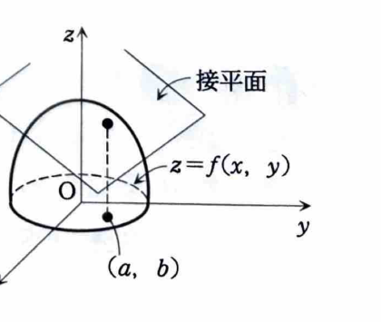
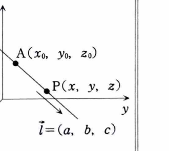
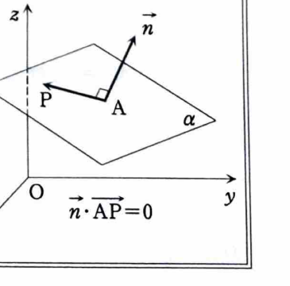

例題 6-2（接平面①）

次の曲面の与えられた点における接平面および法線の方程式を求めよ。

> **前提知識：陽関数で表された曲面の接平面**
>
> 曲面 $z=f(x,y)$ 上の点 $(a,b,f(a,b))$ における接平面は、
>
> $$
> z-f(a,b)=f_x(a,b)(x-a)+f_y(a,b)(y-b)
> $$
>
> で与えられる。この式を
>
> $$
> f_x(a,b)(x-a)+f_y(a,b)(y-b)-(z-f(a,b))=0
> $$
>
> と書けば、接平面の法線ベクトルは
>
> $$
> \boldsymbol{n}=\bigl(f_x(a,b),f_y(a,b),-1\bigr)
> $$
>
> である。
>
> 点 $(x_0,y_0,z_0)$ を通り、方向ベクトル $(A,B,C)$ をもつ直線は、
>
> $$
> \frac{x-x_0}{A}=\frac{y-y_0}{B}=\frac{z-z_0}{C}
> $$
>
> と表せる。したがって、法線は接点を通り、接平面の法線ベクトルを方向ベクトルにもつ直線として求める。

> **補足：全微分**
>
> 点 $(a,b)$ における接平面が定まり、$f_x,f_y$ が近傍で連続なら、$f$ は全微分可能であり、
>
> $$
> df=f_x(a,b)\,dx+f_y(a,b)\,dy
> $$
>
> と表される。接平面の右辺は、関数の増分を1次式で近似する全微分に対応している。

---

## (1)

$$
z=x^2+y^2,\qquad (1,2,5)
$$

---

## (1) 解答

> 曲面が $z=f(x,y)$ の形で与えられているので、陽関数用の接平面公式を使う。陰関数 $F(x,y,z)=x^2+y^2-z=0$ として勾配を使う方法もあるが、ここでは資料の流れに沿って $f_x,f_y$ を直接求める。

まず文字のまま偏導関数を求める。

$$
f_x(x,y)=2x,\qquad f_y(x,y)=2y
$$

次に接点の $x,y$ 座標を代入する。

$$
f_x(1,2)=2,\qquad f_y(1,2)=4
$$

接平面の公式

$$
z-f(a,b)=f_x(a,b)(x-a)+f_y(a,b)(y-b)
$$

に、$a=1$、$b=2$、$f(a,b)=5$ を代入すると、

$$
z-5=2(x-1)+4(y-2)
$$

展開して整理する。

$$
z-5=2x-2+4y-8
$$

$$
2x+4y-z-5=0
$$

したがって、接平面は

$$
\boxed{2x+4y-z-5=0}
$$

である。

接平面の法線ベクトルは、

$$
\boldsymbol{n}=(2,4,-1)
$$

である。法線は点 $(1,2,5)$ を通るので、

$$
\boxed{
\frac{x-1}{2}
=
\frac{y-2}{4}
=
\frac{z-5}{-1}
}
$$

---

## (2)

$$
z=\frac{x}{x+y},\qquad (-2,1,2)
$$

---

## (2) 解答

> 分数関数なので、まず商の微分で $f_x,f_y$ を文字のまま求め、その後で点の座標を代入する。値を先に代入すると偏導関数そのものを失うため、必ず偏微分を先に行う。

商の微分公式より、

$$
f_x(x,y)
=
\frac{(x+y)\cdot1-x\cdot1}{(x+y)^2}
=
\frac{y}{(x+y)^2}
$$

同様に、

$$
f_y(x,y)
=
\frac{(x+y)\cdot0-x\cdot1}{(x+y)^2}
=
-\frac{x}{(x+y)^2}
$$

接点の座標を代入する前の式は、

$$
f_x(x,y)=\frac{y}{(x+y)^2},\qquad
f_y(x,y)=-\frac{x}{(x+y)^2}
$$

である。ここに $x=-2$、$y=1$ を代入すると、

$$
f_x(-2,1)
=
\frac{1}{(-2+1)^2}
=
1
$$

$$
f_y(-2,1)
=
-\frac{-2}{(-2+1)^2}
=
2
$$

接平面の公式に代入する。

$$
z-2=1\{x-(-2)\}+2(y-1)
$$

$$
z-2=(x+2)+2(y-1)
$$

$$
x+2y-z+2=0
$$

したがって、

$$
\boxed{x+2y-z+2=0}
$$

法線ベクトルは、

$$
\boldsymbol{n}=(1,2,-1)
$$

であるから、法線は

$$
\boxed{
\frac{x+2}{1}
=
\frac{y-1}{2}
=
\frac{z-2}{-1}
}
$$
