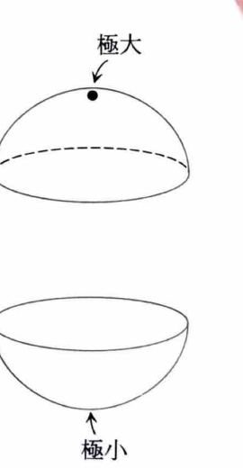
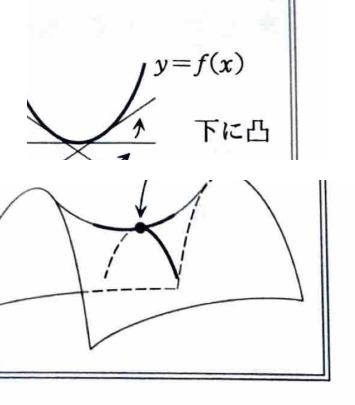

例題 6-8（2変数関数の極値①）

関数

$$
f(x,y)=3x^2+y^3-6xy
$$

を考える。

> **前提知識：2変数関数の極値判定**
>
> 極値をとる可能性のある内部点では、通常
>
> $$
> f_x=0,\qquad f_y=0
> $$
>
> が成り立つ。このような点を停留点という。
>
> 停留点 $(a,b)$ で
>
> $$
> H(a,b)=f_{xx}(a,b)f_{yy}(a,b)-\{f_{xy}(a,b)\}^2
> $$
>
> を計算する。
>
> $$
> \begin{array}{c|c}
> H(a,b)>0,\ f_{xx}(a,b)>0 & \text{極小}\\
> H(a,b)>0,\ f_{xx}(a,b)<0 & \text{極大}\\
> H(a,b)<0 & \text{極値をとらない}\\
> H(a,b)=0 & \text{この判定法だけでは判定不能}
> \end{array}
> $$
>
> $H=0$ の場合は、停留点へ近づく経路を変えて関数値の符号や大小を直接調べる。

> **関連する補足：2変数のTaylorの定理**
>
> 偏微分作用素
>
> $$
> D=h\frac{\partial}{\partial x}+k\frac{\partial}{\partial y}
> $$
>
> を用いると、十分滑らかな $f$ について
>
> $$
> f(a+h,b+k)
> =
> f(a,b)+Df(a,b)+\frac{1}{2!}D^2f(a,b)+\cdots
> $$
>
> と展開できる。極値判定で2階偏導関数が現れるのは、停留点では1次の項が消え、2次の項が局所的な曲面の形を支配するためである。

---

## (1)

$f(x,y)$ の1階および2階の偏導関数をすべて求めよ。

---

## (1) 解答

> 多項式なので、各変数について他方を定数として項別に微分する。極値判定に必要な $f_{xx},f_{xy},f_{yx},f_{yy}$ まで計算する。

1階偏導関数は、

$$
f_x(x,y)
=
\frac{\partial}{\partial x}(3x^2+y^3-6xy)
=
6x-6y
$$

$$
f_y(x,y)
=
\frac{\partial}{\partial y}(3x^2+y^3-6xy)
=
3y^2-6x
$$

である。

2階偏導関数は、

$$
f_{xx}(x,y)
=
\frac{\partial}{\partial x}(6x-6y)
=
6
$$

$$
f_{xy}(x,y)
=
\frac{\partial}{\partial y}(6x-6y)
=
-6
$$

$$
f_{yx}(x,y)
=
\frac{\partial}{\partial x}(3y^2-6x)
=
-6
$$

$$
f_{yy}(x,y)
=
\frac{\partial}{\partial y}(3y^2-6x)
=
6y
$$

したがって、

$$
\boxed{
\begin{aligned}
f_x&=6x-6y,&
f_y&=3y^2-6x,\\
f_{xx}&=6,&
f_{xy}&=f_{yx}=-6,&
f_{yy}&=6y
\end{aligned}
}
$$

---

## (2)

$f(x,y)$ の極値を求めよ。

---

## (2) 解答

> まず停留点を求め、その各点でヘッシアン
>
> $$
> H=f_{xx}f_{yy}-(f_{xy})^2
> $$
>
> を調べる。停留点が少数なので、この方法が最も直接的である。平方完成やグラフの形から考える方法もあるが、2変数の標準的な判定手順を用いる。

停留点では、

$$
f_x=0,\qquad f_y=0
$$

が成り立つ。

まず、

$$
f_x=6x-6y=0
$$

より、

$$
x-y=0
$$

したがって、

$$
y=x
\tag{1}
$$

である。

次に、

$$
f_y=3y^2-6x=0
$$

より、

$$
y^2-2x=0
\tag{2}
$$

である。

式 (1) の $y=x$ を式 (2) に代入する。

$$
x^2-2x=0
$$

$$
x(x-2)=0
$$

したがって、

$$
x=0,\qquad x=2
$$

であり、$y=x$ だから、停留点は

$$
(0,0),\qquad (2,2)
$$

である。

ヘッシアンを文字のまま計算する。

$$
H(x,y)
=
f_{xx}f_{yy}-(f_{xy})^2
$$

$$
H(x,y)
=
6\cdot6y-(-6)^2
$$

$$
H(x,y)=36(y-1)
$$

まず点 $(0,0)$ では、

$$
H(0,0)=36(0-1)=-36<0
$$

したがって、点 $(0,0)$ では極値をとらない。

次に点 $(2,2)$ では、

$$
H(2,2)=36(2-1)=36>0
$$

さらに、

$$
f_{xx}(2,2)=6>0
$$

だから、点 $(2,2)$ で極小となる。

極小値を求める前に、関数の文字の式を示す。

$$
f(x,y)=3x^2+y^3-6xy
$$

ここに $x=2$、$y=2$ を代入する。

$$
f(2,2)
=
3\cdot2^2+2^3-6\cdot2\cdot2
$$

$$
f(2,2)=12+8-24=-4
$$

したがって、

$$
\boxed{
\text{点 }(2,2)\text{ で極小値 }-4
}
$$

点 $(0,0)$ では極値をとらず、極大値は存在しない。
