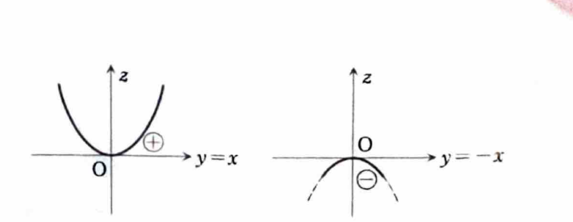

例題 6-9（2変数関数の極値②）

関数

$$
f(x,y)=x^4+y^4-2x^2+4xy-2y^2
$$

の極値を求めよ。

> **前提知識：2変数関数の極値判定**
>
> 極値をとる可能性のある内部点では、通常
>
> $$
> f_x=0,\qquad f_y=0
> $$
>
> が成り立つ。このような点を停留点という。
>
> 停留点 $(a,b)$ で
>
> $$
> H(a,b)=f_{xx}(a,b)f_{yy}(a,b)-\{f_{xy}(a,b)\}^2
> $$
>
> を計算する。
>
> $$
> \begin{array}{c|c}
> H(a,b)>0,\ f_{xx}(a,b)>0 & \text{極小}\\
> H(a,b)>0,\ f_{xx}(a,b)<0 & \text{極大}\\
> H(a,b)<0 & \text{極値をとらない}\\
> H(a,b)=0 & \text{この判定法だけでは判定不能}
> \end{array}
> $$
>
> $H=0$ の場合は、停留点へ近づく経路を変えて関数値の符号や大小を直接調べる。

> **関連する補足：2変数のTaylorの定理**
>
> 偏微分作用素
>
> $$
> D=h\frac{\partial}{\partial x}+k\frac{\partial}{\partial y}
> $$
>
> を用いると、十分滑らかな $f$ について
>
> $$
> f(a+h,b+k)
> =
> f(a,b)+Df(a,b)+\frac{1}{2!}D^2f(a,b)+\cdots
> $$
>
> と展開できる。極値判定で2階偏導関数が現れるのは、停留点では1次の項が消え、2次の項が局所的な曲面の形を支配するためである。

---

## 解答

> 停留点を求めた後、ヘッシアンで分類する。ただし、ヘッシアンが $0$ になる停留点では判定できないため、異なる経路に沿って関数値の符号を直接調べる。

1階偏導関数は、

$$
f_x=4x^3-4x+4y
$$

$$
f_y=4y^3-4y+4x
$$

である。

停留点では、

$$
x^3-x+y=0
\tag{1}
$$

$$
y^3-y+x=0
\tag{2}
$$

が成り立つ。

式 (1) と式 (2) を加えると、

$$
x^3+y^3=0
$$

$$
(x+y)(x^2-xy+y^2)=0
$$

実数 $x,y$ について、

$$
x^2-xy+y^2
=
\left(x-\frac{y}{2}\right)^2+\frac34y^2
\ge0
$$

であり、これが $0$ なら $x=y=0$ である。したがって停留点では基本的に

$$
y=-x
$$

とおける。

これを式 (1) に代入する。

$$
x^3-x-x=0
$$

$$
x^3-2x=0
$$

$$
x(x^2-2)=0
$$

よって、

$$
x=0,\qquad x=\sqrt2,\qquad x=-\sqrt2
$$

である。$y=-x$ より、停留点は

$$
(0,0),\qquad
(\sqrt2,-\sqrt2),\qquad
(-\sqrt2,\sqrt2)
$$

である。

2階偏導関数は、

$$
f_{xx}=12x^2-4
$$

$$
f_{yy}=12y^2-4
$$

$$
f_{xy}=f_{yx}=4
$$

である。

ヘッシアンは、

$$
H(x,y)
=
(12x^2-4)(12y^2-4)-16
$$

である。

点 $(\sqrt2,-\sqrt2)$ と $(-\sqrt2,\sqrt2)$ では、

$$
f_{xx}=12\cdot2-4=20
$$

$$
f_{yy}=12\cdot2-4=20
$$

だから、

$$
H=20\cdot20-4^2=384>0
$$

さらに、

$$
f_{xx}=20>0
$$

なので、両点で極小となる。

関数値は、まず文字の式に代入して、

$$
f(\sqrt2,-\sqrt2)
=
(\sqrt2)^4+(-\sqrt2)^4
-2(\sqrt2)^2
+4(\sqrt2)(-\sqrt2)
-2(-\sqrt2)^2
$$

$$
f(\sqrt2,-\sqrt2)
=
4+4-4-8-4=-8
$$

対称性により、

$$
f(-\sqrt2,\sqrt2)=-8
$$

である。

点 $(0,0)$ では、

$$
H(0,0)=(-4)(-4)-4^2=0
$$

となり、ヘッシアンだけでは判定できない。

そこで、異なる直線に沿って原点へ近づく。

直線 $y=x$ 上では、

$$
f(x,x)
=
x^4+x^4-2x^2+4x^2-2x^2
$$

$$
f(x,x)=2x^4>0\qquad(x\ne0)
$$

である。

一方、直線 $y=-x$ 上では、

$$
f(x,-x)
=
x^4+x^4-2x^2-4x^2-2x^2
$$

$$
f(x,-x)=2x^4-8x^2
$$

$$
f(x,-x)=2x^2(x^2-4)
$$

十分小さい $0<|x|<2$ では、

$$
f(x,-x)<0
$$

である。

原点の任意に近くに正の値と負の値の両方があるので、原点では極値をとらない。

したがって、

$$
\boxed{
\text{点 }(\sqrt2,-\sqrt2),\ (-\sqrt2,\sqrt2)
\text{ で極小値 }-8
}
$$

極大値は存在しない。
