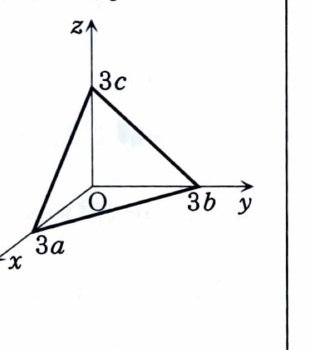

第6章 章末問題 1

曲面

$$
\{(x,y,z)\in\mathbb{R}^3\mid xyz=1,\ x>0,\ y>0,\ z>0\}
$$

の接平面と、$xy$ 平面、$yz$ 平面、$zx$ 平面とで囲まれる三角錐の体積は、接平面の取り方によらず一定であることを示せ。

（京都工芸繊維大学）

> **前提知識：陰関数で表された曲面の接平面**
>
> 曲面が
>
> $$
> F(x,y,z)=0
> $$
>
> と表されているとき、点 $(a,b,c)$ における勾配
>
> $$
> \nabla F(a,b,c)=\bigl(F_x(a,b,c),F_y(a,b,c),F_z(a,b,c)\bigr)
> $$
>
> は接平面の法線ベクトルになる。したがって接平面は
>
> $$
> F_x(a,b,c)(x-a)+F_y(a,b,c)(y-b)+F_z(a,b,c)(z-c)=0
> $$
>
> である。法線は、接点を通り、方向ベクトル $\nabla F(a,b,c)$ をもつ直線である。

---

## 解答

> 接点を一般に $(a,b,c)$ とおき、接平面の各座標軸との切片を求める。三角錐の3本の辺はそれぞれ座標軸上にあるため、体積は切片の積の $\frac16$ で計算できる。接点は曲面上にあるので $abc=1$ を最後に使う。

曲面を、

$$
F(x,y,z)=xyz-1
$$

と表す。

接点を、

$$
(a,b,c)
$$

とする。接点は曲面上にあるから、

$$
abc=1
\tag{1}
$$

である。

偏導関数を文字のまま求める。

$$
F_x(x,y,z)=yz
$$

$$
F_y(x,y,z)=zx
$$

$$
F_z(x,y,z)=xy
$$

接点 $(a,b,c)$ を代入すると、

$$
F_x(a,b,c)=bc
$$

$$
F_y(a,b,c)=ca
$$

$$
F_z(a,b,c)=ab
$$

したがって接平面は、

$$
bc(x-a)+ca(y-b)+ab(z-c)=0
$$

展開する。

$$
bcx-abc+cay-abc+abz-abc=0
$$

$$
bcx+cay+abz=3abc
$$

式 (1) より $abc=1$ なので、

$$
bcx+cay+abz=3
$$

両辺を $3abc$ で割る形で切片表示に直すと、

$$
\frac{x}{3a}+\frac{y}{3b}+\frac{z}{3c}=1
$$

である。

したがって、この接平面の $x$ 軸、$y$ 軸、$z$ 軸との交点はそれぞれ、

$$
(3a,0,0)
$$

$$
(0,3b,0)
$$

$$
(0,0,3c)
$$

である。

3本の座標軸方向の辺の長さは、

$$
3a,\qquad 3b,\qquad 3c
$$

であり、互いに直交している。

直方体の3辺が $A,B,C$ のとき、その1つの頂点と3本の座標軸上の点で作る三角錐の体積は、

$$
V=\frac16ABC
$$

である。

ここで、

$$
A=3a,\qquad B=3b,\qquad C=3c
$$

を代入する。

$$
V
=
\frac16(3a)(3b)(3c)
$$

$$
V
=
\frac{27}{6}abc
$$

式 (1) の $abc=1$ を代入すると、

$$
V=\frac{27}{6}
$$

$$
V=\frac92
$$

接点 $(a,b,c)$ は途中で任意に選んだが、最終結果に $a,b,c$ は残らない。したがって体積は接平面の取り方によらず一定であり、

$$
\boxed{
V=\frac92
}
$$
