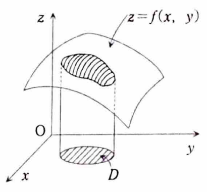
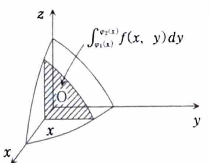
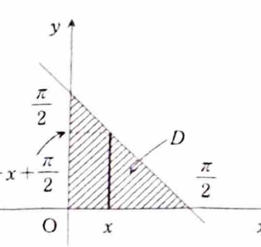
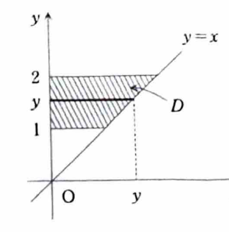

例題 7-1（逐次積分）

> **この問題で使う前提知識**
>
> 領域 $D$ 上の二重積分
>
> $$
> \iint_D f(x,y)\,dxdy
> $$
>
> は、$z=f(x,y)$ と $xy$ 平面上の領域 $D$ の間にある符号付き体積として考えられる。
>
> 
>
> 領域が
>
> $$
> D=\{(x,y)\mid a\le x\le b,\ \varphi_1(x)\le y\le\varphi_2(x)\}
> $$
>
> と表せるとき、二重積分は
>
> $$
> \iint_D f(x,y)\,dxdy
> =
> \int_a^b\left(\int_{\varphi_1(x)}^{\varphi_2(x)}f(x,y)\,dy\right)dx
> $$
>
> と計算できる。このように一つの変数ずつ積分する方法を**逐次積分**または**累次積分**という。
>
> 
>
> また、領域が
>
> $$
> D=\{(x,y)\mid \psi_1(y)\le x\le\psi_2(y),\ c\le y\le d\}
> $$
>
> と表せるときは、
>
> $$
> \iint_D f(x,y)\,dxdy
> =
> \int_c^d\left(\int_{\psi_1(y)}^{\psi_2(y)}f(x,y)\,dx\right)dy
> $$
>
> と積分順序を逆にして計算できる。

次の二重積分を計算せよ。

---

## (1)

$$
\iint_D\sin(x+y)\,dxdy,
\qquad
D:\ x\ge0,\ y\ge0,\ x+y\le\frac{\pi}{2}
$$

---

## (1) 解答

> **解法を選ぶ理由**
>
> 領域 $D$ は、第1象限にあり、直線
>
> $$
> x+y=\frac{\pi}{2}
> $$
>
> と二つの座標軸で囲まれた三角形である。
>
> $x$ を固定すると、$y$ は
>
> $$
> 0\le y\le\frac{\pi}{2}-x
> $$
>
> の範囲を動くため、まず $y$ について積分する逐次積分がそのまま使える。
>
> 先に $x$ について積分しても同様に計算できるが、この領域は $x$ と $y$ に関して対称なので、どちらの順序を選んでも難しさはほぼ同じである。ここでは資料の解答に合わせて $y$ から積分する。

領域 $D$ を逐次積分の範囲で書くと、

$$
0\le x\le\frac{\pi}{2},
\qquad
0\le y\le\frac{\pi}{2}-x
$$

である。したがって、

$$
\iint_D\sin(x+y)\,dxdy
=
\int_0^{\pi/2}
\left(
\int_0^{\pi/2-x}\sin(x+y)\,dy
\right)dx
$$

となる。

> $y$ について積分するとき、$x$ は定数として扱う。
>
> $x+y$ を $y$ で微分すると $1$ であるから、
>
> $$
> \int\sin(x+y)\,dy=-\cos(x+y)
> $$
>
> である。

よって、内側の積分は

$$
\int_0^{\pi/2-x}\sin(x+y)\,dy
=
\left[-\cos(x+y)\right]_{y=0}^{y=\pi/2-x}
$$

となる。まず上端 $y=\dfrac{\pi}{2}-x$ を代入すると、

$$
-\cos\left(x+\frac{\pi}{2}-x\right)
=
-\cos\frac{\pi}{2}
=
0
$$

である。次に下端 $y=0$ を代入すると、

$$
-\cos(x+0)=-\cos x
$$

である。したがって、

$$
\left[-\cos(x+y)\right]_{y=0}^{y=\pi/2-x}
=
0-(-\cos x)
=
\cos x
$$

となる。

よって、二重積分は一変数の積分

$$
\iint_D\sin(x+y)\,dxdy
=
\int_0^{\pi/2}\cos x\,dx
$$

に帰着する。

$\cos x$ の原始関数は $\sin x$ なので、

$$
\int_0^{\pi/2}\cos x\,dx
=
\left[\sin x\right]_0^{\pi/2}
$$

である。上端と下端を順に代入すると、

$$
\left[\sin x\right]_0^{\pi/2}
=
\sin\frac{\pi}{2}-\sin0
=
1-0
=
1
$$

となる。

したがって、

$$
\boxed{\iint_D\sin(x+y)\,dxdy=1}
$$

---

## (2)

$$
\iint_D\frac{x}{\sqrt{x^2+y^2}}\,dxdy,
\qquad
D:\ 0\le x\le y,\ 1\le y\le2
$$

---

## (2) 解答

> **解法を選ぶ理由**
>
> 問題文では領域が
>
> $$
> 1\le y\le2,
> \qquad
> 0\le x\le y
> $$
>
> と、すでに $y$ を外側、$x$ を内側にする形で与えられている。
>
> また、被積分関数の分子が $x$ であり、
>
> $$
> \frac{d}{dx}(x^2+y^2)=2x
> $$
>
> となるため、$x$ から積分すると平方根が直接積分できる。
>
> 積分順序を逆にすると領域を分割する必要があるので、ここでは資料と同じく $x$ から積分する。

与えられた範囲をそのまま用いると、

$$
\iint_D\frac{x}{\sqrt{x^2+y^2}}\,dxdy
=
\int_1^2
\left(
\int_0^y\frac{x}{\sqrt{x^2+y^2}}\,dx
\right)dy
$$

である。

> 内側の積分では $y$ は定数である。
>
> まず文字だけの式として、
>
> $$
> \frac{d}{dx}\sqrt{x^2+y^2}
> =
> \frac{1}{2\sqrt{x^2+y^2}}\cdot2x
> =
> \frac{x}{\sqrt{x^2+y^2}}
> $$
>
> である。したがって、
>
> $$
> \int\frac{x}{\sqrt{x^2+y^2}}\,dx
> =
> \sqrt{x^2+y^2}
> $$
>
> となる。

よって、

$$
\int_0^y\frac{x}{\sqrt{x^2+y^2}}\,dx
=
\left[\sqrt{x^2+y^2}\right]_{x=0}^{x=y}
$$

である。

上端 $x=y$ を代入すると、

$$
\sqrt{y^2+y^2}
=
\sqrt{2y^2}
=
\sqrt2\,|y|
$$

となる。ここで積分範囲は $1\le y\le2$ なので $y>0$ であり、

$$
|y|=y
$$

である。したがって、

$$
\sqrt{2y^2}=\sqrt2\,y
$$

となる。

下端 $x=0$ を代入すると、

$$
\sqrt{0^2+y^2}
=
\sqrt{y^2}
=
|y|
=
y
$$

である。よって、

$$
\left[\sqrt{x^2+y^2}\right]_{x=0}^{x=y}
=
\sqrt2\,y-y
=
(\sqrt2-1)y
$$

となる。

したがって、

$$
\iint_D\frac{x}{\sqrt{x^2+y^2}}\,dxdy
=
\int_1^2(\sqrt2-1)y\,dy
$$

である。定数 $\sqrt2-1$ を積分の外に出すと、

$$
=
(\sqrt2-1)\int_1^2y\,dy
$$

となる。

$y$ の原始関数は $\dfrac{y^2}{2}$ なので、

$$
(\sqrt2-1)\int_1^2y\,dy
=
(\sqrt2-1)
\left[
\frac{y^2}{2}
\right]_1^2
$$

である。上端と下端を代入すると、

$$
\left[
\frac{y^2}{2}
\right]_1^2
=
\frac{2^2}{2}-\frac{1^2}{2}
=
\frac42-\frac12
=
\frac32
$$

となる。

したがって、

$$
\boxed{
\iint_D\frac{x}{\sqrt{x^2+y^2}}\,dxdy
=
\frac32(\sqrt2-1)
}
$$
