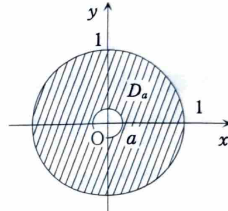

例題 7-4（広義積分①）

> **この問題で使う前提知識**
>
> 積分領域内で被積分関数が発散する場合、その点を除いた近似領域で積分し、極限を取って広義積分を定義する。
>
> 原点が特異点である円板上の積分では、内半径 $a>0$ の円環
>
> $$
> D_a=\{(x,y)\mid a^2\le x^2+y^2\le1\}
> $$
>
> を用い、
>
> $$
> \iint_Df(x,y)\,dxdy
> =
> \lim_{a\to+0}
> \iint_{D_a}f(x,y)\,dxdy
> $$
>
> とする。
>
> 極座標変換では、
>
> $$
> x=r\cos\theta,\qquad y=r\sin\theta,\qquad dxdy=r\,drd\theta
> $$
>
> を用いる。

次の二重積分の値を求めよ。

$$
\iint_D\log(x^2+y^2)\,dxdy,
\qquad
D:\ x^2+y^2\le1
$$

---

## 解答

> **解法を選ぶ理由**
>
> 被積分関数
>
> $$
> \log(x^2+y^2)
> $$
>
> は原点 $(0,0)$ で $\log0$ となり、通常の意味では定義されない。そのため、この積分は広義積分として扱う必要がある。
>
> 領域が円板であり、被積分関数も $x^2+y^2$ だけに依存するため、原点の周りに小さな円をくり抜き、極座標で計算する。
>
> 長方形を用いて原点を除くこともできるが、円形の近似領域を用いると極座標の積分範囲が簡単になる。

内半径 $a$、外半径 $1$ の円環を

$$
D_a:\ a^2\le x^2+y^2\le1,
\qquad
a>0
$$

とする。

極座標変換

$$
x=r\cos\theta,
\qquad
y=r\sin\theta
$$

を用いると、$D_a$ は

$$
E_a:\ a\le r\le1,
\qquad
0\le\theta\le2\pi
$$

へ移る。

また、

$$
x^2+y^2=r^2
$$

であり、

$$
dxdy=r\,drd\theta
$$

なので、

$$
\iint_{D_a}\log(x^2+y^2)\,dxdy
=
\int_0^{2\pi}
\int_a^1
\log(r^2)\,r\,drd\theta
$$

となる。

$r>0$ なので、

$$
\log(r^2)=2\log r
$$

である。したがって、

$$
\int_0^{2\pi}
\int_a^1
\log(r^2)\,r\,drd\theta
=
\int_0^{2\pi}
\int_a^1
2r\log r\,drd\theta
$$

となる。

内側の積分は $\theta$ に依存しないため、

$$
=
2\pi\int_a^12r\log r\,dr
=
4\pi\int_a^1r\log r\,dr
$$

である。

ここで部分積分を用いる。公式

$$
\int u\,dv=uv-\int v\,du
$$

に対して、

$$
u=\log r,
\qquad
dv=r\,dr
$$

と置く。このとき、

$$
du=\frac1r\,dr,
\qquad
v=\frac{r^2}{2}
$$

である。したがって、

$$
\int r\log r\,dr
=
\frac{r^2}{2}\log r
-
\int\frac{r^2}{2}\cdot\frac1r\,dr
$$

となる。第2項を整理すると、

$$
=
\frac{r^2}{2}\log r
-
\frac12\int r\,dr
$$

であるから、

$$
\int r\log r\,dr
=
\frac{r^2}{2}\log r
-
\frac{r^2}{4}
$$

となる。

よって、

$$
\iint_{D_a}\log(x^2+y^2)\,dxdy
=
4\pi
\left[
\frac{r^2}{2}\log r-\frac{r^2}{4}
\right]_a^1
$$

である。

上端 $r=1$ を代入すると、

$$
\frac{1^2}{2}\log1-\frac{1^2}{4}
=
0-\frac14
=
-\frac14
$$

である。下端 $r=a$ を代入すると、

$$
\frac{a^2}{2}\log a-\frac{a^2}{4}
$$

である。したがって、

$$
\iint_{D_a}\log(x^2+y^2)\,dxdy
=
4\pi
\left(
-\frac14-\frac{a^2}{2}\log a+\frac{a^2}{4}
\right)
$$

となる。

ここで $a\to+0$ の極限を取る。明らかに、

$$
\lim_{a\to+0}a^2=0
$$

である。また、

$$
\lim_{a\to+0}a^2\log a
$$

は $0\cdot(-\infty)$ 型なので、そのままでは判断できない。分数の形に直すと、

$$
a^2\log a
=
\frac{\log a}{a^{-2}}
$$

である。ロピタルの定理を用いると、分子と分母を $a$ で微分して、

$$
\lim_{a\to+0}
\frac{\log a}{a^{-2}}
=
\lim_{a\to+0}
\frac{1/a}{-2a^{-3}}
$$

となる。分数を整理すると、

$$
\frac{1/a}{-2a^{-3}}
=
-\frac{a^2}{2}
$$

なので、

$$
\lim_{a\to+0}a^2\log a
=
\lim_{a\to+0}
\left(-\frac{a^2}{2}\right)
=
0
$$

である。

したがって、

$$
\iint_D\log(x^2+y^2)\,dxdy
=
\lim_{a\to+0}
4\pi
\left(
-\frac14-\frac{a^2}{2}\log a+\frac{a^2}{4}
\right)
$$

であり、

$$
=
4\pi\left(-\frac14-0+0\right)
=
-\pi
$$

となる。

よって、

$$
\boxed{
\iint_D\log(x^2+y^2)\,dxdy=-\pi
}
$$
