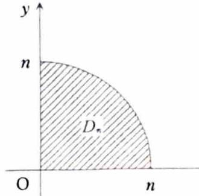
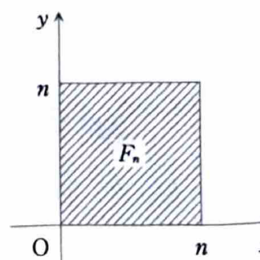

例題 7-5（広義積分②）

> **この問題で使う前提知識**
>
> 無限領域上の二重積分は、有界な近似領域 $D_n$ を用いて、
>
> $$
> \iint_Df(x,y)\,dxdy
> =
> \lim_{n\to\infty}
> \iint_{D_n}f(x,y)\,dxdy
> $$
>
> と定義する。
>
> また、長方形領域上で被積分関数が
>
> $$
> f(x,y)=g(x)h(y)
> $$
>
> と積の形に分かれるとき、
>
> $$
> \int_a^b\int_c^d g(x)h(y)\,dxdy
> =
> \left(\int_a^bg(x)\,dx\right)
> \left(\int_c^dh(y)\,dy\right)
> $$
>
> と分離できる。

---

## (1)

次の二重積分を計算せよ。

$$
\iint_De^{-x^2-y^2}\,dxdy,
\qquad
D:\ x\ge0,\ y\ge0
$$

---

## (1) 解答

> **解法を選ぶ理由**
>
> 積分領域は第1象限全体という無限領域であるため、まず有界な領域で近似して極限を取る。
>
> 被積分関数は
>
> $$
> e^{-x^2-y^2}=e^{-r^2}
> $$
>
> と極座標で非常に簡単になるので、半径 $n$ の4分円板を近似領域に選ぶ。
>
> 正方形で近似する方法もあるが、その方法は小問 (2) で一変数積分との関係を導くために用いる。小問 (1) 自体は極座標が最も直接的である。

近似領域を

$$
D_n:\ x\ge0,\ y\ge0,\ x^2+y^2\le n^2
$$

とする。

極座標変換

$$
x=r\cos\theta,
\qquad
y=r\sin\theta
$$

を用いると、$D_n$ は

$$
E_n:\ 0\le r\le n,
\qquad
0\le\theta\le\frac{\pi}{2}
$$

へ移る。

また、

$$
x^2+y^2=r^2
$$

および

$$
dxdy=r\,drd\theta
$$

なので、

$$
\iint_{D_n}e^{-x^2-y^2}\,dxdy
=
\int_0^{\pi/2}
\int_0^ne^{-r^2}r\,drd\theta
$$

である。

動径方向の積分を計算する。文字だけの置換

$$
u=-r^2
$$

を行うと、

$$
du=-2r\,dr
$$

である。したがって、

$$
\int e^{-r^2}r\,dr
=
-\frac12e^{-r^2}
$$

となる。

よって、

$$
\int_0^ne^{-r^2}r\,dr
=
\left[
-\frac12e^{-r^2}
\right]_0^n
$$

である。上端と下端を代入すると、

$$
=
-\frac12e^{-n^2}
-
\left(-\frac12e^0\right)
$$

より、

$$
=
\frac12(1-e^{-n^2})
$$

となる。

したがって、

$$
\iint_{D_n}e^{-x^2-y^2}\,dxdy
=
\int_0^{\pi/2}
\frac12(1-e^{-n^2})\,d\theta
$$

である。括弧内は $\theta$ に関して定数なので、

$$
=
\frac12(1-e^{-n^2})
\left[
\theta
\right]_0^{\pi/2}
$$

となり、

$$
=
\frac12(1-e^{-n^2})\cdot\frac{\pi}{2}
=
\frac{\pi}{4}(1-e^{-n^2})
$$

である。

$n\to\infty$ とすると、

$$
e^{-n^2}\to0
$$

なので、

$$
\iint_De^{-x^2-y^2}\,dxdy
=
\lim_{n\to\infty}
\frac{\pi}{4}(1-e^{-n^2})
=
\frac{\pi}{4}
$$

となる。

したがって、

$$
\boxed{
\iint_De^{-x^2-y^2}\,dxdy
=
\frac{\pi}{4}
}
$$

---

## (2)

小問 (1) の結果を用いて、次の積分の値を求めよ。

$$
\int_0^\infty e^{-x^2}\,dx
$$

---

## (2) 解答

> **解法を選ぶ理由**
>
> 一変数の積分
>
> $$
> \int e^{-x^2}\,dx
> $$
>
> は、初等関数を用いた原始関数を持たない。
>
> そこで、この積分を二乗して二重積分に変え、
>
> $$
> e^{-x^2}e^{-y^2}=e^{-x^2-y^2}
> $$
>
> を利用する。小問 (1) で同じ二重積分の値が $\dfrac{\pi}{4}$ と求まっているため、この方法で値を決定できる。

正方形の近似領域を

$$
F_n:\ 0\le x\le n,\ 0\le y\le n
$$

とする。

この領域上では、

$$
e^{-x^2-y^2}
=
e^{-x^2}e^{-y^2}
$$

なので、

$$
\iint_{F_n}e^{-x^2-y^2}\,dxdy
=
\int_0^n
\left(
\int_0^ne^{-x^2}e^{-y^2}\,dx
\right)dy
$$

である。

内側の積分では $e^{-y^2}$ は $x$ に関して定数なので、

$$
\int_0^ne^{-x^2}e^{-y^2}\,dx
=
e^{-y^2}\int_0^ne^{-x^2}\,dx
$$

である。したがって、

$$
\iint_{F_n}e^{-x^2-y^2}\,dxdy
=
\left(\int_0^ne^{-x^2}\,dx\right)
\left(\int_0^ne^{-y^2}\,dy\right)
$$

となる。

積分変数は記号が違うだけで、二つの積分の値は等しい。よって、

$$
\iint_{F_n}e^{-x^2-y^2}\,dxdy
=
\left(\int_0^ne^{-x^2}\,dx\right)^2
$$

である。

$n\to\infty$ とすると、正方形 $F_n$ は第1象限全体へ広がる。したがって、小問 (1) の結果から、

$$
\lim_{n\to\infty}
\iint_{F_n}e^{-x^2-y^2}\,dxdy
=
\frac{\pi}{4}
$$

である。一方、

$$
\lim_{n\to\infty}
\left(\int_0^ne^{-x^2}\,dx\right)^2
=
\left(\int_0^\infty e^{-x^2}\,dx\right)^2
$$

なので、

$$
\left(\int_0^\infty e^{-x^2}\,dx\right)^2
=
\frac{\pi}{4}
$$

となる。

両辺の平方根を取ると、形式上は

$$
\int_0^\infty e^{-x^2}\,dx
=
\pm\frac{\sqrt\pi}{2}
$$

である。しかし、被積分関数は

$$
e^{-x^2}>0
$$

であり、積分区間の長さも正なので、積分値は正である。したがって負の値は取らない。

よって、

$$
\boxed{
\int_0^\infty e^{-x^2}\,dx
=
\frac{\sqrt\pi}{2}
}
$$
