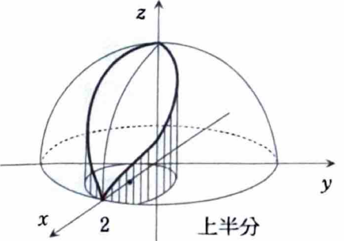
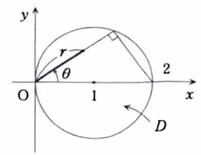

例題 7-6（体積）

> **この問題で使う前提知識**
>
> $xy$ 平面上の領域 $D$ において、立体の上面が
>
> $$
> z=f_{\mathrm{上}}(x,y)
> $$
>
> 下面が
>
> $$
> z=f_{\mathrm{下}}(x,y)
> $$
>
> で表されるとき、その体積は
>
> $$
> V
> =
> \iint_D
> \left\{
> f_{\mathrm{上}}(x,y)-f_{\mathrm{下}}(x,y)
> \right\}dxdy
> $$
>
> で求められる。
>
> 積分領域が円で表される場合は、
>
> $$
> x=r\cos\theta,
> \qquad
> y=r\sin\theta,
> \qquad
> dxdy=r\,drd\theta
> $$
>
> を用いる。

球面

$$
x^2+y^2+z^2=4
$$

と円柱

$$
(x-1)^2+y^2=1
$$

で囲まれた立体の体積を求めよ。

---

## 解答

> **解法を選ぶ理由**
>
> 円柱は $z$ に依存しないため、立体を $xy$ 平面へ射影すると、
>
> $$
> D:\ (x-1)^2+y^2\le1
> $$
>
> という円板になる。
>
> 球面からは上面と下面を
>
> $$
> z=\pm\sqrt{4-x^2-y^2}
> $$
>
> と表せるため、高さは
>
> $$
> 2\sqrt{4-x^2-y^2}
> $$
>
> である。
>
> 射影領域は原点を通る円であり、極座標では
>
> $$
> 0\le r\le2\cos\theta
> $$
>
> と簡単に表せる。三重積分で直接計算する方法もあるが、上下の差を二重積分するほうが積分回数が少なく簡単である。

立体とその上半分は次の図のようになる。

球面の式

$$
x^2+y^2+z^2=4
$$

を $z$ について解く。まず、

$$
z^2=4-x^2-y^2
$$

であるから、

$$
z=\pm\sqrt{4-x^2-y^2}
$$

となる。

上面は、

$$
z_{\mathrm{上}}
=
\sqrt{4-x^2-y^2}
$$

であり、下面は、

$$
z_{\mathrm{下}}
=
-\sqrt{4-x^2-y^2}
$$

である。したがって、高さは、

$$
z_{\mathrm{上}}-z_{\mathrm{下}}
=
\sqrt{4-x^2-y^2}
-
\left(
-\sqrt{4-x^2-y^2}
\right)
$$

より、

$$
=
2\sqrt{4-x^2-y^2}
$$

である。

円柱の内部を $xy$ 平面へ射影した領域は、

$$
D:\ (x-1)^2+y^2\le1
$$

である。よって、求める体積を $V$ とすると、

$$
V
=
2\iint_D\sqrt{4-x^2-y^2}\,dxdy
$$

となる。

次に、領域 $D$ を極座標で表す。まず、境界式を展開すると、

$$
(x-1)^2+y^2=1
$$

より、

$$
x^2-2x+1+y^2=1
$$

である。両辺から $1$ を引くと、

$$
x^2+y^2=2x
$$

となる。

極座標

$$
x=r\cos\theta,
\qquad
y=r\sin\theta
$$

を代入すると、

$$
r^2=2r\cos\theta
$$

である。$r\ge0$ なので、境界は、

$$
r=2\cos\theta
$$

と表せる。

領域内で $r\ge0$ かつ $2\cos\theta\ge0$ となる必要があるため、

$$
-\frac{\pi}{2}\le\theta\le\frac{\pi}{2}
$$

である。したがって、

$$
0\le r\le2\cos\theta,
\qquad
-\frac{\pi}{2}\le\theta\le\frac{\pi}{2}
$$

となる。

被積分関数は、

$$
\sqrt{4-x^2-y^2}
=
\sqrt{4-r^2}
$$

となり、面積要素は、

$$
dxdy=r\,drd\theta
$$

となる。よって、

$$
V
=
2
\int_{-\pi/2}^{\pi/2}
\int_0^{2\cos\theta}
r\sqrt{4-r^2}\,drd\theta
$$

である。

内側の積分を計算する。文字だけの置換

$$
u=4-r^2
$$

を行うと、

$$
du=-2r\,dr
$$

である。したがって、

$$
\int r\sqrt{4-r^2}\,dr
=
-\frac12\int u^{1/2}\,du
$$

となる。積分すると、

$$
=
-\frac12\cdot\frac23u^{3/2}
=
-\frac13(4-r^2)^{3/2}
$$

である。

よって、

$$
\int_0^{2\cos\theta}
r\sqrt{4-r^2}\,dr
=
\left[
-\frac13(4-r^2)^{3/2}
\right]_{r=0}^{r=2\cos\theta}
$$

となる。

上端 $r=2\cos\theta$ を代入すると、

$$
-\frac13
\left(
4-4\cos^2\theta
\right)^{3/2}
$$

である。三角関数の公式

$$
1-\cos^2\theta=\sin^2\theta
$$

を用いると、

$$
4-4\cos^2\theta
=
4\sin^2\theta
$$

なので、

$$
\left(4\sin^2\theta\right)^{3/2}
=
8|\sin\theta|^3
$$

である。したがって、上端の値は、

$$
-\frac83|\sin\theta|^3
$$

となる。

下端 $r=0$ を代入すると、

$$
-\frac13(4-0^2)^{3/2}
=
-\frac13\cdot8
=
-\frac83
$$

である。よって、

$$
\int_0^{2\cos\theta}
r\sqrt{4-r^2}\,dr
=
-\frac83|\sin\theta|^3
-
\left(-\frac83\right)
$$

より、

$$
=
\frac83
\left(
1-|\sin\theta|^3
\right)
$$

となる。

したがって、

$$
V
=
2
\int_{-\pi/2}^{\pi/2}
\frac83
\left(
1-|\sin\theta|^3
\right)d\theta
$$

である。関数 $1-|\sin\theta|^3$ は偶関数なので、

$$
\int_{-\pi/2}^{\pi/2}
\left(
1-|\sin\theta|^3
\right)d\theta
=
2
\int_0^{\pi/2}
\left(
1-\sin^3\theta
\right)d\theta
$$

である。したがって、

$$
V
=
\frac{32}{3}
\int_0^{\pi/2}
\left(
1-\sin^3\theta
\right)d\theta
$$

となる。

ここで、

$$
\sin^3\theta
=
\sin\theta(1-\cos^2\theta)
$$

と変形する。よって、

$$
\int_0^{\pi/2}\sin^3\theta\,d\theta
=
\int_0^{\pi/2}
\sin\theta(1-\cos^2\theta)\,d\theta
$$

である。

文字だけの置換

$$
u=\cos\theta
$$

を行うと、

$$
du=-\sin\theta\,d\theta
$$

である。積分範囲は、$\theta=0$ のとき $u=1$、$\theta=\dfrac{\pi}{2}$ のとき $u=0$ である。したがって、

$$
\int_0^{\pi/2}\sin^3\theta\,d\theta
=
-\int_1^0(1-u^2)\,du
=
\int_0^1(1-u^2)\,du
$$

となる。積分すると、

$$
=
\left[
u-\frac{u^3}{3}
\right]_0^1
=
1-\frac13
=
\frac23
$$

である。

また、

$$
\int_0^{\pi/2}1\,d\theta
=
\frac{\pi}{2}
$$

なので、

$$
\int_0^{\pi/2}
\left(
1-\sin^3\theta
\right)d\theta
=
\frac{\pi}{2}-\frac23
$$

となる。

したがって、

$$
\boxed{
V
=
\frac{32}{3}
\left(
\frac{\pi}{2}-\frac23
\right)
}
$$
