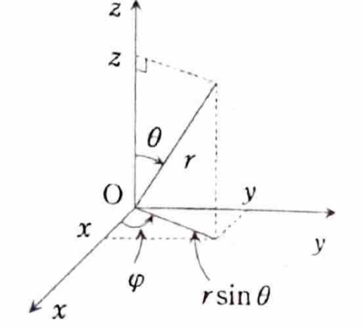

例題 7-7（三重積分）

> **この問題で使う前提知識**
>
> 空間の極座標、すなわち球座標を
>
> $$
> x=r\sin\theta\cos\varphi,
> \qquad
> y=r\sin\theta\sin\varphi,
> \qquad
> z=r\cos\theta
> $$
>
> と定める。
>
> ここで、
>
> $$
> r\ge0,
> \qquad
> 0\le\theta\le\pi,
> \qquad
> 0\le\varphi\le2\pi
> $$
>
> である。
>
> ヤコビアンの絶対値は、
>
> $$
> \left|
> \frac{\partial(x,y,z)}{\partial(r,\theta,\varphi)}
> \right|
> =
> r^2\sin\theta
> $$
>
> なので、
>
> $$
> dxdydz=r^2\sin\theta\,drd\theta d\varphi
> $$
>
> となる。
>
> 

ただし、$a$ は正定数とする。次の三重積分の値を求めよ。

$$
\iiint_D(x^2+y^2)\,dxdydz,
\qquad
D:\ x^2+y^2+z^2\le a^2
$$

---

## 解答

> **解法を選ぶ理由**
>
> 積分領域は原点を中心とする半径 $a$ の球であるため、球座標を用いると積分範囲が
>
> $$
> 0\le r\le a,
> \qquad
> 0\le\theta\le\pi,
> \qquad
> 0\le\varphi\le2\pi
> $$
>
> という直方体状の範囲になる。
>
> また、
>
> $$
> x^2+y^2=r^2\sin^2\theta
> $$
>
> と簡単に表せる。
>
> 円柱座標で $z$ を先に積分する方法もあるが、球の上下端に平方根が現れるため、球座標のほうが自然である。

球座標変換を

$$
x=r\sin\theta\cos\varphi,
\qquad
y=r\sin\theta\sin\varphi,
\qquad
z=r\cos\theta
$$

とする。

まず、領域の式を変換する。文字だけで計算すると、

$$
x^2+y^2+z^2
=
r^2\sin^2\theta\cos^2\varphi
+
r^2\sin^2\theta\sin^2\varphi
+
r^2\cos^2\theta
$$

である。前二項から $r^2\sin^2\theta$ をくくると、

$$
=
r^2\sin^2\theta
\left(
\cos^2\varphi+\sin^2\varphi
\right)
+
r^2\cos^2\theta
$$

となる。三角関数の公式

$$
\cos^2\varphi+\sin^2\varphi=1
$$

を用いると、

$$
=
r^2\sin^2\theta+r^2\cos^2\theta
$$

である。さらに、

$$
\sin^2\theta+\cos^2\theta=1
$$

なので、

$$
x^2+y^2+z^2=r^2
$$

となる。

したがって、球

$$
x^2+y^2+z^2\le a^2
$$

は、

$$
0\le r\le a,
\qquad
0\le\theta\le\pi,
\qquad
0\le\varphi\le2\pi
$$

へ移る。

次に、被積分関数を変換する。

$$
x^2+y^2
=
r^2\sin^2\theta\cos^2\varphi
+
r^2\sin^2\theta\sin^2\varphi
$$

である。$r^2\sin^2\theta$ をくくると、

$$
x^2+y^2
=
r^2\sin^2\theta
\left(
\cos^2\varphi+\sin^2\varphi
\right)
$$

となる。したがって、

$$
x^2+y^2=r^2\sin^2\theta
$$

である。

ヤコビアンを掛けると、

$$
(x^2+y^2)\,dxdydz
=
r^2\sin^2\theta
\cdot
r^2\sin\theta\,drd\theta d\varphi
$$

となる。整理すると、

$$
=
r^4\sin^3\theta\,drd\theta d\varphi
$$

である。

よって、

$$
\iiint_D(x^2+y^2)\,dxdydz
=
\int_0^{2\pi}
\int_0^\pi
\int_0^a
r^4\sin^3\theta\,drd\theta d\varphi
$$

となる。被積分関数は各変数の因子に分かれているので、

$$
=
\left(
\int_0^ar^4\,dr
\right)
\left(
\int_0^\pi\sin^3\theta\,d\theta
\right)
\left(
\int_0^{2\pi}d\varphi
\right)
$$

である。

動径方向の積分は、

$$
\int_0^ar^4\,dr
=
\left[
\frac{r^5}{5}
\right]_0^a
=
\frac{a^5}{5}
$$

となる。

角度 $\varphi$ の積分は、

$$
\int_0^{2\pi}d\varphi
=
\left[
\varphi
\right]_0^{2\pi}
=
2\pi
$$

である。

次に、

$$
\int_0^\pi\sin^3\theta\,d\theta
$$

を求める。まず、

$$
\sin^3\theta
=
\sin\theta(1-\cos^2\theta)
$$

と変形する。ここで、

$$
u=\cos\theta
$$

と置くと、

$$
du=-\sin\theta\,d\theta
$$

である。積分範囲は、$\theta=0$ のとき $u=1$、$\theta=\pi$ のとき $u=-1$ である。したがって、

$$
\int_0^\pi\sin^3\theta\,d\theta
=
-\int_1^{-1}(1-u^2)\,du
$$

となる。上下端を交換すると、

$$
=
\int_{-1}^1(1-u^2)\,du
$$

である。積分すると、

$$
=
\left[
u-\frac{u^3}{3}
\right]_{-1}^1
$$

となる。上端の値は、

$$
1-\frac13=\frac23
$$

であり、下端の値は、

$$
-1-\frac{(-1)^3}{3}
=
-1+\frac13
=
-\frac23
$$

である。したがって、

$$
\int_0^\pi\sin^3\theta\,d\theta
=
\frac23-\left(-\frac23\right)
=
\frac43
$$

となる。

以上を代入すると、

$$
\iiint_D(x^2+y^2)\,dxdydz
=
\frac{a^5}{5}\cdot\frac43\cdot2\pi
$$

である。係数を整理すると、

$$
=
\frac{8}{15}\pi a^5
$$

となる。

したがって、

$$
\boxed{
\iiint_D(x^2+y^2)\,dxdydz
=
\frac{8}{15}\pi a^5
}
$$
