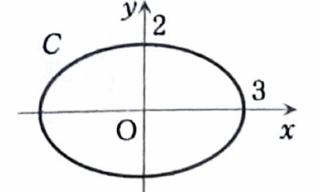

第7章 章末問題 4

> **この問題で使う前提知識**
>
> 楕円
>
> $$
> \frac{x^2}{a^2}+\frac{y^2}{b^2}=1
> $$
>
> の内部は、変数変換
>
> $$
> x=ar\cos\theta,
> \qquad
> y=br\sin\theta
> $$
>
> により、
>
> $$
> 0\le r\le1,
> \qquad
> 0\le\theta\le2\pi
> $$
>
> へ移る。
>
> この変換のヤコビアンの絶対値は、
>
> $$
> \left|
> \frac{\partial(x,y)}{\partial(r,\theta)}
> \right|
> =
> ab\,r
> $$
>
> である。

媒介変数表示された曲線

$$
C:\ x=3\cos t,\qquad y=2\sin t
\qquad
(0\le t\le2\pi)
$$

を図示し、この曲線で囲まれた図形 $D$ 上の重積分

$$
\iint_D(xy+1)\,dxdy
$$

の値を求めよ。

---

## 解答

> **解法を選ぶ理由**
>
> 与えられた媒介変数表示は、$x$ 方向の半径が $3$、$y$ 方向の半径が $2$ の楕円を表す。
>
> そこで、楕円を単位円板へ移す変数変換
>
> $$
> x=3r\cos\theta,
> \qquad
> y=2r\sin\theta
> $$
>
> を用いる。
>
> 直交座標のまま積分すると、楕円の上下端
>
> $$
> y=\pm2\sqrt{1-\frac{x^2}{9}}
> $$
>
> が現れる。被積分関数 $xy+1$ は積分できるが、変数変換のほうが対称性も明確で計算が短い。

まず、曲線の式を確認する。媒介変数表示から、

$$
\frac{x}{3}=\cos t
$$

および

$$
\frac{y}{2}=\sin t
$$

である。両辺を二乗して加えると、

$$
\frac{x^2}{9}+\frac{y^2}{4}
=
\cos^2t+\sin^2t
$$

となる。三角関数の基本公式より、

$$
\cos^2t+\sin^2t=1
$$

なので、

$$
\frac{x^2}{9}+\frac{y^2}{4}=1
$$

である。

したがって、$C$ は原点を中心とし、$x$ 軸方向の半径が $3$、$y$ 軸方向の半径が $2$ の楕円である。図形 $D$ は、

$$
D:
\frac{x^2}{9}+\frac{y^2}{4}\le1
$$

である。

変数変換を

$$
x=3r\cos\theta,
\qquad
y=2r\sin\theta
$$

とする。

このとき、

$$
\frac{x^2}{9}+\frac{y^2}{4}
=
r^2\cos^2\theta+r^2\sin^2\theta
=
r^2
$$

なので、領域 $D$ は、

$$
E:\ 0\le r\le1,
\qquad
0\le\theta\le2\pi
$$

へ移る。

ヤコビアンを計算する。各偏微分は、

$$
\frac{\partial x}{\partial r}=3\cos\theta,
\qquad
\frac{\partial x}{\partial\theta}=-3r\sin\theta
$$

であり、

$$
\frac{\partial y}{\partial r}=2\sin\theta,
\qquad
\frac{\partial y}{\partial\theta}=2r\cos\theta
$$

である。したがって、

$$
\frac{\partial(x,y)}{\partial(r,\theta)}
=
\begin{vmatrix}
3\cos\theta&-3r\sin\theta\\
2\sin\theta&2r\cos\theta
\end{vmatrix}
$$

となる。行列式を展開すると、

$$
=
3\cos\theta\cdot2r\cos\theta
-
(-3r\sin\theta)\cdot2\sin\theta
$$

より、

$$
=
6r\cos^2\theta+6r\sin^2\theta
$$

である。したがって、

$$
\frac{\partial(x,y)}{\partial(r,\theta)}
=
6r
\left(
\cos^2\theta+\sin^2\theta
\right)
=
6r
$$

となる。$r\ge0$ なので、

$$
\left|
\frac{\partial(x,y)}{\partial(r,\theta)}
\right|
=
6r
$$

である。

被積分関数を変換する。まず、

$$
xy
=
(3r\cos\theta)(2r\sin\theta)
$$

なので、

$$
xy=6r^2\sin\theta\cos\theta
$$

である。したがって、

$$
xy+1
=
6r^2\sin\theta\cos\theta+1
$$

となる。

変数変換の公式より、

$$
\iint_D(xy+1)\,dxdy
=
\int_0^{2\pi}
\int_0^1
\left(
6r^2\sin\theta\cos\theta+1
\right)6r\,drd\theta
$$

である。積を展開すると、

$$
=
\int_0^{2\pi}
\int_0^1
\left(
36r^3\sin\theta\cos\theta+6r
\right)drd\theta
$$

となる。

内側の積分を計算する。まず文字だけで、

$$
\int
\left(
36r^3\sin\theta\cos\theta+6r
\right)dr
$$

を積分すると、

$$
=
9r^4\sin\theta\cos\theta+3r^2
$$

である。したがって、

$$
\int_0^1
\left(
36r^3\sin\theta\cos\theta+6r
\right)dr
=
\left[
9r^4\sin\theta\cos\theta+3r^2
\right]_0^1
$$

となる。上端と下端を代入すると、

$$
=
9\sin\theta\cos\theta+3
$$

である。

よって、

$$
\iint_D(xy+1)\,dxdy
=
\int_0^{2\pi}
\left(
9\sin\theta\cos\theta+3
\right)d\theta
$$

となる。

第1項について、

$$
\sin\theta\cos\theta
=
\frac12\sin2\theta
$$

なので、

$$
\int_0^{2\pi}9\sin\theta\cos\theta\,d\theta
=
\frac92
\int_0^{2\pi}\sin2\theta\,d\theta
$$

である。積分すると、

$$
=
\frac92
\left[
-\frac12\cos2\theta
\right]_0^{2\pi}
=
0
$$

となる。

> この項が $0$ になることは、領域 $D$ が $x$ 軸および $y$ 軸に関して対称であり、$xy$ が軸をまたぐと符号を変えることからも分かる。

第2項は、

$$
\int_0^{2\pi}3\,d\theta
=
3
\left[
\theta
\right]_0^{2\pi}
=
6\pi
$$

である。

したがって、

$$
\boxed{
\iint_D(xy+1)\,dxdy
=
6\pi
}
$$
