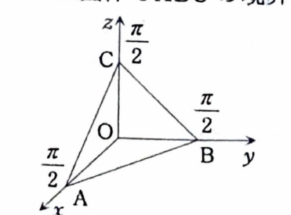

第7章 章末問題 5

> **この問題で使う前提知識**
>
> 第1象限・第1八分体では、座標がすべて非負である。
>
> 平面
>
> $$
> x+y+z=c
> $$
>
> と三つの座標平面で囲まれる領域は四面体になる。
>
> 三重積分を $z$ から計算するとき、固定した $(x,y)$ に対して
>
> $$
> 0\le z\le c-x-y
> $$
>
> となり、$xy$ 平面への射影領域は
>
> $$
> x\ge0,\qquad y\ge0,\qquad x+y\le c
> $$
>
> である。
>
> **資料の要項 7.5「微分と積分の順序交換」**
>
> $a\le x\le b,\ c\le y\le d$ で定義された関数 $f(x,y)$ について、$f$ が連続なら、
>
> $$
> F(x)=\int_c^df(x,y)\,dy
> $$
>
> は $x$ の連続関数である。
>
> また、$\dfrac{\partial f}{\partial x}$ が連続なら、
>
> $$
> \frac{d}{dx}
> \int_c^df(x,y)\,dy
> =
> \int_c^d
> \frac{\partial f}{\partial x}(x,y)\,dy
> $$
>
> が成り立つ。この章末問題では直接使用しないが、資料に掲載された重積分に関する基本定理である。

重積分に関する以下の問いに答えよ。

---

## (1)

領域

$$
D=
\left\{
(x,y,z)
\mathrel{}\middle|\mathrel{}
x\ge0,\ y\ge0,\ z\ge0,\ x+y+z\le\frac{\pi}{2}
\right\}
$$

を図示せよ。

---

## (1) 解答

> **解法を選ぶ理由**
>
> 領域を図示するには、まず境界となる平面
>
> $$
> x+y+z=\frac{\pi}{2}
> $$
>
> が各座標軸と交わる点を求める。
>
> その平面と三つの座標平面
>
> $$
> x=0,\qquad y=0,\qquad z=0
> $$
>
> に囲まれた第1八分体内の部分が求める領域である。

境界平面は、

$$
x+y+z=\frac{\pi}{2}
$$

である。

$x$ 軸との交点では、

$$
y=0,\qquad z=0
$$

である。これを平面の式へ代入すると、

$$
x+0+0=\frac{\pi}{2}
$$

なので、

$$
x=\frac{\pi}{2}
$$

である。したがって、$x$ 軸上の頂点は、

$$
A=\left(\frac{\pi}{2},0,0\right)
$$

である。

$y$ 軸との交点では、

$$
x=0,\qquad z=0
$$

である。平面の式へ代入すると、

$$
0+y+0=\frac{\pi}{2}
$$

なので、

$$
y=\frac{\pi}{2}
$$

である。したがって、$y$ 軸上の頂点は、

$$
B=\left(0,\frac{\pi}{2},0\right)
$$

である。

$z$ 軸との交点では、

$$
x=0,\qquad y=0
$$

である。平面の式へ代入すると、

$$
0+0+z=\frac{\pi}{2}
$$

なので、

$$
z=\frac{\pi}{2}
$$

である。したがって、$z$ 軸上の頂点は、

$$
C=\left(0,0,\frac{\pi}{2}\right)
$$

である。

また、原点を

$$
O=(0,0,0)
$$

とする。

したがって、領域 $D$ は、四つの頂点

$$
O,\qquad A,\qquad B,\qquad C
$$

を持つ四面体の境界および内部である。

領域を逐次積分の範囲として表すと、例えば、

$$
0\le x\le\frac{\pi}{2}
$$

であり、固定した $x$ に対して、

$$
0\le y\le\frac{\pi}{2}-x
$$

である。さらに、固定した $x,y$ に対して、

$$
0\le z\le\frac{\pi}{2}-x-y
$$

となる。

よって、図示された領域は、

$$
\boxed{
D=
\left\{
(x,y,z)
\mathrel{}\middle|\mathrel{}
0\le x\le\frac{\pi}{2},\
0\le y\le\frac{\pi}{2}-x,\
0\le z\le\frac{\pi}{2}-x-y
\right\}
}
$$

と表せる四面体である。

---

## (2)

ただし、$a$ は定数とする。次の不定積分を求めよ。

$$
\int x\sin(a+x)\,dx
$$

---

## (2) 解答

> **解法を選ぶ理由**
>
> 被積分関数は、
>
> $$
> x
> $$
>
> と
>
> $$
> \sin(a+x)
> $$
>
> の積である。
>
> $x$ を微分すると $1$ になり、$\sin(a+x)$ は容易に積分できるため、部分積分を用いる。
>
> 置換 $u=a+x$ を先に行う方法もあるが、その場合も $(u-a)\sin u$ を部分積分することになり、計算量は同じである。ここでは資料に合わせて直接部分積分する。

部分積分の公式は、

$$
\int u\,dv
=
uv-\int v\,du
$$

である。

今回、

$$
u=x
$$

と置き、

$$
dv=\sin(a+x)\,dx
$$

と置く。

まず、

$$
du=dx
$$

である。

次に $v$ を求める。文字だけの式として、

$$
\frac{d}{dx}\cos(a+x)
=
-\sin(a+x)\cdot\frac{d}{dx}(a+x)
$$

である。$a$ は定数なので、

$$
\frac{d}{dx}(a+x)=1
$$

である。したがって、

$$
\frac{d}{dx}\{-\cos(a+x)\}
=
\sin(a+x)
$$

となり、

$$
v=\int\sin(a+x)\,dx
=
-\cos(a+x)
$$

である。

部分積分の公式へ代入すると、

$$
\int x\sin(a+x)\,dx
=
x\{-\cos(a+x)\}
-
\int\{-\cos(a+x)\}\,dx
$$

となる。整理すると、

$$
=
-x\cos(a+x)
+
\int\cos(a+x)\,dx
$$

である。

$\cos(a+x)$ の原始関数は $\sin(a+x)$ なので、

$$
\int\cos(a+x)\,dx
=
\sin(a+x)
$$

である。したがって、

$$
\int x\sin(a+x)\,dx
=
-x\cos(a+x)+\sin(a+x)+C
$$

となる。ここで $C$ は積分定数である。

よって、

$$
\boxed{
\int x\sin(a+x)\,dx
=
-x\cos(a+x)+\sin(a+x)+C
}
$$

> 検算として右辺を微分すると、
>
> $$
> \frac{d}{dx}\{-x\cos(a+x)\}
> =
> -\cos(a+x)+x\sin(a+x)
> $$
>
> であり、
>
> $$
> \frac{d}{dx}\sin(a+x)
> =
> \cos(a+x)
> $$
>
> である。二つを加えると、
>
> $$
> x\sin(a+x)
> $$
>
> となり、元の被積分関数と一致する。

---

## (3)

小問 (1) の $D$ を積分領域として、次の三重積分の値を求めよ。

$$
\iiint_Dz\sin(x+y+z)\,dxdydz
$$

---

## (3) 解答

> **解法を選ぶ理由**
>
> 固定した $x,y$ に対して、$z$ の範囲は、
>
> $$
> 0\le z\le\frac{\pi}{2}-x-y
> $$
>
> である。
>
> 内側の積分は、
>
> $$
> \int z\sin\{(x+y)+z\}\,dz
> $$
>
> となり、小問 (2) の公式で
>
> $$
> a=x+y,\qquad x\text{ を }z\text{ に置き換える}
> $$
>
> と、そのまま計算できる。
>
> 先に $x$ または $y$ を積分する方法もあるが、$z$ を先に積分すると上端で $x+y+z=\dfrac{\pi}{2}$ となり、三角関数の値が簡単になるため、この順序を選ぶ。

小問 (1) で求めた積分範囲を用いると、

$$
0\le x\le\frac{\pi}{2}
$$

であり、

$$
0\le y\le\frac{\pi}{2}-x
$$

である。さらに、

$$
0\le z\le\frac{\pi}{2}-x-y
$$

である。

したがって、

$$
\iiint_Dz\sin(x+y+z)\,dxdydz
=
\int_0^{\pi/2}
\int_0^{\pi/2-x}
\int_0^{\pi/2-x-y}
z\sin(x+y+z)\,dzdydx
$$

となる。

内側の積分を計算する。小問 (2) の文字だけの公式

$$
\int t\sin(a+t)\,dt
=
-t\cos(a+t)+\sin(a+t)+C
$$

を用いる。

ここで、

$$
t=z
$$

および

$$
a=x+y
$$

を代入すると、

$$
\int z\sin(x+y+z)\,dz
=
-z\cos(x+y+z)+\sin(x+y+z)
$$

となる。

したがって、

$$
\int_0^{\pi/2-x-y}
z\sin(x+y+z)\,dz
$$

は、

$$
=
\left[
-z\cos(x+y+z)+\sin(x+y+z)
\right]_{z=0}^{z=\pi/2-x-y}
$$

である。

まず上端

$$
z=\frac{\pi}{2}-x-y
$$

を代入する。このとき、

$$
x+y+z
=
x+y+\frac{\pi}{2}-x-y
=
\frac{\pi}{2}
$$

である。したがって、上端の値は、

$$
-\left(
\frac{\pi}{2}-x-y
\right)
\cos\frac{\pi}{2}
+
\sin\frac{\pi}{2}
$$

となる。

$$
\cos\frac{\pi}{2}=0
$$

および

$$
\sin\frac{\pi}{2}=1
$$

なので、上端の値は、

$$
1
$$

である。

次に下端 $z=0$ を代入すると、

$$
-0\cdot\cos(x+y)+\sin(x+y)
=
\sin(x+y)
$$

である。

したがって、内側の積分は、

$$
1-\sin(x+y)
$$

となる。

よって、三重積分は二重積分

$$
\int_0^{\pi/2}
\int_0^{\pi/2-x}
\{1-\sin(x+y)\}\,dydx
$$

に帰着する。

まず $y$ について積分する。文字だけで、

$$
\int\{1-\sin(x+y)\}\,dy
$$

を積分すると、

$$
y+\cos(x+y)
$$

である。なぜなら、

$$
\frac{d}{dy}\cos(x+y)
=
-\sin(x+y)
$$

だからである。

したがって、

$$
\int_0^{\pi/2-x}
\{1-\sin(x+y)\}\,dy
=
\left[
y+\cos(x+y)
\right]_{y=0}^{y=\pi/2-x}
$$

となる。

上端 $y=\dfrac{\pi}{2}-x$ を代入すると、

$$
\frac{\pi}{2}-x
+
\cos\left(
x+\frac{\pi}{2}-x
\right)
$$

である。括弧内を整理すると、

$$
=
\frac{\pi}{2}-x+\cos\frac{\pi}{2}
$$

となり、

$$
=
\frac{\pi}{2}-x
$$

である。

下端 $y=0$ を代入すると、

$$
0+\cos(x+0)
=
\cos x
$$

である。したがって、

$$
\int_0^{\pi/2-x}
\{1-\sin(x+y)\}\,dy
=
\frac{\pi}{2}-x-\cos x
$$

となる。

よって、

$$
\iiint_Dz\sin(x+y+z)\,dxdydz
=
\int_0^{\pi/2}
\left(
\frac{\pi}{2}-x-\cos x
\right)dx
$$

である。

各項を積分すると、

$$
\int\frac{\pi}{2}\,dx
=
\frac{\pi}{2}x
$$

であり、

$$
\int x\,dx=\frac{x^2}{2}
$$

であり、

$$
\int\cos x\,dx=\sin x
$$

である。したがって、

$$
\int_0^{\pi/2}
\left(
\frac{\pi}{2}-x-\cos x
\right)dx
=
\left[
\frac{\pi}{2}x-\frac{x^2}{2}-\sin x
\right]_0^{\pi/2}
$$

となる。

上端 $x=\dfrac{\pi}{2}$ を代入すると、

$$
\frac{\pi}{2}\cdot\frac{\pi}{2}
-
\frac12
\left(
\frac{\pi}{2}
\right)^2
-
\sin\frac{\pi}{2}
$$

である。各項を計算すると、

$$
=
\frac{\pi^2}{4}
-
\frac{\pi^2}{8}
-
1
$$

より、

$$
=
\frac{\pi^2}{8}-1
$$

である。

下端 $x=0$ を代入すると、

$$
0-0-\sin0=0
$$

である。

したがって、

$$
\boxed{
\iiint_Dz\sin(x+y+z)\,dxdydz
=
\frac{\pi^2}{8}-1
}
$$
