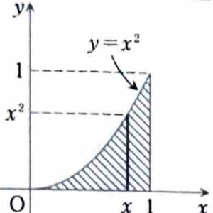
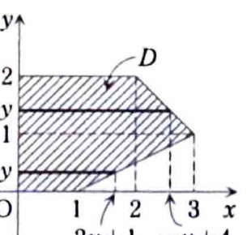

類題 7-1

> **この問題で使う前提知識**
>
> 二重積分は、積分領域を縦または横に切ったときの範囲を読み取り、逐次積分に直して計算する。
>
> $x$ を固定した縦線で領域を表せるときは、
>
> $$
> \iint_D f(x,y)\,dxdy
> =
> \int_a^b
> \left(
> \int_{\varphi_1(x)}^{\varphi_2(x)}f(x,y)\,dy
> \right)dx
> $$
>
> を用いる。
>
> 一方、$y$ を固定した横線で領域を表すほうが簡単な場合は、
>
> $$
> \iint_D f(x,y)\,dxdy
> =
> \int_c^d
> \left(
> \int_{\psi_1(y)}^{\psi_2(y)}f(x,y)\,dx
> \right)dy
> $$
>
> を用いる。領域の境界式が途中で変わる場合は、その高さまたは位置で積分を分割する。

次の二重積分を計算せよ。

---

## (1)

$$
\iint_D\frac{x}{1+y}\,dxdy,
\qquad
D:\ 0\le x\le1,\ 0\le y\le x^2
$$

---

## (1) 解答

> **解法を選ぶ理由**
>
> 領域は
>
> $$
> 0\le x\le1,
> \qquad
> 0\le y\le x^2
> $$
>
> と、$x$ を外側、$y$ を内側にする形でそのまま与えられている。
>
> また、$y$ について積分すると
>
> $$
> \int\frac{1}{1+y}\,dy=\log|1+y|
> $$
>
> が使える。積分範囲では $1+y>0$ なので、絶対値を外して $\log(1+y)$ と書ける。
>
> 積分順序を逆にする方法もあるが、その場合は $x\ge\sqrt y$ を扱う必要があり、資料の方法より複雑になる。そのため $y$ から積分する。

積分領域は次の図の斜線部分である。

逐次積分に直すと、

$$
\iint_D\frac{x}{1+y}\,dxdy
=
\int_0^1
\left(
\int_0^{x^2}\frac{x}{1+y}\,dy
\right)dx
$$

となる。

内側の積分では $x$ は定数なので、

$$
\int\frac{x}{1+y}\,dy
=
x\int\frac{1}{1+y}\,dy
=
x\log(1+y)
$$

である。したがって、

$$
\int_0^{x^2}\frac{x}{1+y}\,dy
=
\left[x\log(1+y)\right]_{y=0}^{y=x^2}
$$

となる。

上端 $y=x^2$ を代入すると、

$$
x\log(1+x^2)
$$

であり、下端 $y=0$ を代入すると、

$$
x\log(1+0)
=
x\log1
=
0
$$

である。よって、

$$
\int_0^{x^2}\frac{x}{1+y}\,dy
=
x\log(1+x^2)
$$

となる。

したがって、

$$
\iint_D\frac{x}{1+y}\,dxdy
=
\int_0^1x\log(1+x^2)\,dx
$$

である。

> ここからは部分積分を用いる。
>
> 部分積分の公式は、文字だけで書くと
>
> $$
> \int u\,dv=uv-\int v\,du
> $$
>
> である。
>
> 今回は対数関数を微分すると簡単になるため、
>
> $$
> u=\log(1+x^2),
> \qquad
> dv=x\,dx
> $$
>
> と選ぶ。

このとき、

$$
du=\frac{2x}{1+x^2}\,dx
$$

であり、

$$
v=\int x\,dx=\frac{x^2}{2}
$$

である。したがって、部分積分より、

$$
\int_0^1x\log(1+x^2)\,dx
=
\left[
\frac{x^2}{2}\log(1+x^2)
\right]_0^1
-
\int_0^1
\frac{x^2}{2}\cdot\frac{2x}{1+x^2}\,dx
$$

となる。第2項を整理すると、

$$
=
\left[
\frac{x^2}{2}\log(1+x^2)
\right]_0^1
-
\int_0^1\frac{x^3}{1+x^2}\,dx
$$

である。

まず境界項は、

$$
\left[
\frac{x^2}{2}\log(1+x^2)
\right]_0^1
=
\frac{1^2}{2}\log(1+1^2)
-
\frac{0^2}{2}\log(1+0^2)
=
\frac12\log2
$$

となる。

次に、分子 $x^3$ を

$$
x^3=x(1+x^2)-x
$$

と変形すると、

$$
\frac{x^3}{1+x^2}
=
\frac{x(1+x^2)-x}{1+x^2}
=
x-\frac{x}{1+x^2}
$$

である。よって、

$$
\int_0^1\frac{x^3}{1+x^2}\,dx
=
\int_0^1
\left(
x-\frac{x}{1+x^2}
\right)dx
$$

となる。

それぞれ積分すると、

$$
\int x\,dx=\frac{x^2}{2}
$$

である。また、$1+x^2$ の微分が $2x$ であることから、

$$
\int\frac{x}{1+x^2}\,dx
=
\frac12\log(1+x^2)
$$

である。したがって、

$$
\int_0^1\frac{x^3}{1+x^2}\,dx
=
\left[
\frac{x^2}{2}
-
\frac12\log(1+x^2)
\right]_0^1
$$

となる。上端と下端を代入すると、

$$
=
\left(
\frac12-\frac12\log2
\right)
-
(0-0)
=
\frac12-\frac12\log2
$$

である。

以上を元の式へ代入すると、

$$
\int_0^1x\log(1+x^2)\,dx
=
\frac12\log2
-
\left(
\frac12-\frac12\log2
\right)
$$

となる。括弧を外して整理すると、

$$
=
\frac12\log2-\frac12+\frac12\log2
=
\log2-\frac12
$$

である。

したがって、

$$
\boxed{
\iint_D\frac{x}{1+y}\,dxdy
=
\log2-\frac12
}
$$

---

## (2)

$$
\iint_Dy\,dxdy
$$

ただし、$D$ は

$$
(0,0),\ (1,0),\ (3,1),\ (2,2),\ (0,2)
$$

を頂点とする五角形がつくる閉領域である。

---

## (2) 解答

> **解法を選ぶ理由**
>
> 被積分関数は $y$ だけの関数なので、先に $x$ について積分すると、
>
> $$
> \int y\,dx=yx
> $$
>
> となり簡単である。
>
> そのため、領域を水平な線分で切り、$y$ を外側の変数にする。
>
> 五角形の右側の境界は、$0\le y\le1$ と $1\le y\le2$ で別の直線になる。そのため、$y=1$ で積分を二つに分ける必要がある。

積分領域は次の図のようになる。

まず、点 $(1,0)$ と点 $(3,1)$ を通る直線の式を求める。

傾きは、文字だけの公式

$$
\text{傾き}
=
\frac{y_2-y_1}{x_2-x_1}
$$

に値を代入して、

$$
\frac{1-0}{3-1}
=
\frac12
$$

である。点 $(1,0)$ を通るので、

$$
y-0=\frac12(x-1)
$$

となる。これを $x$ について解くと、

$$
2y=x-1
$$

より、

$$
x=2y+1
$$

である。

したがって、$0\le y\le1$ では、

$$
0\le x\le2y+1
$$

となる。

次に、点 $(3,1)$ と点 $(2,2)$ を通る直線の傾きは、

$$
\frac{2-1}{2-3}
=
-1
$$

である。点 $(3,1)$ を通るので、

$$
y-1=-1(x-3)
$$

となる。整理すると、

$$
y-1=-x+3
$$

より、

$$
x=-y+4
$$

である。

したがって、$1\le y\le2$ では、

$$
0\le x\le-y+4
$$

となる。

よって、二重積分は

$$
\iint_Dy\,dxdy
=
\int_0^1
\left(
\int_0^{2y+1}y\,dx
\right)dy
+
\int_1^2
\left(
\int_0^{-y+4}y\,dx
\right)dy
$$

と分割できる。

第1の積分について、$y$ は $x$ に関して定数なので、

$$
\int y\,dx=yx
$$

である。したがって、

$$
\int_0^{2y+1}y\,dx
=
\left[yx\right]_{x=0}^{x=2y+1}
=
y(2y+1)-y\cdot0
=
2y^2+y
$$

となる。

同様に、第2の積分は、

$$
\int_0^{-y+4}y\,dx
=
\left[yx\right]_{x=0}^{x=-y+4}
=
y(-y+4)
=
-y^2+4y
$$

となる。

よって、

$$
\iint_Dy\,dxdy
=
\int_0^1(2y^2+y)\,dy
+
\int_1^2(-y^2+4y)\,dy
$$

である。

第1項を計算すると、

$$
\int_0^1(2y^2+y)\,dy
=
\left[
\frac23y^3+\frac12y^2
\right]_0^1
$$

である。上端と下端を代入して、

$$
=
\frac23+\frac12
=
\frac46+\frac36
=
\frac76
$$

となる。

第2項を計算すると、

$$
\int_1^2(-y^2+4y)\,dy
=
\left[
-\frac13y^3+2y^2
\right]_1^2
$$

である。まず上端 $y=2$ を代入すると、

$$
-\frac13\cdot2^3+2\cdot2^2
=
-\frac83+8
=
\frac{16}{3}
$$

である。次に下端 $y=1$ を代入すると、

$$
-\frac13\cdot1^3+2\cdot1^2
=
-\frac13+2
=
\frac53
$$

である。したがって、

$$
\int_1^2(-y^2+4y)\,dy
=
\frac{16}{3}-\frac53
=
\frac{11}{3}
$$

となる。

二つの結果を加えると、

$$
\iint_Dy\,dxdy
=
\frac76+\frac{11}{3}
$$

である。分母を $6$ にそろえると、

$$
\frac76+\frac{11}{3}
=
\frac76+\frac{22}{6}
=
\frac{29}{6}
$$

となる。

したがって、

$$
\boxed{\iint_Dy\,dxdy=\frac{29}{6}}
$$
