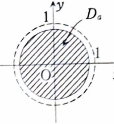
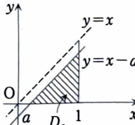

類題 7-4

> **この問題で使う前提知識**
>
> 被積分関数が領域の内部または境界で発散するときは、発散する部分を避けた近似領域 $D_a$ 上で積分し、最後に $a$ を極限へ近づける。
>
> $f(x,y)\ge0$ の場合、近似領域が元の領域へ単調に広がるように選べば、
>
> $$
> \iint_Df(x,y)\,dxdy
> =
> \lim\iint_{D_a}f(x,y)\,dxdy
> $$
>
> として計算できる。

次の二重積分を計算せよ。

---

## (1)

$$
\iint_D\frac{1}{\sqrt{1-x^2-y^2}}\,dxdy,
\qquad
D:\ x^2+y^2\le1
$$

---

## (1) 解答

> **解法を選ぶ理由**
>
> 被積分関数は円周
>
> $$
> x^2+y^2=1
> $$
>
> 上で分母が $0$ となり発散する。そのため、半径 $a<1$ の円板で近似し、$a\to1-0$ の極限を取る。
>
> 円板と $x^2+y^2$ が現れているので、極座標変換が最も簡単である。

$0<a<1$ として、

$$
D_a:\ x^2+y^2\le a^2
$$

と置く。

極座標変換を用いると、

$$
0\le r\le a,
\qquad
0\le\theta\le2\pi
$$

である。さらに、

$$
1-x^2-y^2=1-r^2
$$

および

$$
dxdy=r\,drd\theta
$$

なので、

$$
\iint_{D_a}
\frac{1}{\sqrt{1-x^2-y^2}}\,dxdy
=
\int_0^{2\pi}
\int_0^a
\frac{r}{\sqrt{1-r^2}}\,drd\theta
$$

となる。

内側の積分は $\theta$ に依存しないため、

$$
=
2\pi
\int_0^a
\frac{r}{\sqrt{1-r^2}}\,dr
$$

である。

ここで、文字だけの置換

$$
u=1-r^2
$$

を行う。微分すると、

$$
du=-2r\,dr
$$

であるから、

$$
r\,dr=-\frac12du
$$

である。したがって、

$$
\int\frac{r}{\sqrt{1-r^2}}\,dr
=
-\frac12\int u^{-1/2}\,du
$$

となる。積分すると、

$$
=
-\frac12\cdot2u^{1/2}
=
-\sqrt u
=
-\sqrt{1-r^2}
$$

である。

よって、

$$
\int_0^a
\frac{r}{\sqrt{1-r^2}}\,dr
=
\left[
-\sqrt{1-r^2}
\right]_0^a
$$

となる。上端と下端を代入すると、

$$
=
-\sqrt{1-a^2}
-
\left(-\sqrt{1-0^2}\right)
$$

より、

$$
=
1-\sqrt{1-a^2}
$$

である。

したがって、

$$
\iint_{D_a}
\frac{1}{\sqrt{1-x^2-y^2}}\,dxdy
=
2\pi\left(1-\sqrt{1-a^2}\right)
$$

となる。

$a\to1-0$ とすると、

$$
\sqrt{1-a^2}\to0
$$

なので、

$$
\iint_D\frac{1}{\sqrt{1-x^2-y^2}}\,dxdy
=
\lim_{a\to1-0}
2\pi\left(1-\sqrt{1-a^2}\right)
$$

より、

$$
=
2\pi(1-0)
=
2\pi
$$

となる。

したがって、

$$
\boxed{
\iint_D\frac{1}{\sqrt{1-x^2-y^2}}\,dxdy
=
2\pi
}
$$

---

## (2)

$$
\iint_D\frac{1}{\sqrt{x-y}}\,dxdy,
\qquad
D:\ 0\le y\le x,\ 0\le x\le1
$$

---

## (2) 解答

> **解法を選ぶ理由**
>
> 被積分関数は境界
>
> $$
> y=x
> $$
>
> 上で分母が $0$ となり発散する。
>
> そこで、境界から距離に相当する量 $a>0$ だけ離れた直線
>
> $$
> y=x-a
> $$
>
> までを積分し、最後に $a\to+0$ とする。
>
> $y$ から積分すると、$x-y$ の微分が $-1$ なので直接積分できる。積分順序を逆にする方法もあるが、同じ特異境界を扱う必要があり、この方法が資料に沿って最も明快である。

$0<a<1$ とし、近似領域を

$$
D_a:\ 0\le y\le x-a,\qquad a\le x\le1
$$

とする。

このとき、

$$
\iint_{D_a}\frac{1}{\sqrt{x-y}}\,dxdy
=
\int_a^1
\left(
\int_0^{x-a}
\frac{1}{\sqrt{x-y}}\,dy
\right)dx
$$

である。

内側の積分を計算する。$x$ は定数なので、

$$
u=x-y
$$

と置くと、

$$
du=-dy
$$

である。したがって、

$$
\int\frac{1}{\sqrt{x-y}}\,dy
=
-\int u^{-1/2}\,du
$$

となる。積分すると、

$$
=
-2u^{1/2}
=
-2\sqrt{x-y}
$$

である。

よって、

$$
\int_0^{x-a}
\frac{1}{\sqrt{x-y}}\,dy
=
\left[
-2\sqrt{x-y}
\right]_{y=0}^{y=x-a}
$$

となる。

上端 $y=x-a$ を代入すると、

$$
-2\sqrt{x-(x-a)}
=
-2\sqrt a
$$

である。下端 $y=0$ を代入すると、

$$
-2\sqrt{x-0}
=
-2\sqrt x
$$

である。したがって、

$$
\left[
-2\sqrt{x-y}
\right]_{y=0}^{y=x-a}
=
-2\sqrt a-(-2\sqrt x)
$$

より、

$$
=
2\sqrt x-2\sqrt a
$$

となる。

よって、

$$
\iint_{D_a}\frac{1}{\sqrt{x-y}}\,dxdy
=
\int_a^1
\left(
2\sqrt x-2\sqrt a
\right)dx
$$

である。

それぞれ積分すると、

$$
\int2\sqrt x\,dx
=
2\int x^{1/2}\,dx
=
2\cdot\frac23x^{3/2}
=
\frac43x^{3/2}
$$

である。また、$\sqrt a$ は $x$ に関して定数なので、

$$
\int2\sqrt a\,dx
=
2\sqrt a\,x
$$

である。したがって、

$$
\iint_{D_a}\frac{1}{\sqrt{x-y}}\,dxdy
=
\left[
\frac43x^{3/2}-2\sqrt a\,x
\right]_a^1
$$

となる。

上端 $x=1$ を代入すると、

$$
\frac43\cdot1^{3/2}-2\sqrt a\cdot1
=
\frac43-2\sqrt a
$$

である。

下端 $x=a$ を代入すると、

$$
\frac43a^{3/2}-2\sqrt a\cdot a
$$

である。ここで、

$$
\sqrt a\cdot a=a^{3/2}
$$

なので、

$$
\frac43a^{3/2}-2a^{3/2}
=
-\frac23a^{3/2}
$$

となる。

したがって、

$$
\iint_{D_a}\frac{1}{\sqrt{x-y}}\,dxdy
=
\left(\frac43-2\sqrt a\right)
-
\left(-\frac23a^{3/2}\right)
$$

より、

$$
=
\frac43-2\sqrt a+\frac23a^{3/2}
$$

である。

$a\to+0$ とすると、

$$
\sqrt a\to0
$$

および

$$
a^{3/2}\to0
$$

なので、

$$
\iint_D\frac{1}{\sqrt{x-y}}\,dxdy
=
\lim_{a\to+0}
\left(
\frac43-2\sqrt a+\frac23a^{3/2}
\right)
=
\frac43
$$

となる。

したがって、

$$
\boxed{
\iint_D\frac{1}{\sqrt{x-y}}\,dxdy
=
\frac43
}
$$
