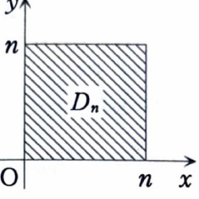

類題 7-5

> **この問題で使う前提知識**
>
> 第1象限全体のような無限領域上の積分は、たとえば正方形
>
> $$
> D_n=\{(x,y)\mid0\le x\le n,\ 0\le y\le n\}
> $$
>
> を用いて、
>
> $$
> \iint_Df(x,y)\,dxdy
> =
> \lim_{n\to\infty}
> \iint_{D_n}f(x,y)\,dxdy
> $$
>
> と計算する。

次の二重積分を計算せよ。

$$
\iint_D\frac{1}{(x+y+1)^3}\,dxdy,
\qquad
D:\ x\ge0,\ y\ge0
$$

---

## 解答

> **解法を選ぶ理由**
>
> 積分領域は第1象限全体なので、資料に従って正方形
>
> $$
> 0\le x\le n,\qquad0\le y\le n
> $$
>
> で近似する。
>
> 被積分関数は $x+y+1$ の負のべきであり、$y$ についても $x$ についても初等的に積分できる。そのため、変数変換をせず、逐次積分を2回行う方法が最も直接的である。

近似領域を

$$
D_n:\ 0\le x\le n,\ 0\le y\le n
$$

とする。

このとき、

$$
\iint_{D_n}\frac{1}{(x+y+1)^3}\,dxdy
=
\int_0^n
\left(
\int_0^n
\frac{1}{(x+y+1)^3}\,dy
\right)dx
$$

である。

内側の積分を計算する。文字だけの置換

$$
u=x+y+1
$$

を行うと、$x$ は定数なので、

$$
du=dy
$$

である。したがって、

$$
\int\frac{1}{(x+y+1)^3}\,dy
=
\int u^{-3}\,du
$$

となる。べき乗の積分公式から、

$$
\int u^{-3}\,du
=
\frac{u^{-2}}{-2}
=
-\frac{1}{2u^2}
$$

である。元の変数へ戻すと、

$$
\int\frac{1}{(x+y+1)^3}\,dy
=
-\frac{1}{2(x+y+1)^2}
$$

となる。

よって、

$$
\int_0^n
\frac{1}{(x+y+1)^3}\,dy
=
\left[
-\frac{1}{2(x+y+1)^2}
\right]_{y=0}^{y=n}
$$

である。上端と下端を代入すると、

$$
=
-\frac{1}{2(x+n+1)^2}
-
\left(
-\frac{1}{2(x+1)^2}
\right)
$$

より、

$$
=
\frac{1}{2(x+1)^2}
-
\frac{1}{2(x+n+1)^2}
$$

となる。

したがって、

$$
\iint_{D_n}\frac{1}{(x+y+1)^3}\,dxdy
=
\int_0^n
\left\{
\frac{1}{2(x+1)^2}
-
\frac{1}{2(x+n+1)^2}
\right\}dx
$$

である。

第1項について、

$$
\int\frac{1}{2(x+1)^2}\,dx
=
\frac12\int(x+1)^{-2}\,dx
=
-\frac{1}{2(x+1)}
$$

である。

第2項には負号が付いているので、

$$
\int-\frac{1}{2(x+n+1)^2}\,dx
=
\frac{1}{2(x+n+1)}
$$

である。したがって、

$$
\iint_{D_n}\frac{1}{(x+y+1)^3}\,dxdy
=
\left[
-\frac{1}{2(x+1)}
+
\frac{1}{2(x+n+1)}
\right]_0^n
$$

となる。

上端 $x=n$ を代入すると、

$$
-\frac{1}{2(n+1)}
+
\frac{1}{2(2n+1)}
$$

である。

下端 $x=0$ を代入すると、

$$
-\frac{1}{2(0+1)}
+
\frac{1}{2(n+1)}
=
-\frac12+\frac{1}{2(n+1)}
$$

である。したがって、

$$
\iint_{D_n}\frac{1}{(x+y+1)^3}\,dxdy
=
\left\{
-\frac{1}{2(n+1)}
+
\frac{1}{2(2n+1)}
\right\}
-
\left\{
-\frac12+\frac{1}{2(n+1)}
\right\}
$$

となる。括弧を外して、

$$
=
\frac12
-
\frac{1}{n+1}
+
\frac{1}{2(2n+1)}
$$

である。

$n\to\infty$ とすると、

$$
\frac{1}{n+1}\to0
$$

および

$$
\frac{1}{2(2n+1)}\to0
$$

なので、

$$
\iint_D\frac{1}{(x+y+1)^3}\,dxdy
=
\lim_{n\to\infty}
\left(
\frac12
-
\frac{1}{n+1}
+
\frac{1}{2(2n+1)}
\right)
$$

より、

$$
=
\frac12
$$

となる。

したがって、

$$
\boxed{
\iint_D\frac{1}{(x+y+1)^3}\,dxdy
=
\frac12
}
$$
