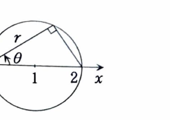

類題 7-6

> **この問題で使う前提知識**
>
> 二つの曲面
>
> $$
> z=f(x,y)
> $$
>
> と
>
> $$
> z=g(x,y)
> $$
>
> に挟まれ、$f(x,y)\ge g(x,y)$ となる立体の体積は、
>
> $$
> V=\iint_D\{f(x,y)-g(x,y)\}\,dxdy
> $$
>
> である。ここで $D$ は二つの曲面の交線を $xy$ 平面へ射影した領域である。

曲面

$$
z=x^2+y^2
$$

と平面

$$
z=2x
$$

で囲まれた立体の体積を求めよ。

---

## 解答

> **解法を選ぶ理由**
>
> 二つの曲面の上下差は、
>
> $$
> 2x-(x^2+y^2)
> $$
>
> である。
>
> 交線を求めると、
>
> $$
> x^2+y^2=2x
> $$
>
> という円になるので、極座標で積分領域を表すと簡単になる。
>
> 円柱座標による三重積分でも計算できるが、上面と下面が明確なので、高さを二重積分する方法が最短である。

二つの曲面の交線は、

$$
x^2+y^2=2x
$$

を満たす。平方完成すると、

$$
x^2-2x+y^2=0
$$

より、

$$
(x-1)^2-1+y^2=0
$$

であるから、

$$
(x-1)^2+y^2=1
$$

となる。

したがって、射影領域は、

$$
D:\ (x-1)^2+y^2\le1
$$

である。

極座標で表した領域は次の図の円板である。

領域 $D$ の内部では、

$$
x^2+y^2\le2x
$$

なので、

$$
2x\ge x^2+y^2
$$

である。したがって、上面は平面

$$
z_{\mathrm{上}}=2x
$$

であり、下面は放物面

$$
z_{\mathrm{下}}=x^2+y^2
$$

である。

よって、体積は、

$$
V
=
\iint_D
\left\{
2x-(x^2+y^2)
\right\}dxdy
$$

となる。

極座標変換

$$
x=r\cos\theta,
\qquad
y=r\sin\theta
$$

を用いる。境界式

$$
x^2+y^2=2x
$$

へ代入すると、

$$
r^2=2r\cos\theta
$$

である。したがって、

$$
r=2\cos\theta
$$

となる。$r\ge0$ であるため、

$$
-\frac{\pi}{2}\le\theta\le\frac{\pi}{2}
$$

である。よって、積分範囲は、

$$
-\frac{\pi}{2}\le\theta\le\frac{\pi}{2},
\qquad
0\le r\le2\cos\theta
$$

となる。

被積分関数は、

$$
2x-(x^2+y^2)
=
2r\cos\theta-r^2
$$

である。さらに、

$$
dxdy=r\,drd\theta
$$

なので、

$$
V
=
\int_{-\pi/2}^{\pi/2}
\int_0^{2\cos\theta}
(2r\cos\theta-r^2)r\,drd\theta
$$

となる。積を展開すると、

$$
V
=
\int_{-\pi/2}^{\pi/2}
\int_0^{2\cos\theta}
\left(
2r^2\cos\theta-r^3
\right)drd\theta
$$

である。

内側の積分について、まず文字だけで積分すると、

$$
\int
\left(
2r^2\cos\theta-r^3
\right)dr
=
\frac23r^3\cos\theta-\frac14r^4
$$

である。したがって、

$$
\int_0^{2\cos\theta}
\left(
2r^2\cos\theta-r^3
\right)dr
=
\left[
\frac23r^3\cos\theta-\frac14r^4
\right]_0^{2\cos\theta}
$$

となる。

上端 $r=2\cos\theta$ を代入すると、

$$
\frac23(2\cos\theta)^3\cos\theta
-
\frac14(2\cos\theta)^4
$$

である。それぞれのべき乗を計算すると、

$$
(2\cos\theta)^3=8\cos^3\theta
$$

および

$$
(2\cos\theta)^4=16\cos^4\theta
$$

なので、

$$
\frac23\cdot8\cos^4\theta
-
\frac14\cdot16\cos^4\theta
$$

となる。係数を整理すると、

$$
\frac{16}{3}\cos^4\theta-4\cos^4\theta
=
\frac43\cos^4\theta
$$

である。下端 $r=0$ の値は $0$ なので、

$$
V
=
\frac43
\int_{-\pi/2}^{\pi/2}
\cos^4\theta\,d\theta
$$

となる。

$\cos^4\theta$ は偶関数なので、

$$
V
=
\frac83
\int_0^{\pi/2}
\cos^4\theta\,d\theta
$$

である。

半角公式

$$
\cos^2\theta=\frac{1+\cos2\theta}{2}
$$

を二回用いる。まず、

$$
\cos^4\theta
=
\left(
\frac{1+\cos2\theta}{2}
\right)^2
$$

である。展開すると、

$$
\cos^4\theta
=
\frac14
\left(
1+2\cos2\theta+\cos^22\theta
\right)
$$

となる。また、

$$
\cos^22\theta
=
\frac{1+\cos4\theta}{2}
$$

なので、

$$
\cos^4\theta
=
\frac14
\left(
1+2\cos2\theta+\frac{1+\cos4\theta}{2}
\right)
$$

である。整理すると、

$$
\cos^4\theta
=
\frac38+\frac12\cos2\theta+\frac18\cos4\theta
$$

となる。

したがって、

$$
\int_0^{\pi/2}\cos^4\theta\,d\theta
=
\int_0^{\pi/2}
\left(
\frac38+\frac12\cos2\theta+\frac18\cos4\theta
\right)d\theta
$$

である。積分すると、

$$
=
\left[
\frac38\theta
+
\frac14\sin2\theta
+
\frac1{32}\sin4\theta
\right]_0^{\pi/2}
$$

となる。正弦の項は両端で $0$ なので、

$$
\int_0^{\pi/2}\cos^4\theta\,d\theta
=
\frac38\cdot\frac{\pi}{2}
=
\frac{3\pi}{16}
$$

である。

よって、

$$
V
=
\frac83\cdot\frac{3\pi}{16}
=
\frac{\pi}{2}
$$

となる。

したがって、

$$
\boxed{V=\frac{\pi}{2}}
$$
