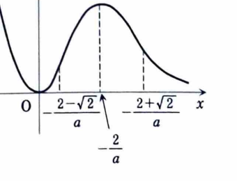

1B-05（関数のグラフ）

$a<0$ とし、

$$
f(x)=x^2e^{ax}
$$

と定義する。

---

## (1)

$f'(x)$ と $f''(x)$ を求めよ。

---

## (1) 解答

> 多項式と指数関数の積なので、積の微分公式を用いる。

$$
f'(x)
=
(x^2)'e^{ax}+x^2(e^{ax})'
$$

ここに、

$$
(x^2)'=2x,\qquad (e^{ax})'=ae^{ax}
$$

を代入すると、

$$
f'(x)
=
2xe^{ax}+ax^2e^{ax}
$$

$$
=
x(ax+2)e^{ax}
$$

したがって、

$$
\boxed{f'(x)=x(ax+2)e^{ax}}
$$

である。

次に、

$$
f''(x)=\{(ax^2+2x)e^{ax}\}'
$$

だから、

$$
f''(x)
=
(2ax+2)e^{ax}
+
(ax^2+2x)ae^{ax}
$$

$$
=
(a^2x^2+4ax+2)e^{ax}
$$

よって、

$$
\boxed{f''(x)=(a^2x^2+4ax+2)e^{ax}}
$$

である。

---

## (2)

$$
\lim_{x\to+\infty}f(x)
$$

を求めよ。

---

## (2) 解答

> $a<0$ なので $e^{ax}=1/e^{-ax}$ とし、指数関数が多項式より速く増加することを用いる。

$$
f(x)=x^2e^{ax}
=
\frac{x^2}{e^{-ax}}
$$

である。$-a>0$ なので、分母は指数関数的に増加する。ロピタルの定理を2回用いると、

$$
\lim_{x\to\infty}\frac{x^2}{e^{-ax}}
=
\lim_{x\to\infty}\frac{2x}{(-a)e^{-ax}}
$$

$$
=
\lim_{x\to\infty}\frac{2}{a^2e^{-ax}}
=0
$$

したがって、

$$
\boxed{0}
$$

である。

---

## (3)

$f(x)$ の増減、極値、凹凸、変曲点を調べ、増減表を書き、概形を描け。

---

## (3) 解答

> $e^{ax}>0$ なので、導関数の符号は多項式部分だけで決まる。

### 増減と極値

$$
f'(x)=x(ax+2)e^{ax}
$$

だから、

$$
f'(x)=0
$$

となるのは、

$$
x=0,\qquad x=-\frac2a
$$

である。$a<0$ より $-2/a>0$ である。

符号を調べると、

- $x<0$ では $x<0$、$ax+2>0$ なので $f'(x)<0$
- $0<x<-2/a$ では $x>0$、$ax+2>0$ なので $f'(x)>0$
- $x>-2/a$ では $x>0$、$ax+2<0$ なので $f'(x)<0$

したがって、

$$
x=0
$$

で極小、

$$
x=-\frac2a
$$

で極大である。

極小値は、

$$
f(0)=0
$$

である。極大値は、代入前の式

$$
f(x)=x^2e^{ax}
$$

に $x=-2/a$ を代入して、

$$
f\left(-\frac2a\right)
=
\frac4{a^2}e^{-2}
$$

である。

### 凹凸と変曲点

$$
f''(x)
=
(a^2x^2+4ax+2)e^{ax}
$$

だから、

$$
a^2x^2+4ax+2=0
$$

を解く。解の公式に代入する前の式は、

$$
x=
\frac{-4a\pm\sqrt{(4a)^2-4a^2\cdot2}}{2a^2}
$$

である。整理すると、

$$
x
=
\frac{-2\pm\sqrt2}{a}
$$

である。$a<0$ を考慮して、

$$
\alpha=-\frac{2-\sqrt2}{a},
\qquad
\beta=-\frac{2+\sqrt2}{a}
$$

とおけば、

$$
0<\alpha<-\frac2a<\beta
$$

である。

二次式の先頭係数は正なので、

- $x<\alpha$ では $f''(x)>0$
- $\alpha<x<\beta$ では $f''(x)<0$
- $x>\beta$ では $f''(x)>0$

となる。したがって変曲点は、

$$
\left(
-\frac{2-\sqrt2}{a},
\frac{(2-\sqrt2)^2}{a^2}e^{-(2-\sqrt2)}
\right)
$$

および

$$
\left(
-\frac{2+\sqrt2}{a},
\frac{(2+\sqrt2)^2}{a^2}e^{-(2+\sqrt2)}
\right)
$$

である。

