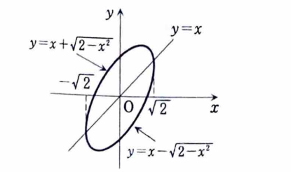

1B-10（面積、最大・最小）

---

## (1)

$xy$ 平面上の曲線

$$
2x^2-2xy+y^2=2
$$

で囲まれる領域の面積を求めよ。

---

## (1) 解答

> $y$ について解くと、上側と下側の曲線の差が半円の高さに帰着する。座標回転でも楕円の面積を求められるが、資料に沿って縦に積分する。

与えられた式を $y$ の二次方程式とみると、

$$
y^2-2xy+2x^2-2=0
$$

である。解の公式に代入する前の式は、

$$
y=
\frac{2x\pm\sqrt{(-2x)^2-4(2x^2-2)}}2
$$

である。整理すると、

$$
y=x\pm\sqrt{2-x^2}
$$

となる。実数値を取るためには、

$$
2-x^2\ge0
$$

すなわち、

$$
-\sqrt2\le x\le\sqrt2
$$

である。

上側の曲線を

$$
y_+=x+\sqrt{2-x^2}
$$

下側の曲線を

$$
y_-=x-\sqrt{2-x^2}
$$

とすると、面積 $S$ は、

$$
S
=
\int_{-\sqrt2}^{\sqrt2}
(y_+-y_-)\,dx
$$

$$
=
\int_{-\sqrt2}^{\sqrt2}
2\sqrt{2-x^2}\,dx
$$

である。積分

$$
\int_{-\sqrt2}^{\sqrt2}\sqrt{2-x^2}\,dx
$$

は半径 $\sqrt2$ の半円の面積に等しいので、

$$
\int_{-\sqrt2}^{\sqrt2}\sqrt{2-x^2}\,dx
=
\frac12\pi(\sqrt2)^2
=\pi
$$

である。したがって、

$$
\boxed{S=2\pi}
$$

である。

---

## (2)

$x,y$ が

$$
2x^2-2xy+y^2=2
$$

を満たすとき、$x+y$ の最大値と最小値を求めよ。

---

## (2) 解答

> $x+y$ を定数 $k$ とおき、直線 $x+y=k$ と曲線が共有点をもつ条件を判別式で調べる。ラグランジュの未定乗数法でも求められるが、資料の方法は二次方程式に帰着している。

$$
x+y=k
$$

とおくと、

$$
y=k-x
$$

である。これを制約式に代入すると、

$$
2x^2-2x(k-x)+(k-x)^2=2
$$

展開して、

$$
2x^2-2kx+2x^2+k^2-2kx+x^2=2
$$

$$
5x^2-4kx+k^2-2=0
$$

となる。

この二次方程式が実数解をもつための条件は、判別式が非負であることである。判別式を $D$ とすると、

$$
D=(-4k)^2-4\cdot5(k^2-2)
$$

$$
=16k^2-20k^2+40
$$

$$
=40-4k^2
$$

である。したがって、

$$
D\ge0
$$

より、

$$
40-4k^2\ge0
$$

$$
k^2\le10
$$

すなわち、

$$
-\sqrt{10}\le k\le\sqrt{10}
$$

である。よって、

$$
\boxed{\text{最大値 }\sqrt{10},\qquad
\text{最小値 }-\sqrt{10}}
$$

である。
