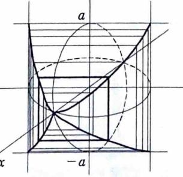

1B-16（体積）

半径が $a$ の無限に長い2つの直円柱があり、互いの中心軸が直交して交わっている。共通部分を図示し、その体積を求めよ。

---

## 解答

> これは、2本の直交する円柱の共通部分の体積を求める問題である。この立体は各座標平面について対称であるため、第1八分体にある部分の体積を求めて8倍する方法を選ぶ。
>
> 二重積分や三重積分を用いる方法もあるが、$x=t$ で切った断面が正方形になることに気づけば、断面積を1変数で積分するだけで求められる。この方法が最も計算量が少なく、資料の解答にも沿っている。
>
> 断面積が $S(x)$ で表される立体の体積は、
>
> $$
> V=\int S(x)\,dx
> $$
>
> で求められる。

2つの円柱の中心軸がそれぞれ $z$ 軸、$y$ 軸となるように座標を取る。このとき、2つの円柱はそれぞれ、

$$
x^2+y^2\le a^2
$$

および

$$
x^2+z^2\le a^2
$$

で表される。

> 第1の不等式 $x^2+y^2\le a^2$ は、$z$ の値に関係しないため、$z$ 軸方向に無限に伸びる円柱を表す。
>
> 第2の不等式 $x^2+z^2\le a^2$ は、$y$ の値に関係しないため、$y$ 軸方向に無限に伸びる円柱を表す。

共通部分は、$x$、$y$、$z$ の各座標の符号を変えても形が変わらない。したがって、

$$
x\ge0,\qquad y\ge0,\qquad z\ge0
$$

を満たす第1八分体内の体積を $V_0$ とすると、全体の体積 $V$ は、

$$
V=8V_0
$$

である。

次に、平面

$$
x=t
$$

で立体を切った断面を考える。ただし、第1八分体を考えているので、

$$
0\le t\le a
$$

である。

まず、円柱の式を文字のまま整理する。第1の円柱条件

$$
x^2+y^2\le a^2
$$

において $x=t$ を代入すると、

$$
t^2+y^2\le a^2
$$

である。これを $y$ について解くと、

$$
y^2\le a^2-t^2
$$

となる。第1八分体では $y\ge0$ なので、

$$
0\le y\le\sqrt{a^2-t^2}
$$

である。

同様に、第2の円柱条件

$$
x^2+z^2\le a^2
$$

において $x=t$ を代入すると、

$$
t^2+z^2\le a^2
$$

である。これを $z$ について解くと、

$$
z^2\le a^2-t^2
$$

となる。第1八分体では $z\ge0$ なので、

$$
0\le z\le\sqrt{a^2-t^2}
$$

である。

したがって、平面 $x=t$ による第1八分体内の断面は、$y$ 方向と $z$ 方向の辺の長さがともに

$$
\sqrt{a^2-t^2}
$$

である正方形になる。

よって、断面積を $S(t)$ とすると、正方形の面積の公式より、

$$
S(t)
=
\sqrt{a^2-t^2}\,\sqrt{a^2-t^2}
$$

したがって、

$$
S(t)=a^2-t^2
$$

である。

第1八分体内の体積は、断面積を $t=0$ から $t=a$ まで積分して、

$$
V_0=\int_0^a S(t)\,dt
$$

である。ここに

$$
S(t)=a^2-t^2
$$

を代入すると、

$$
V_0
=
\int_0^a(a^2-t^2)\,dt
$$

となる。

積分公式

$$
\int t^n\,dt=\frac{t^{n+1}}{n+1}+C
\qquad(n\ne-1)
$$

を用いると、

$$
\int(a^2-t^2)\,dt
=
a^2t-\frac{t^3}{3}
$$

である。したがって、

$$
V_0
=
\left[
a^2t-\frac{t^3}{3}
\right]_0^a
$$

となる。

上端 $t=a$ と下端 $t=0$ の値をそれぞれ代入すると、

$$
V_0
=
\left(
a^2\cdot a-\frac{a^3}{3}
\right)
-
\left(
a^2\cdot0-\frac{0^3}{3}
\right)
$$

$$
=
a^3-\frac{a^3}{3}
$$

$$
=
\frac{2}{3}a^3
$$

である。

最後に、全体の体積を表す式

$$
V=8V_0
$$

に

$$
V_0=\frac{2}{3}a^3
$$

を代入すると、

$$
V
=
8\cdot\frac{2}{3}a^3
$$

$$
=
\frac{16}{3}a^3
$$

となる。

したがって、求める共通部分の体積は、

$$
\boxed{V=\frac{16}{3}a^3}
$$

である。
