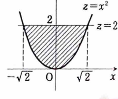

1B-17（体積）

$xyz$ 空間において、

$$
S:\quad x^2+y^2\le z\le2
$$

を満たす部分の体積を求めよ。

---

## 解答

> 不等式 $x^2+y^2\le z$ は回転放物面 $z=x^2+y^2$ の上側、$z\le2$ は平面 $z=2$ の下側を表す。高さ $z$ で水平に切ると、断面は半径 $\sqrt z$ の円になるため、断面積を $z$ で積分する。

領域は、$xz$ 平面で見ると、

$$
x^2\le z\le2
$$

で表される部分を $z$ 軸のまわりに回転して得られる。

高さ $z$ を固定すると、

$$
x^2+y^2\le z
$$

だから、断面は半径

$$
r=\sqrt z
$$

の円である。したがって、断面積 $A(z)$ は、まず文字だけの式として、

$$
A(z)=\pi r^2
$$

であり、$r=\sqrt z$ を代入すると、

$$
A(z)=\pi z
$$

となる。

$z$ の範囲は、

$$
0\le z\le2
$$

である。よって体積 $V$ は、

$$
V
=
\int_0^2A(z)\,dz
$$

$$
=
\int_0^2\pi z\,dz
$$

$$
=
\pi
\left[
\frac{z^2}{2}
\right]_0^2
$$

$$
=
\pi\cdot\frac4{2}
$$

したがって、

$$
\boxed{V=2\pi}
$$

である。
