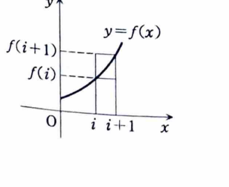

1C-05（定積分と数列）

$f(x)$ を $x\ge0$ で定義された連続な単調増加関数とする。

---

## (1)

任意の正整数 $n$ に対して、

$$
\int_0^nf(x)\,dx
\le
\sum_{i=1}^{n}f(i)
\le
\int_0^nf(x+1)\,dx
$$

を示せ。

---

## (1) 解答

> 単調増加性から、各区間 $[i,i+1]$ で関数値を左右の端点値で挟む。図形的には、左端・右端を高さとする長方形で積分を挟む。

$f$ は単調増加なので、$x\in[i,i+1]$ に対して、

$$
f(i)\le f(x)\le f(i+1)
$$

である。区間 $[i,i+1]$ で積分すると、

$$
f(i)
\le
\int_i^{i+1}f(x)\,dx
\le
f(i+1)
$$

となる。

右側の不等式

$$
\int_i^{i+1}f(x)\,dx\le f(i+1)
$$

を $i=0,1,\ldots,n-1$ で足すと、

$$
\int_0^nf(x)\,dx
\le
\sum_{i=1}^{n}f(i)
$$

を得る。

一方、左側の不等式

$$
f(i)\le\int_i^{i+1}f(x)\,dx
$$

を $i=1,\ldots,n$ で足すと、

$$
\sum_{i=1}^{n}f(i)
\le
\int_1^{n+1}f(x)\,dx
$$

である。右辺で $u=x-1$ と置換すると、

$$
\int_1^{n+1}f(x)\,dx
=
\int_0^nf(u+1)\,du
$$

だから、

$$
\boxed{
\int_0^nf(x)\,dx
\le
\sum_{i=1}^{n}f(i)
\le
\int_0^nf(x+1)\,dx
}
$$

が成り立つ。

---

## (2)

実数 $s$ に対し、

$$
a_n=\frac1{n^s}\sum_{i=1}^{n}f(i)
$$

と定義する。$f(x)=x^\alpha$ $(\alpha>0)$ のとき、数列 $\{a_n\}$ が収束する $s$ の範囲を求めよ。

---

## (2) 解答

> (1) の積分による挟み込みを $f(x)=x^\alpha$ に適用し、$a_n$ の主要な大きさが $n^{\alpha+1-s}$ であることを調べる。有限値への収束を求めるため、指数が正・零・負で場合分けする。

(1) に $f(x)=x^\alpha$ を代入すると、

$$
\int_0^nx^\alpha\,dx
\le
\sum_{i=1}^{n}i^\alpha
\le
\int_0^n(x+1)^\alpha\,dx
$$

である。積分を計算すると、

$$
\frac{n^{\alpha+1}}{\alpha+1}
\le
\sum_{i=1}^{n}i^\alpha
\le
\frac{(n+1)^{\alpha+1}-1}{\alpha+1}
$$

となる。

各辺を $n^s$ で割ると、

$$
\frac1{\alpha+1}n^{\alpha+1-s}
\le
a_n
\le
\frac1{\alpha+1}
\left\{
\left(1+\frac1n\right)^{\alpha+1}
-\frac1{n^{\alpha+1}}
\right\}
n^{\alpha+1-s}
$$

である。

ここで、

$$
\left(1+\frac1n\right)^{\alpha+1}\to1,
\qquad
\frac1{n^{\alpha+1}}\to0
$$

である。

- $s<\alpha+1$ なら $\alpha+1-s>0$ なので、下界が $\infty$ に発散し、$a_n$ は有限値に収束しない。
- $s=\alpha+1$ なら、両側とも $1/(\alpha+1)$ に近づき、

$$
a_n\to\frac1{\alpha+1}
$$

である。
- $s>\alpha+1$ なら $\alpha+1-s<0$ なので、両側とも $0$ に近づき、

$$
a_n\to0
$$

である。

したがって、有限値に収束する範囲は、

$$
\boxed{s\ge\alpha+1}
$$

である。
