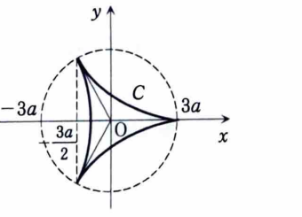
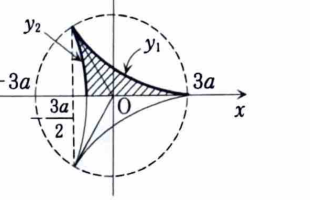

1C-08（媒介変数で表された曲線）

$xy$ 平面上の曲線 $C$ が、$a>0$ として、

$$
x=2a\cos\theta+a\cos2\theta,
\qquad
y=2a\sin\theta-a\sin2\theta
$$

で表される。

---

## (1)

曲線 $C$ の概略図を示せ。

---

## (1) 解答

> 概形を得るため、まず原点からの距離 $x^2+y^2$ と対称性を調べる。さらに導関数から尖点や進行方向を確認する。媒介変数の値を細かく表にして描く方法もあるが、資料では距離と対称性を利用している。

まず、

$$
x^2+y^2
=
(2a\cos\theta+a\cos2\theta)^2
+
(2a\sin\theta-a\sin2\theta)^2
$$

である。展開すると、

$$
x^2+y^2
=
4a^2(\cos^2\theta+\sin^2\theta)
+a^2(\cos^22\theta+\sin^22\theta)
$$

$$
\quad
+4a^2(\cos\theta\cos2\theta-\sin\theta\sin2\theta)
$$

三角関数の恒等式を用いて、

$$
x^2+y^2
=
5a^2+4a^2\cos(2\theta+\theta)
$$

$$
=
a^2(5+4\cos3\theta)
$$

となる。したがって、原点からの距離は $3\theta$ によって周期的に変化し、3つの尖った部分をもつ形になる。

次に対称性を調べる。$x(\theta)$ に $-\theta$ を代入すると、

$$
x(-\theta)
=
2a\cos(-\theta)+a\cos(-2\theta)
$$

$$
=
2a\cos\theta+a\cos2\theta
=x(\theta)
$$

である。一方、

$$
y(-\theta)
=
2a\sin(-\theta)-a\sin(-2\theta)
$$

$$
=-2a\sin\theta+a\sin2\theta
=-y(\theta)
$$

である。よって曲線は $x$ 軸に関して対称である。

主な点は、

$$
\theta=0
\Rightarrow
(x,y)=(3a,0)
$$

$$
\theta=\frac{2\pi}{3}
\Rightarrow
(x,y)=\left(-\frac{3a}{2},\frac{3\sqrt3a}{2}\right)
$$

$$
\theta=\frac{4\pi}{3}
\Rightarrow
(x,y)=\left(-\frac{3a}{2},-\frac{3\sqrt3a}{2}\right)
$$

である。

導関数は、

$$
\frac{dx}{d\theta}
=
-2a\sin\theta-2a\sin2\theta
$$

$$
=-2a\sin\theta(1+2\cos\theta)
$$

および、

$$
\frac{dy}{d\theta}
=
2a\cos\theta-2a\cos2\theta
$$

である。これらから進行方向と接線の向きを確認できる。

したがって概形は次の3尖点をもつ曲線となる。

---

## (2)

曲線 $C$ に囲まれる図形の面積を求めよ。

---

## (2) 解答

> $x$ 軸対称性を用いて上半分の面積を2倍する。媒介変数表示の面積公式
>
> $$
> \int y\,dx
> =
> \int y(\theta)x'(\theta)\,d\theta
> $$
>
> を使う。向きによって符号が変わるため、区間ごとに符号を整える。

図の対称性から、全体の面積を $S$ とすると、資料の区分に従って、

$$
\frac S2
=
\int_{-3a/2}^{3a}y_1\,dx
-
\int_{-3a/2}^{0}y_2\,dx
$$

と書ける。

媒介変数を用いると、

$$
\frac{dx}{d\theta}
=
-2a\sin\theta-2a\sin2\theta
$$

である。区間を整理した後、対称性を使うと、

$$
\frac S2
=
\int_0^\pi
(2a\sin\theta-a\sin2\theta)
(2a\sin\theta+2a\sin2\theta)
\,d\theta
$$

となる。したがって、

$$
\frac S2
=
2a^2
\int_0^\pi
(2\sin\theta-\sin2\theta)
(\sin\theta+\sin2\theta)
\,d\theta
$$

である。積を展開すると、

$$
(2\sin\theta-\sin2\theta)
(\sin\theta+\sin2\theta)
$$

$$
=
2\sin^2\theta
+\sin\theta\sin2\theta
-\sin^22\theta
$$

だから、

$$
\frac S2
=
2a^2
\int_0^\pi
\left(
2\sin^2\theta
+\sin\theta\sin2\theta
-\sin^22\theta
\right)d\theta
$$

となる。

ここで、

$$
2\sin^2\theta=1-\cos2\theta
$$

$$
\sin\theta\sin2\theta
=
2\sin^2\theta\cos\theta
$$

$$
\sin^22\theta
=
\frac{1-\cos4\theta}{2}
$$

を用いると、

$$
\frac S2
=
2a^2
\int_0^\pi
\left(
\frac12-\cos2\theta
+2\sin^2\theta\cos\theta
+\frac12\cos4\theta
\right)d\theta
$$

である。原始関数は、

$$
\frac\theta2
-\frac12\sin2\theta
+\frac23\sin^3\theta
+\frac18\sin4\theta
$$

だから、

$$
\frac S2
=
2a^2
\left[
\frac\theta2
-\frac12\sin2\theta
+\frac23\sin^3\theta
+\frac18\sin4\theta
\right]_0^\pi
$$

端点で正弦項はすべて $0$ なので、

$$
\frac S2
=
2a^2\cdot\frac\pi2
=
\pi a^2
$$

である。したがって、

$$
\boxed{S=2\pi a^2}
$$

となる。

