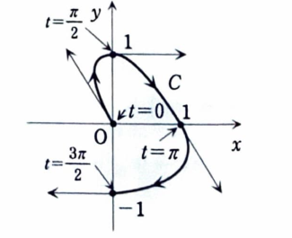

1C-13（媒介変数で表された曲線）

$xy$ 平面上の点 $P$ の座標が、

$$
x(t)=-\frac{t}{\pi}\cos t,
\qquad
y(t)=\sin t
$$

で与えられる。$0\le t\le3\pi/2$ の範囲で点 $P$ が描く曲線を $C$ とする。

---

## (1)

$t=m\pi/2$ $(m=0,1,2,3)$ における点 $P$ の座標と接線の傾きを求め、曲線 $C$ の概形を描け。

---

## (1) 解答

> 媒介変数の代表値を代入して通過点を求め、接線の傾きは
>
> $$
> \frac{dy}{dx}
> =
> \frac{dy/dt}{dx/dt}
> $$
>
> で求める。

まず各点の座標を求める。

$t=0$ のとき、

$$
x(0)=0,\qquad y(0)=0
$$

だから、

$$
P=(0,0)
$$

である。

$t=\pi/2$ のとき、

$$
x\left(\frac\pi2\right)
=
-\frac12\cos\frac\pi2=0
$$

$$
y\left(\frac\pi2\right)=1
$$

だから、

$$
P=(0,1)
$$

である。

$t=\pi$ のとき、

$$
x(\pi)=-1\cdot\cos\pi=1
$$

$$
y(\pi)=0
$$

だから、

$$
P=(1,0)
$$

である。

$t=3\pi/2$ のとき、

$$
x\left(\frac{3\pi}{2}\right)
=
-\frac32\cos\frac{3\pi}{2}=0
$$

$$
y\left(\frac{3\pi}{2}\right)=-1
$$

だから、

$$
P=(0,-1)
$$

である。

次に導関数を求める。まず、

$$
x'(t)
=
-\frac1\pi\cos t
+\frac t\pi\sin t
$$

であり、

$$
y'(t)=\cos t
$$

である。したがって、

$$
\frac{dy}{dx}
=
\frac{\cos t}
{-\dfrac1\pi\cos t+\dfrac t\pi\sin t}
$$

分子・分母に $\pi$ を掛けると、

$$
\frac{dy}{dx}
=
\frac{\pi\cos t}{t\sin t-\cos t}
$$

となる。

各値を代入する。

$t=0$ では、

$$
\left.\frac{dy}{dx}\right|_{t=0}
=
\frac{\pi}{-1}
=-\pi
$$

である。

$t=\pi/2$ では分子が $0$、分母が $\pi/2$ なので、

$$
\left.\frac{dy}{dx}\right|_{t=\pi/2}=0
$$

である。

$t=\pi$ では、

$$
\left.\frac{dy}{dx}\right|_{t=\pi}
=
\frac{-\pi}{1}
=-\pi
$$

である。

$t=3\pi/2$ では、

$$
\left.\frac{dy}{dx}\right|_{t=3\pi/2}=0
$$

である。

以上を表にまとめる。

| $t$ | 点 $P=(x,y)$ | 接線の傾き |
|---:|:---:|---:|
| $0$ | $(0,0)$ | $-\pi$ |
| $\pi/2$ | $(0,1)$ | $0$ |
| $\pi$ | $(1,0)$ | $-\pi$ |
| $3\pi/2$ | $(0,-1)$ | $0$ |

---

## (2)

次の不定積分を求めよ。

$$
\int t\sin^2t\,dt
$$

---

## (2) 解答

> 半角公式で $\sin^2t$ を余弦に直し、$t\cos2t$ に部分積分を用いる。

まず、

$$
\sin^2t=\frac{1-\cos2t}{2}
$$

だから、

$$
\int t\sin^2t\,dt
=
\int t\frac{1-\cos2t}{2}\,dt
$$

$$
=
\frac12\int t\,dt
-\frac12\int t\cos2t\,dt
$$

である。

第1項は、

$$
\frac12\int t\,dt=\frac14t^2
$$

である。

第2項では、

$$
u=t,\qquad dv=\cos2t\,dt
$$

とおく。すると、

$$
du=dt,\qquad v=\frac12\sin2t
$$

だから、

$$
\int t\cos2t\,dt
=
\frac12t\sin2t
-\frac12\int\sin2t\,dt
$$

$$
=
\frac12t\sin2t+\frac14\cos2t
$$

である。したがって、

$$
\int t\sin^2t\,dt
=
\frac14t^2
-\frac12
\left(
\frac12t\sin2t+\frac14\cos2t
\right)
+C
$$

よって、

$$
\boxed{
\int t\sin^2t\,dt
=
\frac14t^2
-\frac14t\sin2t
-\frac18\cos2t
+C
}
$$

である。

---

## (3)

曲線 $C$ と $x$ 軸 $(x\ge0)$ および $y$ 軸 $(y\ge0)$ で囲まれる領域の面積を求めよ。

---

## (3) 解答

> 第1象限で囲まれる部分は、$t=\pi/2$ から $t=\pi$ までの曲線部分である。媒介変数表示の面積公式 $S=\int y\,dx$ を用いる。

求める面積を $S$ とすると、

$$
S
=
\int y\,dx
$$

である。媒介変数に直すと、

$$
S
=
\int_{\pi/2}^{\pi}
y(t)x'(t)\,dt
$$

である。

まず、

$$
y(t)=\sin t
$$

$$
x'(t)
=
-\frac1\pi\cos t
+\frac t\pi\sin t
$$

だから、

$$
S
=
\int_{\pi/2}^{\pi}
\sin t
\left(
-\frac1\pi\cos t
+\frac t\pi\sin t
\right)dt
$$

$$
=
\frac1\pi
\int_{\pi/2}^{\pi}
\{-\sin t\cos t+t\sin^2t\}\,dt
$$

である。

第1項は、

$$
\int-\sin t\cos t\,dt
=
-\frac12\sin^2t
$$

である。第2項は (2) の結果を用いる。したがって、

$$
S
=
\frac1\pi
\left[
-\frac12\sin^2t
+
\frac14t^2
-\frac14t\sin2t
-\frac18\cos2t
\right]_{\pi/2}^{\pi}
$$

である。

$t=\pi$ では、

$$
\sin\pi=0,\qquad \sin2\pi=0,\qquad \cos2\pi=1
$$

だから、括弧内は、

$$
\frac{\pi^2}{4}-\frac18
$$

である。

$t=\pi/2$ では、

$$
\sin\frac\pi2=1,\qquad
\sin\pi=0,\qquad
\cos\pi=-1
$$

だから、括弧内は、

$$
-\frac12+\frac{\pi^2}{16}+\frac18
=
\frac{\pi^2}{16}-\frac38
$$

である。よって、

$$
S
=
\frac1\pi
\left\{
\frac{\pi^2}{4}-\frac18
-\left(
\frac{\pi^2}{16}-\frac38
\right)
\right\}
$$

$$
=
\frac1\pi
\left(
\frac{3\pi^2}{16}+\frac14
\right)
$$

したがって、

$$
\boxed{
S=\frac{3\pi}{16}+\frac1{4\pi}
}
$$

である。
