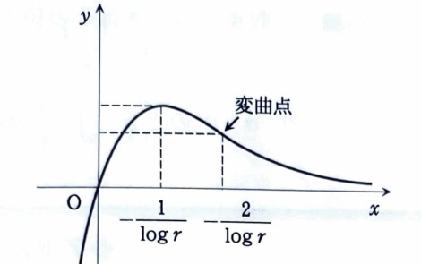

例題 1（関数のグラフ、数列）

$x$ を非負の実数、$r$ を $0<r<1$ を満たす実数とし、

$$
f(x)=xr^x
$$

と定義する。

> 指数関数の微分公式は
>
> $$
> \frac{d}{dx}a^x=a^x\log a
> $$
>
> である。また $0<r<1$ だから $\log r<0$ である。

> **資料のアドバイス・公式**
>
> 指数関数の微分は、
>
> $$
> \frac{d}{dx}a^x=a^x\log a
> $$
>
> である。したがって、
>
> $$
> \frac{d^2}{dx^2}a^x=a^x(\log a)^2>0
> $$
>
> となり、指数関数のグラフは下に凸である。
>
> また、$f''(x)<0$ の区間では接線の傾き $f'(x)$ が減少し、グラフは上に凸になる。$0<r<1$ では、指数関数の減少が多項式の増加より速いため、
>
> $$
> \lim_{x\to\infty}x^mr^x=0
> $$
>
> が任意の正整数 $m$ について成り立つ。
>
> 等比数列の有限和は、
>
> $$
> \sum_{k=1}^{n}ar^{k-1}
> =
> \frac{a(1-r^n)}{1-r}
> \qquad(r\ne1)
> $$
>
> である。係数に $1,2,3,\ldots$ が現れる和では、元の和を $S$ とおき、$S-rS$ を計算する方法が有効である。
>
> **答案作成上の注意**
>
> 資料では、式変形を詰め込みすぎず、等号の位置や途中式を読みやすく書くことが勧められている。採点者が論理を追えるよう、根拠となる式を省略しない。

---

## (1)

$f'(x)$ および $f''(x)$ を求めよ。

---

## (1) 解答

> $f(x)$ は $x$ と $r^x$ の積なので、積の微分公式を用いる。

まず、

$$
f'(x)=(x)'r^x+x(r^x)'
$$

である。ここに

$$
(x)'=1,\qquad (r^x)'=r^x\log r
$$

を代入すると、

$$
f'(x)=r^x+xr^x\log r
=r^x(x\log r+1)
$$

したがって、

$$
\boxed{f'(x)=r^x(x\log r+1)}
$$

である。

次に、

$$
f''(x)=\frac{d}{dx}\{r^x(x\log r+1)\}
$$

であるから、

$$
f''(x)=(r^x)'(x\log r+1)+r^x(x\log r+1)'
$$

$$
=r^x\log r(x\log r+1)+r^x\log r
$$

$$
=r^x\log r(x\log r+2)
$$

よって、

$$
\boxed{f''(x)=r^x\log r(x\log r+2)}
$$

である。

---

## (2)

$f(x)$ の増減表を書き、グラフの概形を描け。

---

## (2) 解答

> 増減は $f'(x)$ の符号、凹凸は $f''(x)$ の符号で調べる。$r^x>0$ なので、$f'(x)$ の符号は $x\log r+1$ で決まる。

極値の候補は

$$
f'(x)=0
$$

を満たす点である。すなわち、

$$
r^x(x\log r+1)=0
$$

であり、$r^x>0$ だから、

$$
x\log r+1=0
$$

$$
x=-\frac1{\log r}
$$

となる。

$\log r<0$ なので、

$$
0\le x<-\frac1{\log r}
$$

では $f'(x)>0$、

$$
x>-\frac1{\log r}
$$

では $f'(x)<0$ である。したがって、

$$
x=-\frac1{\log r}
$$

で極大となる。

極大値は、代入前の式

$$
f(x)=xr^x
$$

に $x=-1/\log r$ を代入して、

$$
f\left(-\frac1{\log r}\right)
=-\frac1{\log r}r^{-1/\log r}
$$

ここで、

$$
r^{-1/\log r}
=e^{-\frac{\log r}{\log r}}
=e^{-1}
$$

だから、

$$
f\left(-\frac1{\log r}\right)
=-\frac1{e\log r}
$$

である。

変曲点は

$$
f''(x)=0
$$

から求める。すなわち、

$$
r^x\log r(x\log r+2)=0
$$

であり、$r^x>0$、$\log r\ne0$ より、

$$
x=-\frac2{\log r}
$$

である。

| $x$ | $0$ | $0<x<-\dfrac1{\log r}$ | $-\dfrac1{\log r}$ | $-\dfrac1{\log r}<x<-\dfrac2{\log r}$ | $-\dfrac2{\log r}$ | $x>-\dfrac2{\log r}$ |
|---|---:|:---:|---:|:---:|---:|:---:|
| $f'(x)$ |  | $+$ | $0$ | $-$ | $-$ | $-$ |
| $f''(x)$ |  | $-$ | $-$ | $-$ | $0$ | $+$ |
| $f(x)$ | $0$ | 増加 | 極大 | 減少 | 変曲点 | 減少して $0$ に近づく |

> $0<r<1$ では
>
> $$
> \lim_{x\to\infty}xr^x=0
> $$
>
> である。

---

## (3)

$n$ を正の整数とし、

$$
a_n=f(n-1)=(n-1)r^{n-1}
$$

と定義する。初項から第 $n$ 項までの和を求めよ。

---

## (3) 解答

> 係数が等差的に増える等比型の和なので、$S_n$ と $rS_n$ を引く方法を用いる。

$$
S_n=\sum_{k=1}^{n}(k-1)r^{k-1}
$$

とおくと、

$$
S_n=r+2r^2+3r^3+\cdots +(n-1)r^{n-1}
$$

である。両辺に $r$ を掛けると、

$$
rS_n=r^2+2r^3+3r^4+\cdots +(n-1)r^n
$$

したがって、

$$
(1-r)S_n
=r+r^2+\cdots+r^{n-1}-(n-1)r^n
$$

有限等比数列の和

$$
r+r^2+\cdots+r^{n-1}
=\frac{r(1-r^{n-1})}{1-r}
$$

を代入すると、

$$
(1-r)S_n
=
\frac{r(1-r^{n-1})}{1-r}-(n-1)r^n
$$

よって、

$$
S_n
=
\frac{r(1-r^{n-1})-(n-1)r^n(1-r)}{(1-r)^2}
$$

分子を整理すると、

$$
r-nr^n+(n-1)r^{n+1}
=r\{1-nr^{n-1}+(n-1)r^n\}
$$

だから、

$$
\boxed{
\sum_{k=1}^{n}a_k
=
\frac{r\{1-nr^{n-1}+(n-1)r^n\}}{(1-r)^2}
}
$$
