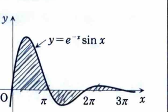

例題 3（積分と級数）

> **資料のアドバイス・公式**
>
> 指数関数と三角関数の積は、部分積分を2回行うと元の積分が再び現れることがある。その場合は、元の積分を文字で置き、方程式として解く。
>
> 整数 $n$ に対して、
>
> $$
> \cos n\pi=(-1)^n
> $$
>
> であり、$\sin x$ の符号は区間 $[n\pi,(n+1)\pi]$ ごとに交互に変わる。
>
> 無限等比級数は、
>
> $$
> \sum_{k=0}^{\infty}ar^k
> =
> \frac{a}{1-r}
> \qquad(|r|<1)
> $$
>
> である。有限和で係数が等差的に変化する場合は、和を $S$ とおいて $S-rS$ を計算する方法が有効である。例えば、
>
> $$
> S=1+2\cdot3+3\cdot3^2+\cdots+n3^{n-1}
> $$
>
> とおき、$3S$ との差を取ると、等比数列の和へ帰着できる。

---

## (1)

$$
\int e^{-x}\sin x\,dx
$$

---

## (1) 解答

> 指数関数と三角関数の積は、部分積分を2回行うと元の積分が現れる。そこで積分を未知数として解く。

$$
I=\int e^{-x}\sin x\,dx
$$

とおく。まず、

$$
u=\sin x,\qquad dv=e^{-x}\,dx
$$

とすれば、

$$
du=\cos x\,dx,\qquad v=-e^{-x}
$$

だから、

$$
I=-e^{-x}\sin x+\int e^{-x}\cos x\,dx
$$

である。次に、

$$
J=\int e^{-x}\cos x\,dx
$$

とおき、

$$
u=\cos x,\qquad dv=e^{-x}\,dx
$$

とすると、

$$
J=-e^{-x}\cos x-\int e^{-x}\sin x\,dx
=-e^{-x}\cos x-I
$$

である。これを $I$ の式に代入すると、

$$
I=-e^{-x}\sin x-e^{-x}\cos x-I
$$

$$
2I=-e^{-x}(\sin x+\cos x)
$$

よって、

$$
\boxed{
\int e^{-x}\sin x\,dx
=
-\frac12e^{-x}(\sin x+\cos x)+C
}
$$

である。

---

## (2)

$$
\int_0^\infty e^{-x}|\sin x|\,dx
$$

---

## (2) 解答

> $\sin x$ は区間 $[n\pi,(n+1)\pi]$ ごとに符号が交互に変わるため、絶対値を区間ごとに外して級数にする。

整数 $n\ge0$ に対して、

$$
|\sin x|=(-1)^n\sin x
\qquad
(n\pi\le x\le(n+1)\pi)
$$

である。したがって、

$$
\int_0^\infty e^{-x}|\sin x|\,dx
=
\sum_{n=0}^{\infty}
(-1)^n
\int_{n\pi}^{(n+1)\pi}e^{-x}\sin x\,dx
$$

である。(1) の原始関数を使うと、

$$
(-1)^n
\int_{n\pi}^{(n+1)\pi}e^{-x}\sin x\,dx
=
\frac12\left(e^{-n\pi}+e^{-(n+1)\pi}\right)
$$

となる。よって、

$$
\int_0^\infty e^{-x}|\sin x|\,dx
=
\frac12
\left(
\sum_{n=0}^{\infty}e^{-n\pi}
+
\sum_{n=0}^{\infty}e^{-(n+1)\pi}
\right)
$$

等比級数の和を代入すると、

$$
=
\frac12
\left(
\frac1{1-e^{-\pi}}
+
\frac{e^{-\pi}}{1-e^{-\pi}}
\right)
$$

したがって、

$$
\boxed{
\int_0^\infty e^{-x}|\sin x|\,dx
=
\frac12\frac{e^\pi+1}{e^\pi-1}
}
$$

である。

