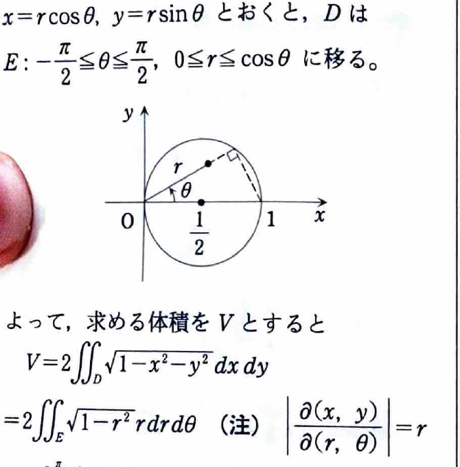

[2B-02] 球
$$
x^2+y^2+z^2\le1
$$
と円柱
$$
x^2+y^2\le x
$$
の共通部分の体積を求めよ。

（神戸大学―工学部）

---

## 解答

> 円柱の内部を $xy$ 平面へ射影した領域上で、球の上半分と下半分の高さの差を積分する。円柱の条件は極座標で $0\le r\le\cos\theta$ となるため、極座標が適している。
>
> 3次元球座標を用いる方法も考えられるが、円柱の境界が球座標では複雑になる。$xy$ 平面上の2重積分が自然である。

円柱の条件を平方完成する。
$$
x^2+y^2\le x
$$
は、
$$
x^2-x+y^2\le0,
$$
$$
\left(x-\frac12\right)^2+y^2\le\frac14
$$
と同値である。

したがって射影領域は、中心 $\left(\frac12,0\right)$、半径 $\frac12$ の円板である。

球の式
$$
x^2+y^2+z^2\le1
$$
から、
$$
-\sqrt{1-x^2-y^2}
\le z\le
\sqrt{1-x^2-y^2}.
$$

したがって、固定した $(x,y)$ における立体の高さは、
$$
\sqrt{1-x^2-y^2}
-
\left(-\sqrt{1-x^2-y^2}\right)
=
2\sqrt{1-x^2-y^2}.
$$

よって体積は、
$$
V
=
2\iint_D\sqrt{1-x^2-y^2}\,dx\,dy.
$$

極座標
$$
x=r\cos\theta,\qquad y=r\sin\theta
$$
を用いる。円柱の条件は、
$$
r^2\le r\cos\theta.
$$
$r\ge0$ なので、
$$
0\le r\le\cos\theta.
$$
右辺が非負となる角度は、
$$
-\frac{\pi}{2}\le\theta\le\frac{\pi}{2}.
$$

また、
$$
dx\,dy=r\,dr\,d\theta.
$$

したがって、
$$
V
=
2\int_{-\pi/2}^{\pi/2}
\int_0^{\cos\theta}
\sqrt{1-r^2}\,r\,dr\,d\theta.
$$

被積分関数と領域は $\theta$ について対称なので、
$$
V
=
4\int_0^{\pi/2}
\int_0^{\cos\theta}
r\sqrt{1-r^2}\,dr\,d\theta.
$$

内側の積分を計算する。置換
$$
u=1-r^2
$$
を用いると、
$$
du=-2r\,dr.
$$
したがって、
$$
\int r\sqrt{1-r^2}\,dr
=
-\frac12\int u^{1/2}\,du
=
-\frac13u^{3/2}
=
-\frac13(1-r^2)^{3/2}.
$$

上下端を代入する前の式は
$$
-\frac13(1-r^2)^{3/2}.
$$
$r=\cos\theta$ と $r=0$ を代入すると、
$$
\begin{aligned}
\int_0^{\cos\theta}r\sqrt{1-r^2}\,dr
&=
\left[
-\frac13(1-r^2)^{3/2}
\right]_0^{\cos\theta}\\
&=
-\frac13(1-\cos^2\theta)^{3/2}
+\frac13.
\end{aligned}
$$

$0\le\theta\le\frac{\pi}{2}$ では $\sin\theta\ge0$ なので、
$$
(1-\cos^2\theta)^{3/2}
=
(\sin^2\theta)^{3/2}
=
\sin^3\theta.
$$

よって、
$$
V
=
\frac43
\int_0^{\pi/2}(1-\sin^3\theta)\,d\theta.
$$

ここで、
$$
\int_0^{\pi/2}1\,d\theta=\frac{\pi}{2}.
$$

また、
$$
\int_0^{\pi/2}\sin^3\theta\,d\theta
=
\int_0^{\pi/2}(1-\cos^2\theta)\sin\theta\,d\theta.
$$
置換
$$
u=\cos\theta,\qquad du=-\sin\theta\,d\theta
$$
を用いると、
$$
\int_0^{\pi/2}\sin^3\theta\,d\theta
=
\int_0^1(1-u^2)\,du
=
\left[u-\frac{u^3}{3}\right]_0^1
=
\frac23.
$$

したがって、
$$
\begin{aligned}
V
&=
\frac43\left(\frac{\pi}{2}-\frac23\right)\\
&=
\frac{2\pi}{3}-\frac89.
\end{aligned}
$$

よって、
$$
\boxed{V=\frac{2\pi}{3}-\frac89}.
$$
