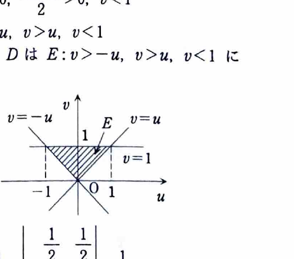

[2B-04] 次の2重積分の値を求めよ。
$$
\iint_D
\cos\frac{\pi(x-y)}{4(x+y)}\,dx\,dy,
$$
ただし、
$$
D=\{(x,y)\mid x>0,\ y>0,\ x+y<1\}.
$$

（大阪府立大学）

---

## 解答

> 被積分関数には $x-y$ と $x+y$ の比が現れ、領域の境界にも $x+y=1$ が現れる。そこで
> $$
> u=x-y,\qquad v=x+y
> $$
> と変数変換すると、被積分関数は $\cos(\pi u/4v)$ となり、領域も直線で囲まれた単純な三角形になる。
>
> 直交座標のまま積分することも理論上は可能だが、比 $(x-y)/(x+y)$ の扱いが難しいため、この変数変換が問題の構造に合っている。

変数変換を、
$$
u=x-y,\qquad v=x+y
$$
とする。

これを $x,y$ について解く。2式を加えると、
$$
u+v=2x,
$$
したがって、
$$
x=\frac{u+v}{2}.
$$

2式の差を取ると、
$$
v-u=2y,
$$
したがって、
$$
y=\frac{v-u}{2}.
$$

ヤコビアンを求める。代入前の行列は、
$$
\frac{\partial(x,y)}{\partial(u,v)}
=
\begin{vmatrix}
\dfrac{\partial x}{\partial u} &
\dfrac{\partial x}{\partial v}\\[4pt]
\dfrac{\partial y}{\partial u} &
\dfrac{\partial y}{\partial v}
\end{vmatrix}.
$$

各偏導関数は、
$$
\frac{\partial x}{\partial u}=\frac12,
\qquad
\frac{\partial x}{\partial v}=\frac12,
$$
$$
\frac{\partial y}{\partial u}=-\frac12,
\qquad
\frac{\partial y}{\partial v}=\frac12.
$$

したがって、
$$
\frac{\partial(x,y)}{\partial(u,v)}
=
\begin{vmatrix}
\frac12&\frac12\\
-\frac12&\frac12
\end{vmatrix}
=
\frac14+\frac14
=
\frac12.
$$

よって、
$$
dx\,dy=\frac12\,du\,dv.
$$

次に領域を変換する。

$x>0$ に
$$
x=\frac{u+v}{2}
$$
を代入すると、
$$
u+v>0,
$$
すなわち、
$$
u>-v.
$$

$y>0$ に
$$
y=\frac{v-u}{2}
$$
を代入すると、
$$
v-u>0,
$$
すなわち、
$$
u<v.
$$

$x+y<1$ は、$v=x+y$ より、
$$
v<1.
$$

また $x>0,y>0$ から $v=x+y>0$ である。したがって、変換後の領域は、
$$
E=\{(u,v)\mid0<v<1,\ -v<u<v\}.
$$

被積分関数は、
$$
\cos\frac{\pi(x-y)}{4(x+y)}
=
\cos\frac{\pi u}{4v}.
$$

したがって、
$$
I
=
\int_0^1
\int_{-v}^{v}
\cos\frac{\pi u}{4v}\cdot\frac12\,du\,dv.
$$

内側の積分を計算する。$v$ は定数なので、
$$
\int\cos\frac{\pi u}{4v}\,du
=
\frac{4v}{\pi}
\sin\frac{\pi u}{4v}.
$$

上下端を代入する前の式は、
$$
\frac{4v}{\pi}
\sin\frac{\pi u}{4v}.
$$
$u=v$ と $u=-v$ を代入すると、
$$
\begin{aligned}
\int_{-v}^{v}
\cos\frac{\pi u}{4v}\,du
&=
\frac{4v}{\pi}
\left(
\sin\frac{\pi}{4}
-\sin\left(-\frac{\pi}{4}\right)
\right)\\
&=
\frac{4v}{\pi}\cdot2\sin\frac{\pi}{4}\\
&=
\frac{4v}{\pi}\cdot2\cdot\frac{\sqrt2}{2}\\
&=
\frac{4\sqrt2}{\pi}v.
\end{aligned}
$$

ヤコビアンの係数 $\frac12$ を掛けて、
$$
I
=
\int_0^1
\frac12\cdot\frac{4\sqrt2}{\pi}v\,dv
=
\frac{2\sqrt2}{\pi}
\int_0^1v\,dv.
$$

原始関数は、
$$
\int v\,dv=\frac{v^2}{2}.
$$
したがって、
$$
I
=
\frac{2\sqrt2}{\pi}
\left[\frac{v^2}{2}\right]_0^1
=
\frac{2\sqrt2}{\pi}\cdot\frac12
=
\frac{\sqrt2}{\pi}.
$$

よって、
$$
\boxed{
\iint_D
\cos\frac{\pi(x-y)}{4(x+y)}\,dx\,dy
=
\frac{\sqrt2}{\pi}
}.
$$
