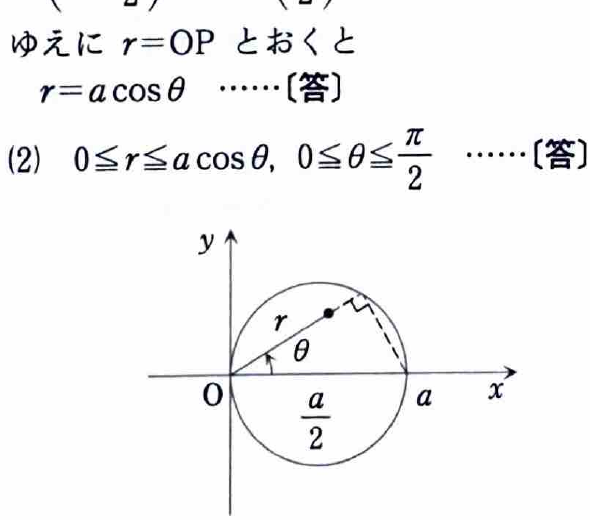

[2B-05] 曲線
$$
\{(x,y)\mid x^2+y^2-ax=0,\ y>0\}\qquad(a>0)
$$
上の1点を $P$ とし、原点を $O$ とする。

（名古屋工業大学）

---

## (1)

直線 $OP$ と $x$ 軸のなす角を $\theta$ としたとき、$OP$ の長さを求めよ。

---

## (1) 解答

> 点 $P$ の極座標を $(r,\theta)$ とすれば、$r=OP$ である。曲線の方程式を極座標へ変換すると、そのまま $r$ が求まる。
>
> 円の中心と半径を平方完成から求め、三角形の幾何で長さを求める方法もあるが、後続の積分でも極座標を使うため、最初から極座標を用いる。

極座標では、
$$
x=r\cos\theta,\qquad y=r\sin\theta,
$$
$$
x^2+y^2=r^2.
$$

曲線の方程式
$$
x^2+y^2-ax=0
$$
へ代入する前の式はそのまま、
$$
x^2+y^2-ax=0.
$$
極座標を代入すると、
$$
r^2-ar\cos\theta=0.
$$

因数分解して、
$$
r(r-a\cos\theta)=0.
$$

$P$ は原点以外の曲線上の点として考えるので $r>0$ であり、
$$
r=a\cos\theta.
$$

$r=OP$ だから、
$$
\boxed{OP=a\cos\theta}.
$$

---

## (2)

領域
$$
D=\{(x,y)\mid x^2+y^2-ax\le0,\ y\ge0\}
$$
を極座標で表せ。

---

## (2) 解答

> (1) で得た境界 $r=a\cos\theta$ の内側を表せばよい。上半平面 $y\ge0$ の条件も角度範囲へ変換する。

まず、
$$
x^2+y^2-ax\le0
$$
を極座標へ変換する。
$$
r^2-ar\cos\theta\le0,
$$
$$
r(r-a\cos\theta)\le0.
$$

$r\ge0$ なので、
$$
0\le r\le a\cos\theta.
$$

この範囲が存在するには、
$$
a\cos\theta\ge0.
$$
$a>0$ なので、
$$
\cos\theta\ge0.
$$

さらに $y\ge0$ は、
$$
r\sin\theta\ge0.
$$
$r\ge0$ だから、
$$
\sin\theta\ge0.
$$

$\sin\theta\ge0$ かつ $\cos\theta\ge0$ となる第1象限を選び、
$$
0\le\theta\le\frac{\pi}{2}.
$$

したがって、
$$
\boxed{
D=
\left\{
(r,\theta)\ \middle|\
0\le r\le a\cos\theta,\ 
0\le\theta\le\frac{\pi}{2}
\right\}
}.
$$

---

## (3)

$D$ を (2) の領域としたとき、次の定積分を求めよ。
$$
I=\iint_D\sqrt{x^2+y^2}\,dx\,dy.
$$

---

## (3) 解答

> 被積分関数 $\sqrt{x^2+y^2}$ は極座標で $r$ となり、領域も (2) で極座標表示されている。したがって、そのまま極座標変換するのが最短である。
>
> ヤコビアンの $r$ を掛けるため、積分する量は $r\cdot r=r^2$ になる。

極座標で、
$$
\sqrt{x^2+y^2}=\sqrt{r^2}=r
$$
である。ここで $r\ge0$ を用いた。

また、
$$
dx\,dy=r\,dr\,d\theta.
$$

(2) の領域を用いると、
$$
I
=
\int_0^{\pi/2}
\int_0^{a\cos\theta}
r\cdot r\,dr\,d\theta.
$$

したがって、
$$
I
=
\int_0^{\pi/2}
\int_0^{a\cos\theta}
r^2\,dr\,d\theta.
$$

内側を積分する。
$$
\int r^2\,dr=\frac{r^3}{3}.
$$

上下端を代入すると、
$$
\begin{aligned}
I
&=
\int_0^{\pi/2}
\left[
\frac{r^3}{3}
\right]_0^{a\cos\theta}
d\theta\\
&=
\frac{a^3}{3}
\int_0^{\pi/2}\cos^3\theta\,d\theta.
\end{aligned}
$$

$\cos^3\theta=\cos\theta(1-\sin^2\theta)$ と書き、
$$
u=\sin\theta,\qquad du=\cos\theta\,d\theta
$$
とおく。積分端は $0$ から $1$ へ移るので、
$$
\begin{aligned}
\int_0^{\pi/2}\cos^3\theta\,d\theta
&=
\int_0^1(1-u^2)\,du\\
&=
\left[u-\frac{u^3}{3}\right]_0^1\\
&=
1-\frac13\\
&=
\frac23.
\end{aligned}
$$

したがって、
$$
I
=
\frac{a^3}{3}\cdot\frac23
=
\frac{2a^3}{9}.
$$

よって、
$$
\boxed{I=\frac{2}{9}a^3}.
$$
