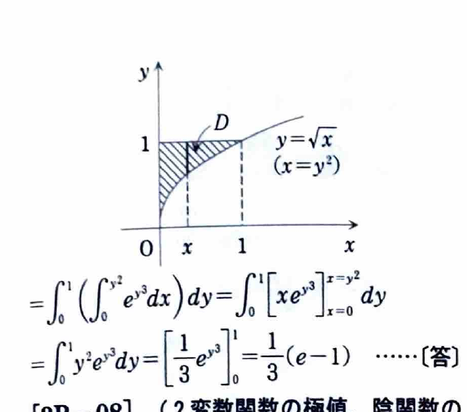

[2B-07] 累次積分
$$
\int_0^1dx\int_{\sqrt{x}}^1e^{y^3}\,dy
$$
の値を、積分の順序を変更して求めよ。

（東京農工大学）

---

## 解答

> 与えられた順序では、内側に $\int e^{y^3}dy$ が現れ、初等関数では原始関数を表せない。積分領域を図示して順序を交換すると、先に $x$ を積分でき、最後に置換 $u=y^3$ が使える。
>
> この問題では「積分順序の交換」が単なる別解ではなく、計算を可能にするための核心である。

与えられた累次積分の領域は、
$$
0\le x\le1,
\qquad
\sqrt{x}\le y\le1
$$
である。

不等式
$$
\sqrt{x}\le y
$$
では、領域内で $x\ge0,y\ge0$ なので両辺を2乗でき、
$$
x\le y^2.
$$

したがって領域は、
$$
D=\{(x,y)\mid0\le y\le1,\ 0\le x\le y^2\}
$$
とも表せる。

よって積分順序を交換すると、
$$
\int_0^1dx\int_{\sqrt{x}}^1e^{y^3}\,dy
=
\int_0^1dy\int_0^{y^2}e^{y^3}\,dx.
$$

内側では $y$ は定数なので、
$$
\int e^{y^3}\,dx=xe^{y^3}.
$$

上下端を代入する前の式は、
$$
xe^{y^3}.
$$
$x=y^2$ と $x=0$ を代入すると、
$$
\int_0^{y^2}e^{y^3}\,dx
=
\left[xe^{y^3}\right]_0^{y^2}
=
y^2e^{y^3}.
$$

したがって、
$$
I
=
\int_0^1y^2e^{y^3}\,dy.
$$

置換前の式は、
$$
\int_0^1y^2e^{y^3}\,dy.
$$
ここで、
$$
u=y^3
$$
とおくと、
$$
du=3y^2\,dy,
\qquad
y^2\,dy=\frac13du.
$$

積分端は、
$$
y=0\Rightarrow u=0,
\qquad
y=1\Rightarrow u=1.
$$

よって、
$$
\begin{aligned}
I
&=
\frac13\int_0^1e^u\,du\\
&=
\frac13\left[e^u\right]_0^1\\
&=
\frac13(e-1).
\end{aligned}
$$

したがって、
$$
\boxed{\frac{e-1}{3}}.
$$
