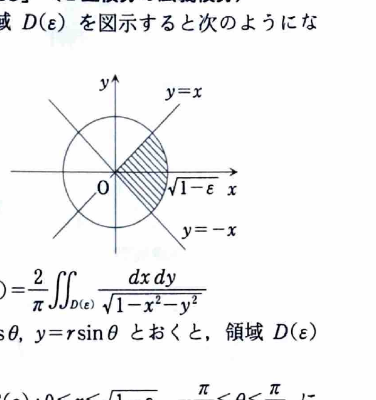

[2B-09] 領域
$$
D(\varepsilon)
=
\{(x,y)\mid x^2+y^2\le1-\varepsilon,\ |y|\le x\}
\qquad(0<\varepsilon<1)
$$
に対して、
$$
I(\varepsilon)
=
\frac2\pi
\iint_{D(\varepsilon)}
\frac{dx\,dy}{\sqrt{1-x^2-y^2}}
$$
とおく。次の問いに答えよ。

（金沢大学―工学部）

---

## (1)

領域 $D(\varepsilon)$ を図示せよ。

---

## (1) 解答

> 円の条件と直線の条件を別々に解釈し、その共通部分を取る。極座標に直すと角度範囲が明確になる。
>
> $|y|\le x$ は $-x\le y\le x$ を意味し、特に $x\ge0$ の右向きの扇形であることに注意する。

円の条件
$$
x^2+y^2\le1-\varepsilon
$$
は、原点中心、半径
$$
\sqrt{1-\varepsilon}
$$
の円板を表す。

また、
$$
|y|\le x
$$
は、
$$
-x\le y\le x
$$
と同値である。境界は直線
$$
y=x,\qquad y=-x
$$
であり、その間の右向きの角度 $\pi/2$ の扇形を表す。

したがって $D(\varepsilon)$ は、半径 $\sqrt{1-\varepsilon}$ の円板のうち、直線 $y=\pm x$ に挟まれた右側の扇形である。

極座標では、
$$
\boxed{
0\le r\le\sqrt{1-\varepsilon},
\qquad
-\frac{\pi}{4}\le\theta\le\frac{\pi}{4}
}.
$$

---

## (2)

$I(\varepsilon)$ を計算せよ。

---

## (2) 解答

> 被積分関数が $x^2+y^2$ のみの関数で、(1) の領域が扇形なので、極座標変換を用いる。
>
> 直交座標では円弧に応じた平方根の積分範囲が必要になるため、極座標の方が大幅に簡単である。

極座標
$$
x=r\cos\theta,\qquad y=r\sin\theta
$$
を用いると、
$$
x^2+y^2=r^2,
\qquad
dx\,dy=r\,dr\,d\theta.
$$

(1) の領域を代入して、
$$
I(\varepsilon)
=
\frac2\pi
\int_{-\pi/4}^{\pi/4}
\int_0^{\sqrt{1-\varepsilon}}
\frac{r}{\sqrt{1-r^2}}\,dr\,d\theta.
$$

内側の積分を計算する。置換前の式は、
$$
\int\frac{r}{\sqrt{1-r^2}}\,dr.
$$
ここで、
$$
u=1-r^2
$$
とおくと、
$$
du=-2r\,dr.
$$
したがって、
$$
\int\frac{r}{\sqrt{1-r^2}}\,dr
=
-\sqrt{1-r^2}.
$$

上下端を代入する前の式は、
$$
-\sqrt{1-r^2}.
$$
$r=\sqrt{1-\varepsilon}$ と $r=0$ を代入すると、
$$
\begin{aligned}
\int_0^{\sqrt{1-\varepsilon}}
\frac{r}{\sqrt{1-r^2}}\,dr
&=
\left[
-\sqrt{1-r^2}
\right]_0^{\sqrt{1-\varepsilon}}\\
&=
-\sqrt{1-(1-\varepsilon)}+\sqrt1\\
&=
-\sqrt{\varepsilon}+1.
\end{aligned}
$$

角度区間の長さは、
$$
\frac{\pi}{4}-\left(-\frac{\pi}{4}\right)
=
\frac{\pi}{2}.
$$

したがって、
$$
\begin{aligned}
I(\varepsilon)
&=
\frac2\pi\cdot\frac{\pi}{2}
(1-\sqrt{\varepsilon})\\
&=
1-\sqrt{\varepsilon}.
\end{aligned}
$$

よって、
$$
\boxed{I(\varepsilon)=1-\sqrt{\varepsilon}}.
$$

---

## (3)

$$
\lim_{\varepsilon\to+0}
\frac{\log I(\varepsilon)}{\sqrt{\varepsilon}}
$$
の値を求めよ。

---

## (3) 解答

> (2) の式を代入し、$t=\sqrt{\varepsilon}$ と置くと、基本極限
> $$
> \lim_{t\to0}\frac{\log(1-t)}{t}=-1
> $$
> に帰着する。
>
> ロピタルの定理を使う方法と、$\log(1-t)=-t+o(t)$ という展開を使う方法がある。ここでは資料に沿ってロピタルの定理で確認する。

(2) より、
$$
I(\varepsilon)=1-\sqrt{\varepsilon}.
$$

したがって、
$$
\frac{\log I(\varepsilon)}{\sqrt{\varepsilon}}
=
\frac{\log(1-\sqrt{\varepsilon})}{\sqrt{\varepsilon}}.
$$

ここで、
$$
t=\sqrt{\varepsilon}
$$
とおく。$\varepsilon\to+0$ のとき $t\to+0$ であるから、
$$
\lim_{\varepsilon\to+0}
\frac{\log I(\varepsilon)}{\sqrt{\varepsilon}}
=
\lim_{t\to+0}\frac{\log(1-t)}{t}.
$$

分子と分母はいずれも $0$ に近づくので、ロピタルの定理を用いる。
$$
\frac{d}{dt}\log(1-t)
=
-\frac1{1-t},
\qquad
\frac{d}{dt}t=1.
$$

したがって、
$$
\begin{aligned}
\lim_{t\to+0}\frac{\log(1-t)}{t}
&=
\lim_{t\to+0}
\frac{-1/(1-t)}{1}\\
&=
-1.
\end{aligned}
$$

よって、
$$
\boxed{-1}.
$$
