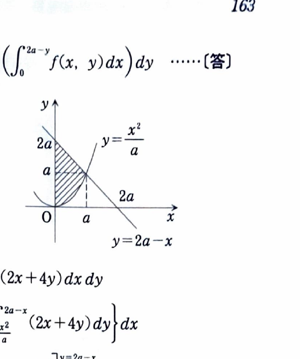

[2B-14] 次の問いに答えよ。ただし、$a>0$ とする。

（広島大学）

---

## (1)

累次積分
$$
\int_0^a
\left\{
\int_{x^2/a}^{\,2a-x}
f(x,y)\,dy
\right\}dx
$$
の積分の順序を変更せよ。

---

## (1) 解答

> 積分順序を交換するには、まず領域を図示し、固定した $y$ に対する $x$ の範囲を読み取る。上側の境界 $y=2a-x$ と下側の境界 $y=x^2/a$ は $(a,a)$ で交わるため、$y=a$ を境に横線の右端が変わる。
>
> 不等式を機械的に解くだけでも求められるが、領域を描くと分割点を見落としにくい。

元の積分領域は、
$$
D=
\left\{
(x,y)\ \middle|\
0\le x\le a,\ 
\frac{x^2}{a}\le y\le2a-x
\right\}.
$$

2つの境界の交点を求める。
$$
\frac{x^2}{a}=2a-x.
$$
両辺に $a$ を掛けると、
$$
x^2=2a^2-ax.
$$
整理して、
$$
x^2+ax-2a^2=0.
$$
因数分解すると、
$$
(x-a)(x+2a)=0.
$$
領域では $x\ge0$ なので、
$$
x=a.
$$
このとき、
$$
y=\frac{a^2}{a}=a.
$$
したがって交点は $(a,a)$ である。

固定した $y$ に対する $x$ の範囲を考える。

放物線の条件
$$
\frac{x^2}{a}\le y
$$
は、$x\ge0,a>0$ より、
$$
x\le\sqrt{ay}.
$$

直線の条件
$$
y\le2a-x
$$
は、
$$
x\le2a-y.
$$

$0\le y\le a$ では、右端は放物線
$$
x=\sqrt{ay}
$$
で決まる。したがって、
$$
0\le x\le\sqrt{ay}.
$$

$a\le y\le2a$ では、右端は直線
$$
x=2a-y
$$
で決まる。したがって、
$$
0\le x\le2a-y.
$$

よって、積分順序を交換すると、
$$
\boxed{
\int_0^a
\left(
\int_0^{\sqrt{ay}}f(x,y)\,dx
\right)dy
+
\int_a^{2a}
\left(
\int_0^{2a-y}f(x,y)\,dx
\right)dy
}.
$$

---

## (2)

不等式
$$
x\ge0,\qquad y\ge\frac{x^2}{a},\qquad x+y\le2a
$$
を満たす $xy$ 平面の領域を $D$ とする。このとき、
$$
\iint_D(2x+4y)\,dx\,dy
$$
を求めよ。

---

## (2) 解答

> 領域は (1) と同じであり、元の縦線型表示
> $$
> 0\le x\le a,\qquad \frac{x^2}{a}\le y\le2a-x
> $$
> をそのまま使うと、被積分関数が $y$ の1次式なので容易に積分できる。
>
> (1) で交換した順序を用いてもよいが、$y=a$ で積分を2つに分ける必要がある。今回は分割のない元の順序を選ぶ。

領域 $D$ は、
$$
0\le x\le a,
\qquad
\frac{x^2}{a}\le y\le2a-x
$$
と表せる。

したがって、
$$
I
=
\int_0^a
\left(
\int_{x^2/a}^{2a-x}
(2x+4y)\,dy
\right)dx.
$$

内側では $x$ を定数として扱う。
$$
\int(2x+4y)\,dy
=
2xy+2y^2.
$$

上下端を代入する前の式は、
$$
2xy+2y^2.
$$

上端 $y=2a-x$ を代入すると、
$$
2x(2a-x)+2(2a-x)^2.
$$

下端 $y=x^2/a$ を代入すると、
$$
2x\frac{x^2}{a}
+
2\left(\frac{x^2}{a}\right)^2.
$$

したがって、
$$
\begin{aligned}
I
&=
\int_0^a
\Biggl[
2x(2a-x)+2(2a-x)^2\\
&\qquad
-\frac{2x^3}{a}
-\frac{2x^4}{a^2}
\Biggr]dx.
\end{aligned}
$$

上端から来る項を整理する。
$$
2x(2a-x)=4ax-2x^2,
$$
$$
2(2a-x)^2
=
2(4a^2-4ax+x^2)
=
8a^2-8ax+2x^2.
$$

したがって、
$$
2x(2a-x)+2(2a-x)^2
=
8a^2-4ax.
$$

よって、
$$
I
=
\int_0^a
\left(
8a^2-4ax-\frac{2x^3}{a}-\frac{2x^4}{a^2}
\right)dx.
$$

各項を積分する。
$$
\int8a^2\,dx=8a^2x,
$$
$$
\int(-4ax)\,dx=-2ax^2,
$$
$$
\int-\frac{2x^3}{a}\,dx
=
-\frac{x^4}{2a},
$$
$$
\int-\frac{2x^4}{a^2}\,dx
=
-\frac{2x^5}{5a^2}.
$$

したがって、
$$
\begin{aligned}
I
&=
\left[
8a^2x-2ax^2-\frac{x^4}{2a}
-\frac{2x^5}{5a^2}
\right]_0^a\\
&=
8a^3-2a^3-\frac{a^4}{2a}
-\frac{2a^5}{5a^2}\\
&=
8a^3-2a^3-\frac12a^3-\frac25a^3.
\end{aligned}
$$

通分すると、
$$
8-2-\frac12-\frac25
=
\frac{80-20-5-4}{10}
=
\frac{51}{10}.
$$

よって、
$$
\boxed{
\iint_D(2x+4y)\,dx\,dy
=
\frac{51}{10}a^3
}.
$$
