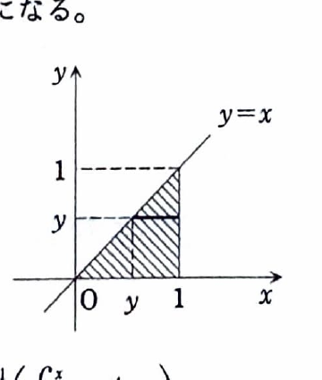

[2C-02] 累次積分
$$
I=\int_0^1\left(\int_y^1y^2e^{x^4}\,dx\right)dy
$$
の計算を実行しよう。次の問いに答えよ。

（大阪府立大学）

---

## (1)

$I$ を2重積分とみたとき、積分する領域（境界を含む）を $xy$ 平面上に図示せよ。

---

## (1) 解答

> 外側の変数 $y$ と内側の変数 $x$ の範囲をそのまま不等式に直し、領域を描く。積分順序を交換するためには、同じ領域を $x$ を外側にした形でも表せるようにする必要がある。

与えられた累次積分から、
$$
0\le y\le1,
\qquad
y\le x\le1
$$
である。

したがって、
$$
D=\{(x,y)\mid0\le y\le1,\ y\le x\le1\}.
$$

これは単位正方形内で、直線 $y=x$ の下側にある三角形である。

同じ領域を $x$ を先に指定する形で表すと、
$$
0\le x\le1,
\qquad
0\le y\le x.
$$

したがって、
$$
\boxed{
D=\{(x,y)\mid0\le x\le1,\ 0\le y\le x\}
}.
$$

---

## (2)

積分順序を交換することにより、$I$ の値を求めよ。

---

## (2) 解答

> 元の順序では内側に $\int e^{x^4}dx$ が現れ、初等関数では原始関数を表せない。順序を交換すると $y$ を先に積分でき、その結果 $x^3e^{x^4}$ が現れて置換積分が可能になる。
>
> この問題では、積分順序の交換が計算を成立させる決定的な操作である。

(1) の領域表示から、
$$
I
=
\int_0^1
\left(
\int_0^x
y^2e^{x^4}\,dy
\right)dx.
$$

内側では $x$ は定数なので、$e^{x^4}$ を定数として扱う。
$$
\int y^2e^{x^4}\,dy
=
e^{x^4}\frac{y^3}{3}.
$$

上下端を代入する前の式は、
$$
e^{x^4}\frac{y^3}{3}.
$$
$y=x$ と $y=0$ を代入すると、
$$
\int_0^x y^2e^{x^4}\,dy
=
e^{x^4}\left[\frac{y^3}{3}\right]_0^x
=
\frac{x^3}{3}e^{x^4}.
$$

したがって、
$$
I
=
\frac13\int_0^1x^3e^{x^4}\,dx.
$$

置換前の式は、
$$
\int_0^1x^3e^{x^4}\,dx.
$$
ここで、
$$
u=x^4
$$
とおくと、
$$
du=4x^3\,dx,
\qquad
x^3\,dx=\frac14du.
$$

積分端は、
$$
x=0\Rightarrow u=0,
\qquad
x=1\Rightarrow u=1.
$$

したがって、
$$
\begin{aligned}
I
&=
\frac13\cdot\frac14
\int_0^1e^u\,du\\
&=
\frac1{12}
\left[e^u\right]_0^1\\
&=
\frac{e-1}{12}.
\end{aligned}
$$

よって、
$$
\boxed{I=\frac{e-1}{12}}.
$$
