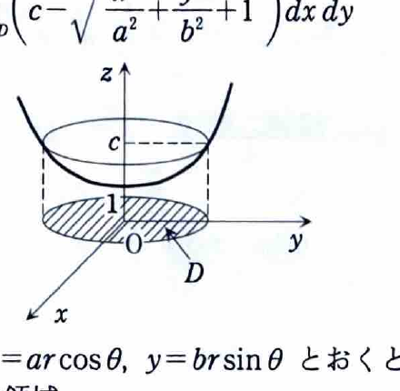

[2C-09] 次の問いに答えよ。

（東京大学―工学部）

---

## (1)

次の不等式の表す立体の体積を求めよ。ただし、$a>0,\ b>0,\ c>1$ とする。
$$
\frac{x^2}{a^2}+\frac{y^2}{b^2}-z^2+1\le0,
\qquad
1\le z\le c.
$$

---

## (1) 解答

> 不等式を $z$ について解くと、下側が双曲面
> $$
> z=\sqrt{1+\frac{x^2}{a^2}+\frac{y^2}{b^2}}
> $$
> 、上側が平面 $z=c$ である。$xy$ 平面上の射影領域は楕円になるため、楕円を単位円へ移す極座標型変換
> $$
> x=ar\cos\theta,\qquad y=br\sin\theta
> $$
> を用いる。
>
> 先に $z$ を含む3重積分を立てる方法もあるが、高さの差を2重積分する方が簡潔である。

最初の不等式を整理する。
$$
\frac{x^2}{a^2}+\frac{y^2}{b^2}-z^2+1\le0.
$$

$z^2$ を右辺へ移すと、
$$
\frac{x^2}{a^2}+\frac{y^2}{b^2}+1\le z^2.
$$

条件 $z\ge1>0$ より正の平方根を取ることができ、
$$
z\ge
\sqrt{
1+\frac{x^2}{a^2}+\frac{y^2}{b^2}
}.
$$

さらに $z\le c$ なので、立体が存在するためには、
$$
\sqrt{
1+\frac{x^2}{a^2}+\frac{y^2}{b^2}
}
\le c.
$$

両辺は非負なので2乗して、
$$
1+\frac{x^2}{a^2}+\frac{y^2}{b^2}\le c^2.
$$
したがって射影領域は、
$$
D=
\left\{
(x,y)\ \middle|\
\frac{x^2}{a^2}+\frac{y^2}{b^2}
\le c^2-1
\right\}.
$$

固定した $(x,y)\in D$ での高さは、
$$
c-
\sqrt{
1+\frac{x^2}{a^2}+\frac{y^2}{b^2}
}.
$$

よって体積は、
$$
V
=
\iint_D
\left(
c-
\sqrt{
1+\frac{x^2}{a^2}+\frac{y^2}{b^2}
}
\right)dx\,dy.
$$

変数変換を、
$$
x=ar\cos\theta,
\qquad
y=br\sin\theta
$$
とする。

すると、
$$
\frac{x^2}{a^2}+\frac{y^2}{b^2}
=
r^2\cos^2\theta+r^2\sin^2\theta
=
r^2.
$$

領域は、
$$
0\le r\le\sqrt{c^2-1},
\qquad
0\le\theta\le2\pi
$$
に移る。

ヤコビアンを求める。
$$
\frac{\partial(x,y)}{\partial(r,\theta)}
=
\begin{vmatrix}
a\cos\theta&-ar\sin\theta\\
b\sin\theta&br\cos\theta
\end{vmatrix}.
$$

計算すると、
$$
\begin{aligned}
\frac{\partial(x,y)}{\partial(r,\theta)}
&=
ab r\cos^2\theta
+
ab r\sin^2\theta\\
&=
ab r.
\end{aligned}
$$

$a,b,r\ge0$ なので、
$$
dx\,dy=ab r\,dr\,d\theta.
$$

したがって、
$$
V
=
ab
\int_0^{2\pi}
\int_0^{\sqrt{c^2-1}}
\left(c-\sqrt{1+r^2}\right)r\,dr\,d\theta.
$$

角度積分を行うと、
$$
V
=
2\pi ab
\int_0^{\sqrt{c^2-1}}
\left(cr-r\sqrt{1+r^2}\right)dr.
$$

各項を積分する。
$$
\int cr\,dr=\frac{c}{2}r^2.
$$

また、置換
$$
u=1+r^2
$$
を用いると、
$$
du=2r\,dr
$$
なので、
$$
\int r\sqrt{1+r^2}\,dr
=
\frac12\int u^{1/2}\,du
=
\frac13u^{3/2}
=
\frac13(1+r^2)^{3/2}.
$$

したがって、
$$
V
=
2\pi ab
\left[
\frac{c}{2}r^2
-
\frac13(1+r^2)^{3/2}
\right]_0^{\sqrt{c^2-1}}.
$$

上端を代入する前の式は、
$$
\frac{c}{2}r^2
-
\frac13(1+r^2)^{3/2}.
$$

$r=\sqrt{c^2-1}$ では、
$$
r^2=c^2-1,
$$
$$
1+r^2=c^2.
$$
$c>1$ なので、
$$
(c^2)^{3/2}=c^3.
$$

下端 $r=0$ では、
$$
\frac{c}{2}\cdot0-\frac13=-\frac13.
$$

したがって、
$$
\begin{aligned}
V
&=
2\pi ab
\left\{
\frac{c}{2}(c^2-1)
-\frac13c^3
+\frac13
\right\}\\
&=
2\pi ab
\left(
\frac{c^3-c}{2}
-\frac{c^3}{3}
+\frac13
\right).
\end{aligned}
$$

分母を $6$ にそろえる。
$$
\frac{c^3-c}{2}
-\frac{c^3}{3}
+\frac13
=
\frac{3c^3-3c-2c^3+2}{6}
=
\frac{c^3-3c+2}{6}.
$$

したがって、
$$
V
=
\frac{\pi ab}{3}(c^3-3c+2).
$$

因数分解すると、
$$
c^3-3c+2=(c-1)^2(c+2).
$$

よって、
$$
\boxed{
V=
\frac{\pi}{3}ab(c-1)^2(c+2)
}.
$$

---

## (2)

次の不等式の表す立体の体積を求めよ。ただし、$a>0,\ b>0$ とする。
$$
0\le z\le x^2+y^2,
\qquad
\frac{x^2}{a^2}+\frac{y^2}{b^2}\le1.
$$

---

## (2) 解答

> $xy$ 平面上の楕円領域で、高さ $x^2+y^2$ を積分する。楕円を円板へ移す変換
> $$
> x=ar\cos\theta,\qquad y=br\sin\theta
> $$
> を用いると、領域が $0\le r\le1$ になる。
>
> $u=x/a,v=y/b$ で単位円へ線形変換してから通常の極座標を用いる方法も同値である。

固定した $(x,y)$ における $z$ の範囲は、
$$
0\le z\le x^2+y^2.
$$
したがって高さは、
$$
x^2+y^2.
$$

射影領域を、
$$
D=
\left\{
(x,y)\ \middle|\
\frac{x^2}{a^2}+\frac{y^2}{b^2}\le1
\right\}
$$
とすると、
$$
V=\iint_D(x^2+y^2)\,dx\,dy.
$$

変数変換
$$
x=ar\cos\theta,
\qquad
y=br\sin\theta
$$
を用いる。

領域は、
$$
0\le r\le1,
\qquad
0\le\theta\le2\pi
$$
に移り、ヤコビアンは、
$$
dx\,dy=ab r\,dr\,d\theta.
$$

また、
$$
x^2+y^2
=
a^2r^2\cos^2\theta
+
b^2r^2\sin^2\theta.
$$

したがって、
$$
\begin{aligned}
V
&=
\int_0^{2\pi}
\int_0^1
\left(
a^2r^2\cos^2\theta
+b^2r^2\sin^2\theta
\right)
ab r\,dr\,d\theta\\
&=
ab
\left(
\int_0^1r^3\,dr
\right)
\left(
\int_0^{2\pi}
(a^2\cos^2\theta+b^2\sin^2\theta)\,d\theta
\right).
\end{aligned}
$$

半径方向は、
$$
\int_0^1r^3\,dr
=
\left[\frac{r^4}{4}\right]_0^1
=
\frac14.
$$

角度方向では、
$$
\int_0^{2\pi}\cos^2\theta\,d\theta=\pi,
$$
$$
\int_0^{2\pi}\sin^2\theta\,d\theta=\pi.
$$

したがって、
$$
\begin{aligned}
\int_0^{2\pi}
(a^2\cos^2\theta+b^2\sin^2\theta)\,d\theta
&=
a^2\pi+b^2\pi\\
&=
\pi(a^2+b^2).
\end{aligned}
$$

よって、
$$
V
=
ab\cdot\frac14\cdot\pi(a^2+b^2).
$$

したがって、
$$
\boxed{
V=\frac{\pi}{4}ab(a^2+b^2)
}.
$$
