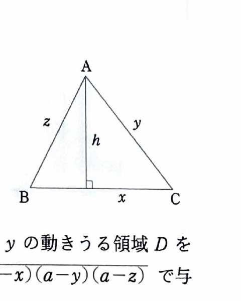
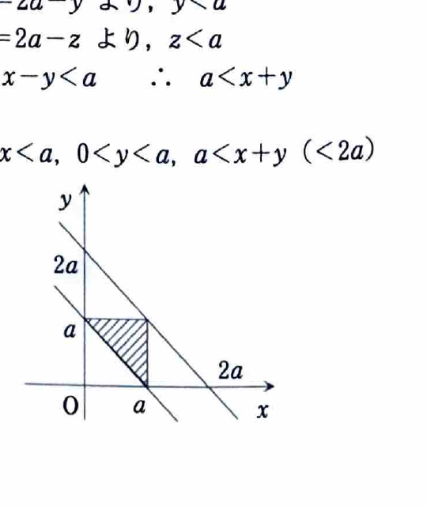

[2C-11] 正の定数を $a$ とする。3辺の長さの和が $2a$ という条件を保ちながら変化する三角形 $ABC$ を考える。辺の長さを

$$
BC=x,\qquad CA=y,\qquad AB=z
$$

とし、頂点 $A$ から辺 $BC$ に下ろした垂線の長さを $h$ とする。

（大阪大学―工学部）

---

## (1)

三角形 $ABC$ を辺 $BC$ のまわりに1回転してできる立体の体積 $V$ を、$x$ と $h$ を用いて表せ。

---

## (1) 解答

> 回転してできる立体は、垂線の足を境にしてできる2つの円すいを合わせたものである。各円すいの底面半径はどちらも $h$ であり、2つの高さの和は辺 $BC$ の長さ $x$ になる。
>
> 円すいの体積の公式は、底面半径を $r$、高さを $H$ とすると
>
> $$
> V_{\mathrm{cone}}=\frac{1}{3}\pi r^2H
> $$
>
> である。この公式を2つの円すいにそれぞれ適用して足し合わせる方法もあるが、高さの和が $x$ であることを使えば一度に計算できる。

垂線の足から頂点 $B$ までの長さを $p$、頂点 $C$ までの長さを $q$ とおくと、

$$
p+q=x
$$

である。

2つの円すいの体積の和は、円すいの体積公式より

$$
V=\frac{1}{3}\pi h^2p+\frac{1}{3}\pi h^2q
$$

である。

共通因数をくくると、

$$
V=\frac{1}{3}\pi h^2(p+q)
$$

ここで、代入前の式

$$
V=\frac{1}{3}\pi h^2(p+q)
$$

に $p+q=x$ を代入すると、

$$
V=\frac{1}{3}\pi h^2x
$$

したがって、

$$
\boxed{V=\frac{\pi}{3}h^2x}
$$

---

## (2)

体積 $V$ を $x$ と $y$ の関数として表せ。また、変数 $x,y$ の動き得る領域 $D$ を図示せよ。

ただし、三角形の面積についてヘロンの公式

$$
S=\sqrt{a(a-x)(a-y)(a-z)}
$$

を用いてよい。

---

## (2) 解答

> この問題では、(1)で得た
>
> $$
> V=\frac{\pi}{3}h^2x
> $$
>
> から高さ $h$ を消去する必要がある。高さを直接、余弦定理などから求めることもできるが、問題文でヘロンの公式が与えられているため、三角形の面積を「底辺と高さ」と「ヘロンの公式」の2通りで表して結び付ける方法が最も自然である。
>
> ヘロンの公式に現れる $a$ は半周長である。ここでは周長が $2a$ なので、半周長は確かに $a$ である。

三角形 $ABC$ の面積を $S$ とする。

底辺を $BC=x$、高さを $h$ と見ると、三角形の面積は

$$
S=\frac{1}{2}xh
$$

である。

一方、ヘロンの公式より、

$$
S=\sqrt{a(a-x)(a-y)(a-z)}
$$

である。

したがって、

$$
\frac{1}{2}xh=\sqrt{a(a-x)(a-y)(a-z)}
$$

両辺を2乗すると、

$$
\left(\frac{1}{2}xh\right)^2
=
\left(\sqrt{a(a-x)(a-y)(a-z)}\right)^2
$$

よって、

$$
\frac{1}{4}x^2h^2=a(a-x)(a-y)(a-z)
$$

両辺を $\dfrac{4}{x^2}$ 倍すると、

$$
h^2=\frac{4a(a-x)(a-y)(a-z)}{x^2}
$$

(1)で得た体積の式は

$$
V=\frac{\pi}{3}h^2x
$$

である。

この式に

$$
h^2=\frac{4a(a-x)(a-y)(a-z)}{x^2}
$$

を代入すると、

$$
V
=
\frac{\pi}{3}
\cdot
\frac{4a(a-x)(a-y)(a-z)}{x^2}
\cdot x
$$

したがって、

$$
V
=
\frac{4\pi a}{3}
\frac{(a-x)(a-y)(a-z)}{x}
$$

周長が $2a$ であるから、

$$
x+y+z=2a
$$

であり、

$$
z=2a-x-y
$$

である。したがって、

$$
a-z=a-(2a-x-y)=x+y-a
$$

となる。

代入前の式

$$
V
=
\frac{4\pi a}{3}
\frac{(a-x)(a-y)(a-z)}{x}
$$

に $a-z=x+y-a$ を代入すると、

$$
\boxed{
V(x,y)
=
\frac{4\pi a}{3}
\frac{(a-x)(a-y)(x+y-a)}{x}
}
$$

を得る。

> 次に、$x,y$ が動き得る範囲を三角形の成立条件から求める。
>
> 3辺の長さが $x,y,z$ である三角形が成立するためには、各辺が正であり、どの1辺も残り2辺の和より短くなければならない。

まず、

$$
x>0,\qquad y>0,\qquad z>0
$$

である。

ここで、

$$
z=2a-x-y
$$

なので、$z>0$ は

$$
2a-x-y>0
$$

すなわち、

$$
x+y<2a
$$

を意味する。

次に、三角形の成立条件

$$
x<y+z
$$

に $z=2a-x-y$ を代入すると、

$$
x<y+(2a-x-y)
$$

よって、

$$
x<2a-x
$$

したがって、

$$
x<a
$$

である。

同様に、

$$
y<z+x
$$

へ $z=2a-x-y$ を代入すると、

$$
y<(2a-x-y)+x
$$

よって、

$$
y<2a-y
$$

したがって、

$$
y<a
$$

である。

最後に、

$$
z<x+y
$$

へ $z=2a-x-y$ を代入すると、

$$
2a-x-y<x+y
$$

よって、

$$
2a<2x+2y
$$

したがって、

$$
a<x+y
$$

である。

以上から、領域 $D$ は

$$
\boxed{
D=\{(x,y)\mid 0<x<a,\ 0<y<a,\ a<x+y<2a\}
}
$$

である。

> ただし、$0<x<a$ かつ $0<y<a$ なら自動的に $x+y<2a$ となる。したがって、同じ領域を
>
> $$
> D=\{(x,y)\mid 0<x<a,\ 0<y<a,\ x+y>a\}
> $$
>
> と表してもよい。
>
> 図では、正方形 $0<x<a,\ 0<y<a$ のうち、直線 $x+y=a$ より上側の三角形状の部分が領域 $D$ である。境界上では三角形がつぶれるため、境界は含まれない。

---

## (3)

$x,y$ が領域 $D$ 内を動くとき、体積 $V$ が最大となる $x,y$ の値を求め、そのときの体積を求めよ。

---

## (3) 解答

> 体積は2変数関数
>
> $$
> V(x,y)
> =
> \frac{4\pi a}{3}
> \frac{(a-x)(a-y)(x+y-a)}{x}
> $$
>
> である。最大値を求める代表的な方法には、偏微分して停留点を調べる方法、変数を置き換えて不等式を用いる方法などがある。ここでは資料の解答に沿い、領域内部で偏導関数をともに $0$ とする点を求める。
>
> 定数因子 $\dfrac{4\pi a}{3}$ は正であるため、偏微分の計算では残りの因子に注目できる。ただし、最終的な体積には定数因子を戻す必要がある。

体積の式を再掲すると、

$$
V(x,y)
=
\frac{4\pi a}{3}
\frac{(a-x)(a-y)(x+y-a)}{x}
$$

である。

まず $x$ で偏微分する。$y$ を定数として扱い、商の微分公式

$$
\left(\frac{F(x)}{x}\right)'
=
\frac{F'(x)x-F(x)}{x^2}
$$

を用いる。

ここで、

$$
F(x)=(a-x)(a-y)(x+y-a)
$$

とおく。

したがって、

$$
\frac{\partial V}{\partial x}
=
\frac{4\pi a}{3}
\frac{F_x(x)x-F(x)}{x^2}
$$

である。

$F(x)$ のうち $(a-y)$ は $x$ に関して定数なので、

$$
F_x(x)
=
(a-y)\frac{\partial}{\partial x}\{(a-x)(x+y-a)\}
$$

積の微分公式より、

$$
\frac{\partial}{\partial x}\{(a-x)(x+y-a)\}
=
(-1)(x+y-a)+(a-x)\cdot1
$$

したがって、

$$
F_x(x)
=
(a-y)\{-(x+y-a)+(a-x)\}
$$

である。

これを商の微分の式に代入すると、

$$
\frac{\partial V}{\partial x}
=
\frac{4\pi a}{3}
\frac{
(a-y)\{-(x+y-a)+(a-x)\}x
-
(a-x)(a-y)(x+y-a)
}{x^2}
$$

$(a-y)$ をくくると、

$$
\frac{\partial V}{\partial x}
=
\frac{4\pi a}{3}
\frac{a-y}{x^2}
\left[
\{-(x+y-a)+(a-x)\}x
-
(a-x)(x+y-a)
\right]
$$

角括弧の中を整理する。

$$
\{-(x+y-a)+(a-x)\}x
=
(-2x-y+2a)x
$$

であるから、

$$
\begin{aligned}
&(-2x-y+2a)x-(a-x)(x+y-a)\\
&=-2x^2-xy+2ax-\{ax+ay-a^2-x^2-xy+ax\}\\
&=-2x^2-xy+2ax-2ax-ay+a^2+x^2+xy\\
&=a^2-x^2-ay
\end{aligned}
$$

よって、

$$
\boxed{
\frac{\partial V}{\partial x}
=
\frac{4\pi a}{3}
\frac{a-y}{x^2}
\left(a^2-x^2-ay\right)
}
$$

である。

次に $y$ で偏微分する。$x$ を定数として扱うと、

$$
\frac{\partial V}{\partial y}
=
\frac{4\pi a}{3}
\frac{a-x}{x}
\frac{\partial}{\partial y}
\{(a-y)(x+y-a)\}
$$

積の微分公式より、

$$
\frac{\partial}{\partial y}
\{(a-y)(x+y-a)\}
=
(-1)(x+y-a)+(a-y)\cdot1
$$

したがって、

$$
\frac{\partial}{\partial y}
\{(a-y)(x+y-a)\}
=
-x-y+a+a-y
$$

よって、

$$
\frac{\partial}{\partial y}
\{(a-y)(x+y-a)\}
=
2a-x-2y
$$

である。

以上から、

$$
\boxed{
\frac{\partial V}{\partial y}
=
\frac{4\pi a}{3}
\frac{(a-x)(2a-x-2y)}{x}
}
$$

を得る。

領域 $D$ の内部では、

$$
0<x<a,\qquad 0<y<a
$$

なので、

$$
x>0,\qquad a-x>0,\qquad a-y>0
$$

である。

したがって、

$$
\frac{\partial V}{\partial x}=0
$$

となるための条件は、

$$
a^2-x^2-ay=0
\tag{1}
$$

である。

また、

$$
\frac{\partial V}{\partial y}=0
$$

となるための条件は、

$$
2a-x-2y=0
\tag{2}
$$

である。

式 (2) を $x$ について解くと、

$$
x=2a-2y
$$

である。

代入前の式 (1)

$$
a^2-x^2-ay=0
$$

に $x=2a-2y$ を代入すると、

$$
a^2-(2a-2y)^2-ay=0
$$

平方を展開すると、

$$
a^2-\left(4a^2-8ay+4y^2\right)-ay=0
$$

よって、

$$
-3a^2+7ay-4y^2=0
$$

両辺に $-1$ を掛けると、

$$
4y^2-7ay+3a^2=0
$$

因数分解すると、

$$
(y-a)(4y-3a)=0
$$

したがって、

$$
y=a
$$

または

$$
y=\frac{3a}{4}
$$

である。

しかし、領域 $D$ の内部では $y<a$ であるため、$y=a$ は含まれない。よって、

$$
y=\frac{3a}{4}
$$

である。

代入前の式

$$
x=2a-2y
$$

に $y=\dfrac{3a}{4}$ を代入すると、

$$
x
=
2a-2\cdot\frac{3a}{4}
$$

したがって、

$$
x
=
2a-\frac{3a}{2}
=
\frac{a}{2}
$$

である。

> 得られた点
>
> $$
> \left(\frac{a}{2},\frac{3a}{4}\right)
> $$
>
> は
>
> $$
> 0<\frac{a}{2}<a,\qquad
> 0<\frac{3a}{4}<a,\qquad
> \frac{a}{2}+\frac{3a}{4}=\frac{5a}{4}>a
> $$
>
> を満たすので、確かに領域 $D$ の内部にある。
>
> また、領域の境界に近づくと三角形が退化し、高さが $0$ に近づくため体積も $0$ に近づく。領域内部の停留点は上で求めた1点だけであり、そこで体積は正になる。したがって、この点で体積は最大になる。

最後に、体積の式

$$
V(x,y)
=
\frac{4\pi a}{3}
\frac{(a-x)(a-y)(x+y-a)}{x}
$$

へ

$$
x=\frac{a}{2},\qquad y=\frac{3a}{4}
$$

を代入する。

まず、各因子を計算すると、

$$
a-x
=
a-\frac{a}{2}
=
\frac{a}{2}
$$

$$
a-y
=
a-\frac{3a}{4}
=
\frac{a}{4}
$$

$$
x+y-a
=
\frac{a}{2}+\frac{3a}{4}-a
=
\frac{a}{4}
$$

である。

したがって、

$$
V
=
\frac{4\pi a}{3}
\frac{
\left(\dfrac{a}{2}\right)
\left(\dfrac{a}{4}\right)
\left(\dfrac{a}{4}\right)
}{
\dfrac{a}{2}
}
$$

分子と分母の $\dfrac{a}{2}$ を約分すると、

$$
V
=
\frac{4\pi a}{3}
\cdot
\frac{a^2}{16}
$$

よって、

$$
V
=
\frac{\pi a^3}{12}
$$

以上より、体積が最大となるのは

$$
\boxed{
x=\frac{a}{2},\qquad y=\frac{3a}{4}
}
$$

のときであり、その最大体積は

$$
\boxed{
V_{\max}=\frac{\pi a^3}{12}
}
$$

である。
