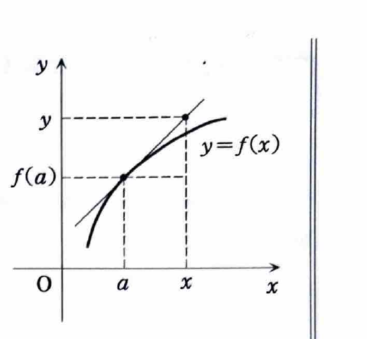
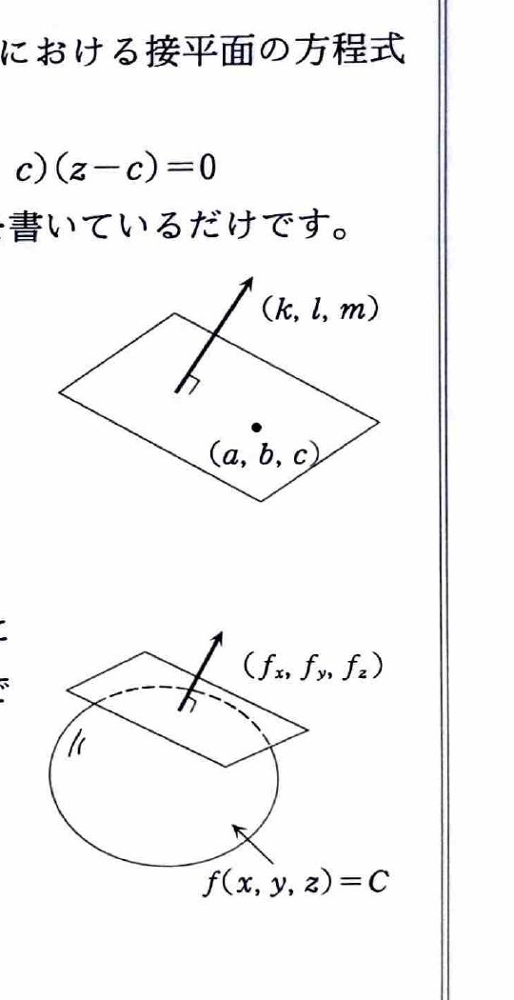

例題1（偏微分）

関数
$$
f(x,y)=\log(x^2+y^2)
$$
について、曲面 $z=f(x,y)$ 上の点
$$
(x,y,z)=(1,1,\log 2)
$$
を通る接平面の方程式、およびその点における曲面の法線の方程式をそれぞれ求めよ。

（京都府立大学）

---

## 解答

> この問題では、曲面が $z=f(x,y)$ の形で与えられ、接点も明示されている。そのため、偏導関数 $f_x,f_y$ を求めて接平面の公式へ代入する方法が最も直接的である。
>
> 別の方法として、曲面を
> $$
> F(x,y,z)=\log(x^2+y^2)-z=0
> $$
> という陰関数の形に直し、勾配 $\nabla F$ を法線ベクトルとして接平面を求めることもできる。今回は資料の解答に合わせて、まず $z=f(x,y)$ の接平面公式を用いる。
>
> **前提知識：接平面の方程式**
>
> 曲面 $z=f(x,y)$ の点 $(a,b,f(a,b))$ における接平面は
> $$
> z-f(a,b)=f_x(a,b)(x-a)+f_y(a,b)(y-b)
> $$
> である。
>
> 1変数関数の接線
> $$
> y-f(a)=f'(a)(x-a)
> $$
> を2変数へ拡張したものと考えると理解しやすい。$x$ 方向の変化と $y$ 方向の変化を足し合わせている。
>
> **補足：陰関数で表された曲面と超曲面**
>
> 曲面が
>
> $$
> F(x,y,z)=C
> $$
>
> の形で与えられているとき、点 $(a,b,c)$ における接平面は
>
> $$
> F_x(a,b,c)(x-a)
> +
> F_y(a,b,c)(y-b)
> +
> F_z(a,b,c)(z-c)
> =0
> $$
>
> である。また、
>
> $$
> \nabla F(a,b,c)
> =
> \bigl(F_x(a,b,c),F_y(a,b,c),F_z(a,b,c)\bigr)
> $$
>
> は接平面の法線ベクトルになる。
>
> さらに、$n$ 変数の超曲面
>
> $$
> F(x_1,\ldots,x_n)=C
> $$
>
> では、点 $(a_1,\ldots,a_n)$ における接超平面は
>
> $$
> \sum_{i=1}^{n}
> F_{x_i}(a_1,\ldots,a_n)(x_i-a_i)=0
> $$
>
> と表される。2変数・3変数の場合は、この一般式の具体例である。

まず、偏導関数を求める。合成関数の微分公式
$$
\frac{d}{dx}\log u=\frac{1}{u}\frac{du}{dx}
$$
を用いる。

$x$ について偏微分するときは $y$ を定数として扱うので、
$$
f_x(x,y)
=\frac{1}{x^2+y^2}\frac{\partial}{\partial x}(x^2+y^2)
=\frac{1}{x^2+y^2}\cdot 2x
=\frac{2x}{x^2+y^2}.
$$

同様に、$y$ について偏微分すると、
$$
f_y(x,y)
=\frac{1}{x^2+y^2}\frac{\partial}{\partial y}(x^2+y^2)
=\frac{1}{x^2+y^2}\cdot 2y
=\frac{2y}{x^2+y^2}.
$$

接点の $x,y$ 座標は $(a,b)=(1,1)$ である。代入前の式は
$$
f_x(a,b)=\frac{2a}{a^2+b^2},
\qquad
f_y(a,b)=\frac{2b}{a^2+b^2}
$$
である。ここへ $a=1,b=1$ を代入すると、
$$
f_x(1,1)=\frac{2\cdot1}{1^2+1^2}=1,
$$
$$
f_y(1,1)=\frac{2\cdot1}{1^2+1^2}=1.
$$

また、
$$
f(1,1)=\log(1^2+1^2)=\log2.
$$

接平面の一般式
$$
z-f(a,b)=f_x(a,b)(x-a)+f_y(a,b)(y-b)
$$
へ、$a=1,b=1,f(1,1)=\log2,f_x(1,1)=1,f_y(1,1)=1$ を代入する。
$$
z-\log2=1\cdot(x-1)+1\cdot(y-1).
$$

右辺を整理すると、
$$
z-\log2=x+y-2,
$$
したがって、
$$
\boxed{x+y-z+\log2-2=0}.
$$

> **法線の考え方**
>
> 接平面
> $$
> x+y-z+\log2-2=0
> $$
> の係数から、法線ベクトルは
> $$
> \boldsymbol n=(1,1,-1)
> $$
> と取れる。法線は接点を通り、このベクトルに平行な直線である。
>
> 一般に、点 $(x_0,y_0,z_0)$ を通り方向ベクトル $(l,m,n)$ をもつ直線は
> $$
> \frac{x-x_0}{l}
> =
> \frac{y-y_0}{m}
> =
> \frac{z-z_0}{n}
> $$
> と表される。

点 $(1,1,\log2)$ を通り、方向ベクトル $(1,1,-1)$ をもつ法線は、
$$
\boxed{
\frac{x-1}{1}
=
\frac{y-1}{1}
=
\frac{z-\log2}{-1}
}.
$$

> 同じ結論は、$F(x,y,z)=\log(x^2+y^2)-z$ とおいて
> $$
> \nabla F(1,1,\log2)
> =
> \left(
> \frac{2}{2},
> \frac{2}{2},
> -1
> \right)
> =(1,1,-1)
> $$
> を法線ベクトルとすることでも得られる。
