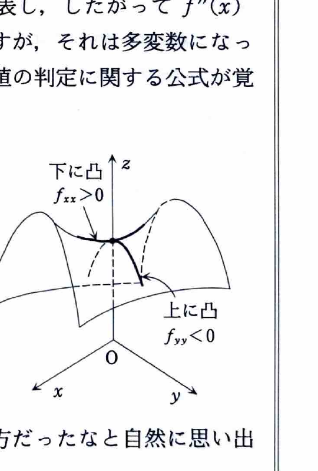

例題2（2変数関数の極値）

関数
$$
f(x,y)=x^2-2xy+y^3-y
$$
の極値を求めよ。

（名古屋大学―情報文化学部）

---

## 解答

> 2変数関数の極値を求める標準的な流れは、まず $f_x=f_y=0$ を解いて停留点を求め、次にヘッシアンで各停留点を分類することである。この問題は多項式なので、偏導関数と2階偏導関数を直接計算する方法が最も自然である。
>
> 別の方法として、ある変数について平方完成したり、曲面の形を局所的に調べたりすることも考えられる。しかし、この関数には $xy$ 項と $y^3$ 項が混在するため、停留点とヘッシアンを用いる方が体系的で確実である。
>
> **前提知識：停留点とヘッシアン**
>
> 極大・極小の候補となる点では、通常
> $$
> f_x(a,b)=0,\qquad f_y(a,b)=0
> $$
> が成り立つ。
>
> 停留点 $(a,b)$ で
> $$
> H(a,b)=
> f_{xx}(a,b)f_{yy}(a,b)-\{f_{xy}(a,b)\}^2
> $$
> とおく。
>
> - $H(a,b)>0$ かつ $f_{xx}(a,b)>0$ なら極小
> - $H(a,b)>0$ かつ $f_{xx}(a,b)<0$ なら極大
> - $H(a,b)<0$ なら極値をとらない
> - $H(a,b)=0$ なら、この判定だけでは結論できない
>
> $f_{xx}$ は、$y$ を固定して $x$ 方向へ進んだときの曲がり方を表す。$H>0$ のときは2つの主な方向で同じ向きに曲がるため、$f_{xx}$ の符号によって極小か極大かを判定できる。一方、$H<0$ のときは方向によって上向きと下向きが入れ替わり、鞍点になる。

まず1階偏導関数を求める。
$$
f_x(x,y)
=
\frac{\partial}{\partial x}
\left(x^2-2xy+y^3-y\right)
=
2x-2y,
$$
$$
f_y(x,y)
=
\frac{\partial}{\partial y}
\left(x^2-2xy+y^3-y\right)
=
-2x+3y^2-1.
$$

停留点では
$$
f_x(x,y)=0,\qquad f_y(x,y)=0
$$
であるから、
$$
2x-2y=0 \tag{1}
$$
$$
-2x+3y^2-1=0. \tag{2}
$$

式 (1) を整理すると、
$$
x-y=0,
$$
したがって、
$$
y=x.
$$

これを式 (2) に代入する。代入前の式は
$$
-2x+3y^2-1=0
$$
である。$y=x$ を代入すると、
$$
-2x+3x^2-1=0,
$$
すなわち、
$$
3x^2-2x-1=0.
$$

因数分解すると、
$$
(3x+1)(x-1)=0.
$$
よって、
$$
x=1
\qquad\text{または}\qquad
x=-\frac13.
$$

停留点では $y=x$ であるから、候補は
$$
(1,1),
\qquad
\left(-\frac13,-\frac13\right)
$$
である。

次に2階偏導関数を求める。
$$
f_{xx}(x,y)=2,
$$
$$
f_{yy}(x,y)=6y,
$$
$$
f_{xy}(x,y)=f_{yx}(x,y)=-2.
$$

したがって、ヘッシアンは
$$
H(x,y)
=
f_{xx}(x,y)f_{yy}(x,y)-\{f_{xy}(x,y)\}^2.
$$
ここへ2階偏導関数を代入すると、
$$
H(x,y)
=
2\cdot 6y-(-2)^2
=
12y-4
=
4(3y-1).
$$

まず $(1,1)$ を調べる。代入前の式は
$$
H(x,y)=4(3y-1)
$$
であるから、
$$
H(1,1)=4(3\cdot1-1)=8>0.
$$
また、
$$
f_{xx}(1,1)=2>0.
$$
したがって、$(1,1)$ では極小値をとる。

極小値を求めるため、元の関数
$$
f(x,y)=x^2-2xy+y^3-y
$$
へ $x=1,y=1$ を代入する。
$$
f(1,1)
=
1^2-2\cdot1\cdot1+1^3-1
=
1-2+1-1
=
-1.
$$

次に $\left(-\frac13,-\frac13\right)$ を調べる。
$$
H\left(-\frac13,-\frac13\right)
=
4\left(3\left(-\frac13\right)-1\right)
=
4(-1-1)
=
-8<0.
$$
よって、この点は鞍点であり、極値をとらない。

したがって、この関数は
$$
\boxed{(x,y)=(1,1)\text{ で極小値 }-1}
$$
をとり、極大値はない。
