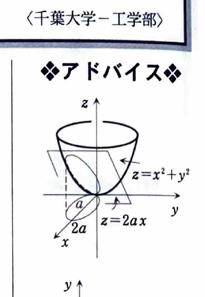
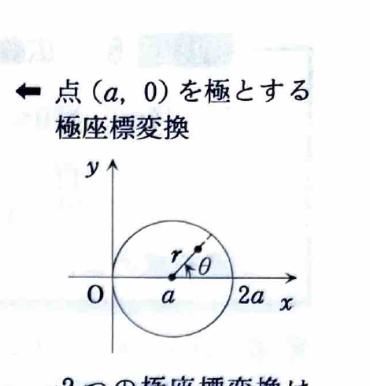
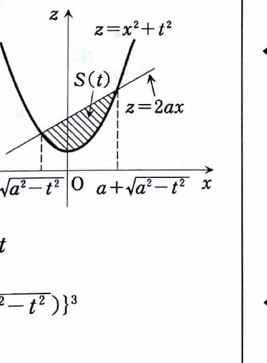

例題4（重積分）

3次元空間 $O\!-\!xyz$ において、曲面
$$
z=x^2+y^2
$$
と平面
$$
z=2ax
$$
で囲まれた立体の体積を求めよ。ただし、$a>0$ とする。

（千葉大学―工学部）

---

## 解答

> 上面と下面の差を $xy$ 平面上で積分すれば体積が得られる。2曲面の交線を $xy$ 平面へ射影すると円になるため、極座標変換が最も自然である。
>
> 資料には別解として、円の中心 $(a,0)$ を極とする平行移動した極座標を使う方法と、$y=t$ で切った断面積を積分する方法も示されている。通常の極座標は積分範囲が $0\le r\le2a\cos\theta$ となるが、被積分関数が簡単になるため、まずこの方法で解く。

2曲面が交わる場所では、
$$
x^2+y^2=2ax.
$$

左辺を平方完成する。
$$
x^2-2ax+y^2=0,
$$
$$
(x-a)^2-a^2+y^2=0,
$$
したがって、
$$
(x-a)^2+y^2=a^2.
$$

よって、$xy$ 平面上の射影領域は
$$
D=\{(x,y)\mid (x-a)^2+y^2\le a^2\}
$$
である。

領域 $D$ の内部では
$$
2ax-(x^2+y^2)\ge0
$$
なので、上面が $z=2ax$、下面が $z=x^2+y^2$ である。したがって体積は、
$$
V=\iint_D\{2ax-(x^2+y^2)\}\,dx\,dy.
$$

> **前提知識：極座標変換**
>
> $$
> x=r\cos\theta,\qquad y=r\sin\theta,\qquad dx\,dy=r\,dr\,d\theta.
> $$
> 円 $(x-a)^2+y^2\le a^2$ を原点中心の極座標で表すと、
> $$
> r^2-2ar\cos\theta\le0
> $$
> となる。$r\ge0$ なので、
> $$
> 0\le r\le2a\cos\theta
> $$
> である。この上限が非負になるために
> $$
> -\frac{\pi}{2}\le\theta\le\frac{\pi}{2}
> $$
> とする。

したがって、極座標での領域は
$$
-\frac{\pi}{2}\le\theta\le\frac{\pi}{2},
\qquad
0\le r\le2a\cos\theta.
$$

被積分関数を変換する。
$$
2ax-(x^2+y^2)
=
2ar\cos\theta-r^2.
$$

ヤコビアン $r$ を掛けるので、
$$
V
=
\int_{-\pi/2}^{\pi/2}
\int_0^{2a\cos\theta}
(2ar\cos\theta-r^2)r\,dr\,d\theta.
$$

内側の積分を計算する。まず展開すると、
$$
(2ar\cos\theta-r^2)r
=
2ar^2\cos\theta-r^3.
$$

したがって、
$$
\int
(2ar^2\cos\theta-r^3)\,dr
=
\frac{2a}{3}r^3\cos\theta-\frac14r^4.
$$

よって、
$$
\begin{aligned}
V
&=
\int_{-\pi/2}^{\pi/2}
\left[
\frac{2a}{3}r^3\cos\theta-\frac14r^4
\right]_{r=0}^{r=2a\cos\theta}
d\theta\\
&=
\int_{-\pi/2}^{\pi/2}
\left\{
\frac{2a}{3}(2a\cos\theta)^3\cos\theta
-\frac14(2a\cos\theta)^4
\right\}d\theta.
\end{aligned}
$$

各項を整理する。
$$
\frac{2a}{3}(2a\cos\theta)^3\cos\theta
=
\frac{16}{3}a^4\cos^4\theta,
$$
$$
\frac14(2a\cos\theta)^4
=
4a^4\cos^4\theta.
$$

したがって、
$$
V
=
\int_{-\pi/2}^{\pi/2}
\left(\frac{16}{3}-4\right)a^4\cos^4\theta\,d\theta
=
\frac43a^4
\int_{-\pi/2}^{\pi/2}\cos^4\theta\,d\theta.
$$

$\cos^4\theta$ は偶関数なので、
$$
\int_{-\pi/2}^{\pi/2}\cos^4\theta\,d\theta
=
2\int_0^{\pi/2}\cos^4\theta\,d\theta.
$$

半角公式
$$
\cos^2\theta=\frac{1+\cos2\theta}{2}
$$
を2回用いると、
$$
\cos^4\theta
=
\left(\frac{1+\cos2\theta}{2}\right)^2
=
\frac{3+4\cos2\theta+\cos4\theta}{8}.
$$

したがって、
$$
\begin{aligned}
\int_0^{\pi/2}\cos^4\theta\,d\theta
&=
\int_0^{\pi/2}
\frac{3+4\cos2\theta+\cos4\theta}{8}\,d\theta\\
&=
\left[
\frac38\theta+\frac14\sin2\theta+\frac1{32}\sin4\theta
\right]_0^{\pi/2}\\
&=
\frac38\cdot\frac{\pi}{2}
=
\frac{3\pi}{16}.
\end{aligned}
$$

よって、
$$
\int_{-\pi/2}^{\pi/2}\cos^4\theta\,d\theta
=
2\cdot\frac{3\pi}{16}
=
\frac{3\pi}{8}.
$$

これを体積の式へ代入する。
$$
V
=
\frac43a^4\cdot\frac{3\pi}{8}
=
\frac{\pi}{2}a^4.
$$

したがって、
$$
\boxed{V=\frac{\pi}{2}a^4}.
$$

> **別解1：円の中心を極とする座標**
>
> $$
> x=a+r\cos\theta,\qquad y=r\sin\theta
> $$
> と置くと、領域は $0\le r\le a,\ 0\le\theta\le2\pi$ という単純な円板になる。
>
> このとき
> $$
> 2ax-(x^2+y^2)
> =
> a^2-r^2
> $$
> なので、
> $$
> V
> =
> \int_0^{2\pi}\int_0^a(a^2-r^2)r\,dr\,d\theta
> =
> \frac{\pi}{2}a^4.
> $$
> 積分自体はこちらの方が短いが、平行移動した極座標を思いつく必要がある。

> **別解2：断面積による方法**
>
> $y=t$ で切ったときの断面は、放物線 $z=x^2+t^2$ と直線 $z=2ax$ に挟まれた部分になる。
>
> 
>
> 交点の $x$ 座標は
> $$
> x=a\pm\sqrt{a^2-t^2}
> $$
> である。切り口の面積を $S(t)$ とすると、
> $$
> S(t)
> =
> \int_{a-\sqrt{a^2-t^2}}^{a+\sqrt{a^2-t^2}}
> \{2ax-(x^2+t^2)\}\,dx
> =
> \frac43(a^2-t^2)^{3/2}.
> $$
> よって、
> $$
> V=\int_{-a}^aS(t)\,dt
> =\frac43\int_{-a}^a(a^2-t^2)^{3/2}\,dt
> =\frac{\pi}{2}a^4.
> $$
