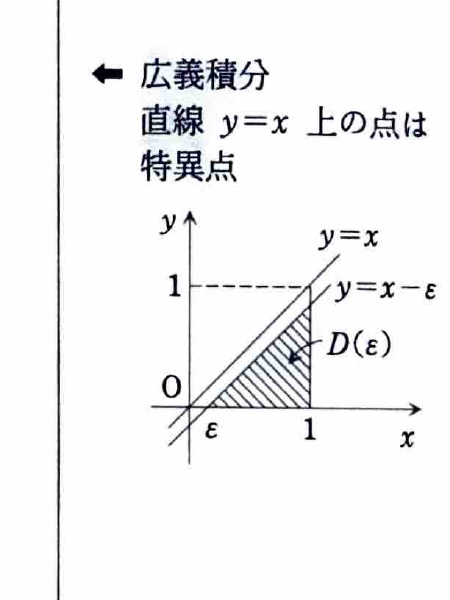

例題5（広義積分）

$$
D=\{(x,y)\mid 0\le y<x\le1\}
$$
とする。$0<\alpha<1$ のとき、広義積分
$$
\iint_D\frac{xy}{(x^2-y^2)^\alpha}\,dx\,dy
$$
の値を求めよ。

（金沢大学―数学科）

---

## 解答

> 被積分関数は $x^2-y^2=0$、すなわち領域の境界 $y=x$ 上で特異になる。このため、通常の重積分として境界まで直接積分するのではなく、特異線から距離を取った領域 $D(\varepsilon)$ で積分し、最後に $\varepsilon\to+0$ とする広義積分の定義を用いる。
>
> 資料には、形式的に最初から $y=x$ まで積分しても同じ値が得られる計算も併記されている。しかし、特異点を含む積分であることを明確にするため、まず $\varepsilon$ を用いる方法を採用する。
>
> **前提知識：広義積分**
>
> 被積分関数が領域の境界で発散する場合、特異点を除いた領域で積分し、その領域を極限で元の領域へ近づける。
>
> 今回は
> $$
> D(\varepsilon)
> =
> \{(x,y)\mid \varepsilon\le x\le1,\ 0\le y\le x-\varepsilon\}
> $$
> とおく。この領域では
> $$
> x^2-y^2\ge x^2-(x-\varepsilon)^2>0
> $$
> なので、被積分関数は有限である。

広義積分を
$$
I=
\iint_D\frac{xy}{(x^2-y^2)^\alpha}\,dx\,dy
$$
とおく。定義より、
$$
I
=
\lim_{\varepsilon\to+0}
\iint_{D(\varepsilon)}
\frac{xy}{(x^2-y^2)^\alpha}\,dx\,dy.
$$

固定した $\varepsilon>0$ に対して、
$$
\iint_{D(\varepsilon)}
\frac{xy}{(x^2-y^2)^\alpha}\,dx\,dy
=
\int_\varepsilon^1
\left(
\int_0^{x-\varepsilon}
xy(x^2-y^2)^{-\alpha}\,dy
\right)dx.
$$

内側の $y$ 積分を計算する。$x$ は定数である。
$$
\int xy(x^2-y^2)^{-\alpha}\,dy.
$$

置換
$$
u=x^2-y^2
$$
を用いると、
$$
du=-2y\,dy,
\qquad
y\,dy=-\frac12du.
$$

したがって、
$$
\begin{aligned}
\int xy(x^2-y^2)^{-\alpha}\,dy
&=
-\frac{x}{2}\int u^{-\alpha}\,du\\
&=
-\frac{x}{2}\cdot\frac{u^{1-\alpha}}{1-\alpha}\\
&=
-\frac{x}{2(1-\alpha)}
(x^2-y^2)^{1-\alpha}.
\end{aligned}
$$

$0<\alpha<1$ なので $1-\alpha>0$ であり、この原始関数を使える。

上下端を代入する前の式は
$$
-\frac{x}{2(1-\alpha)}
(x^2-y^2)^{1-\alpha}.
$$
$y=x-\varepsilon$ と $y=0$ を代入すると、
$$
\begin{aligned}
\int_0^{x-\varepsilon}
xy(x^2-y^2)^{-\alpha}\,dy
&=
-\frac{x}{2(1-\alpha)}
\left[
\{x^2-(x-\varepsilon)^2\}^{1-\alpha}
-(x^2)^{1-\alpha}
\right]\\
&=
-\frac{x}{2(1-\alpha)}
\left[
(2\varepsilon x-\varepsilon^2)^{1-\alpha}
-x^{2-2\alpha}
\right].
\end{aligned}
$$

したがって、
$$
I
=
-\frac{1}{2(1-\alpha)}
\lim_{\varepsilon\to+0}
\left[
\int_\varepsilon^1
x(2\varepsilon x-\varepsilon^2)^{1-\alpha}\,dx
-
\int_\varepsilon^1x^{3-2\alpha}\,dx
\right].
\tag{1}
$$

第1の積分を計算する。
$$
A_\varepsilon
=
\int_\varepsilon^1
x(2\varepsilon x-\varepsilon^2)^{1-\alpha}\,dx.
$$

置換前の式を明示して、
$$
t=2x-\varepsilon
$$
とおく。すると、
$$
x=\frac{t+\varepsilon}{2},
\qquad
dx=\frac12dt,
$$
また、
$$
2\varepsilon x-\varepsilon^2
=
\varepsilon(2x-\varepsilon)
=
\varepsilon t.
$$

積分端は、
$$
x=\varepsilon\Rightarrow t=\varepsilon,
\qquad
x=1\Rightarrow t=2-\varepsilon.
$$

よって、
$$
\begin{aligned}
A_\varepsilon
&=
\int_\varepsilon^{2-\varepsilon}
\frac{t+\varepsilon}{2}
(\varepsilon t)^{1-\alpha}
\frac12\,dt\\
&=
\frac{\varepsilon^{1-\alpha}}4
\int_\varepsilon^{2-\varepsilon}
\left(t^{2-\alpha}+\varepsilon t^{1-\alpha}\right)dt\\
&=
\frac{\varepsilon^{1-\alpha}}4
\left[
\frac{t^{3-\alpha}}{3-\alpha}
+
\varepsilon\frac{t^{2-\alpha}}{2-\alpha}
\right]_\varepsilon^{2-\varepsilon}.
\end{aligned}
$$

$0<\alpha<1$ なので $1-\alpha>0$ である。角括弧内は $\varepsilon\to0$ で有限な値に近づくため、
$$
\lim_{\varepsilon\to+0}A_\varepsilon=0.
$$

次に第2の積分を計算する。
$$
B_\varepsilon
=
\int_\varepsilon^1x^{3-2\alpha}\,dx.
$$

原始関数は
$$
\int x^{3-2\alpha}\,dx
=
\frac{x^{4-2\alpha}}{4-2\alpha}.
$$

したがって、
$$
B_\varepsilon
=
\left[
\frac{x^{4-2\alpha}}{4-2\alpha}
\right]_\varepsilon^1
=
\frac{1-\varepsilon^{4-2\alpha}}{4-2\alpha}.
$$

$0<\alpha<1$ より $4-2\alpha>0$ なので、
$$
\lim_{\varepsilon\to+0}B_\varepsilon
=
\frac{1}{4-2\alpha}
=
\frac{1}{2(2-\alpha)}.
$$

式 (1) へ極限を代入する。
$$
\begin{aligned}
I
&=
-\frac{1}{2(1-\alpha)}
\left(
0-\frac{1}{4-2\alpha}
\right)\\
&=
\frac{1}{2(1-\alpha)(4-2\alpha)}\\
&=
\frac{1}{4(1-\alpha)(2-\alpha)}.
\end{aligned}
$$

したがって、
$$
\boxed{
\iint_D\frac{xy}{(x^2-y^2)^\alpha}\,dx\,dy
=
\frac{1}{4(1-\alpha)(2-\alpha)}
}.
$$

> **形式的な短い計算**
>
> $0<\alpha<1$ なので内側の積分は収束し、結果として次の計算も正しい値を与える。
> $$
> \begin{aligned}
> I
> &=
> \int_0^1
> \left(
> \int_0^x
> xy(x^2-y^2)^{-\alpha}\,dy
> \right)dx\\
> &=
> -\frac{1}{2(1-\alpha)}
> \int_0^1
> x\left[
> (x^2-y^2)^{1-\alpha}
> \right]_{y=0}^{y=x}dx\\
> &=
> \frac{1}{2(1-\alpha)}
> \int_0^1x^{3-2\alpha}\,dx\\
> &=
> \frac{1}{4(1-\alpha)(2-\alpha)}.
> \end{aligned}
> $$
> ただし、広義積分であることを意識せず境界値を代入する方法は、収束条件が変わる問題では誤りになり得る。
