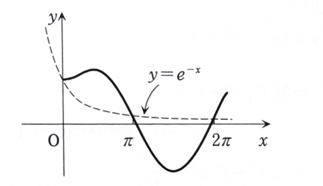

3B-06

次の微分方程式の初期条件を満たす解を求め、$x\geq0$ の範囲で解曲線を図示せよ。

$$
\frac{d^2y}{dx^2}+2\frac{dy}{dx}+y=2\cos x
$$

初期条件は

$$
y(0)=1,\qquad y'(0)=0
$$

である。

---

## 解答

> 定数係数2階線形非同次方程式なので、同次解と特殊解を求め、初期条件を適用する。
>
> 右辺が $2\cos x$ であり、同次方程式の特性根 $-1$ と重ならないため、特殊解を $a\sin x+b\cos x$ と仮定する未定係数法を用いる。

まず同次方程式

$$
y''+2y'+y=0
$$

を解く。特性方程式は

$$
t^2+2t+1=0
$$

であり、

$$
(t+1)^2=0
$$

だから、重根

$$
t=-1
$$

をもつ。したがって、同次方程式の一般解は

$$
y_h=C_1e^{-x}+C_2xe^{-x}
$$

である。

次に特殊解を

$$
y_p=a\sin x+b\cos x
$$

とおく。微分すると、

$$
y_p'=a\cos x-b\sin x
$$

であり、

$$
y_p''=-a\sin x-b\cos x
$$

である。

左辺の文字式は

$$
y_p''+2y_p'+y_p
$$

である。値を代入すると、

$$
(-a\sin x-b\cos x)
+
2(a\cos x-b\sin x)
+
(a\sin x+b\cos x)
$$

となる。$\sin x$ と $\cos x$ の項をまとめると、

$$
y_p''+2y_p'+y_p
=
-2b\sin x+2a\cos x
$$

である。

これが右辺

$$
2\cos x=0\cdot\sin x+2\cdot\cos x
$$

と一致するため、

$$
-2b=0,\qquad 2a=2
$$

である。したがって、

$$
a=1,\qquad b=0
$$

となり、

$$
y_p=\sin x
$$

である。

よって、一般解は

$$
y=C_1e^{-x}+C_2xe^{-x}+\sin x
$$

となる。

次に初期条件を用いる。$x=0$ を代入すると、

$$
y(0)=C_1
$$

なので、$y(0)=1$ より、

$$
C_1=1
$$

である。

導関数を求める。文字式は

$$
y'
=
-C_1e^{-x}
+
C_2\frac{d}{dx}(xe^{-x})
+
\cos x
$$

である。積の微分から、

$$
\frac{d}{dx}(xe^{-x})
=
e^{-x}-xe^{-x}
$$

なので、

$$
y'
=
-C_1e^{-x}
+
C_2(e^{-x}-xe^{-x})
+
\cos x
$$

となる。$x=0$ を代入すると、

$$
y'(0)=-C_1+C_2+1
$$

である。$y'(0)=0$ と $C_1=1$ を代入すると、

$$
-1+C_2+1=0
$$

だから、

$$
C_2=0
$$

となる。

したがって、求める解は

$$
\boxed{y=e^{-x}+\sin x}
$$

である。

> グラフは、減衰項 $e^{-x}$ を正弦波 $\sin x$ に加えた形である。$x=0$ では $y=1$ から水平に出発し、$x$ が大きくなると $e^{-x}\to0$ なので $\sin x$ に近づく。

